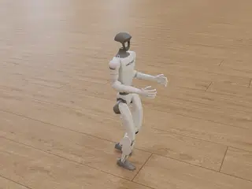
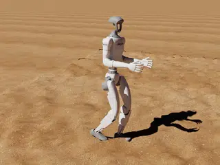
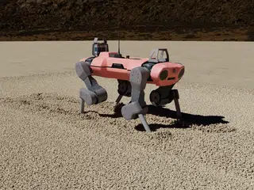
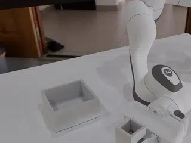
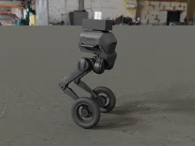
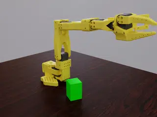
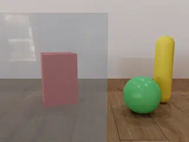
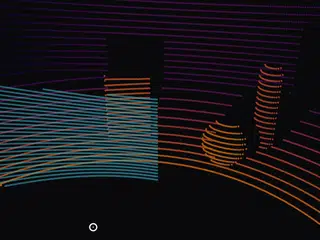
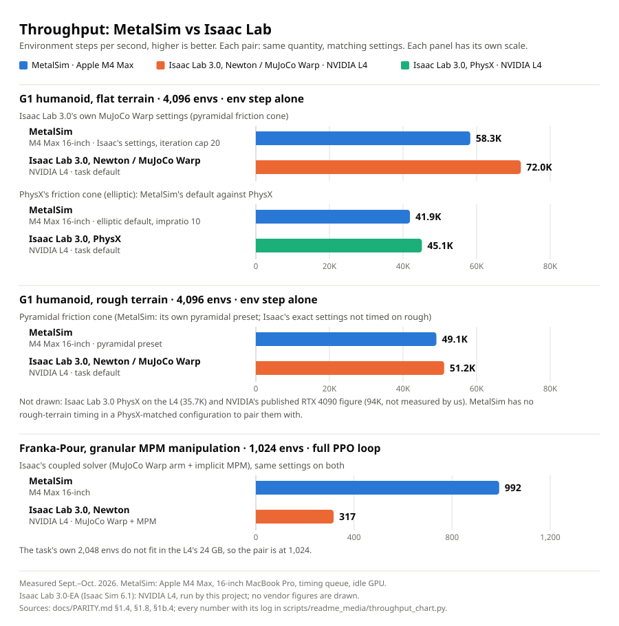

# MetalSim

MetalSim is a robot simulation and learning stack for the GPU of an Apple silicon Mac, built to match
NVIDIA [Isaac Sim](https://developer.nvidia.com/isaac/sim) and [Isaac Lab](https://github.com/isaac-sim/IsaacLab) in
behaviour, sensor output and task definitions, and measured against them.
It runs [MuJoCo Warp](https://github.com/google-deepmind/mujoco_warp) physics on
[Warp](https://github.com/NVIDIA/warp)'s Metal backend, renders on Metal at three tiers (raster, hybrid ray
tracing, a path tracer), traces lidar, radar and height-scan rays on Metal's ray-tracing hardware, generates
labelled data in the layout of Isaac Sim's Replicator, trains policies with a PPO whose rollout runs in Warp
(or with [rsl_rl](https://github.com/leggedrobotics/rsl_rl) and a PyTorch MPS learner for cameras), and runs Isaac Lab's
tasks from Isaac's own assets and configuration files.

Everything below is measured on an Apple M4 Max (40-core GPU, 64 GB) unless marked otherwise. Isaac
references were recorded by the author on an NVIDIA L4 (Isaac Sim 5.1 + Isaac Lab 2.3.2, and Isaac Sim 6.1 +
Isaac Lab 3.0.0-EA); NVIDIA's published RTX 4090 figures are marked "published". MetalSim is an independent
project, not affiliated with or endorsed by NVIDIA, Google DeepMind or Apple.

<table>
  <tr>
    <td align="center" width="33%">
      
      <br><b>python -m metalsim.render.film g1_unitree</b>
    </td>
    <td align="center" width="33%">
      
      <br><b>python -m metalsim.render.film g1_bumps</b>
    </td>
    <td align="center" width="33%">
      
      <br><b>python scripts/particle_demo/render_anymal.py</b>
    </td>
  </tr>
  <tr>
    <td align="center" width="33%">
      
      <br><b>python -m metalsim.render.film franka_pour</b>
    </td>
    <td align="center" width="33%">
      
      <br><b>python -m metalsim.render.film tron1</b>
    </td>
    <td align="center" width="33%">
      
      <br><b>python -m metalsim.render.film so101_lift_deploy</b>
    </td>
  </tr>
  <tr>
    <td align="center" width="33%">
      
      <br><b>python scripts/readme_media/lidar_glass.py</b>
    </td>
    <td align="center" width="33%">
      
      <br><b>depth camera, same scene</b>
    </td>
    <td align="center" width="33%">
      
      <br><b>two-return lidar, same scene</b>
    </td>
  </tr>
</table>

Row 1: Unitree's own pretrained G1 walking policy
([`unitree_rl_gym`](https://github.com/unitreerobotics/unitree_rl_gym)'s
[`deploy/pre_train/g1/motion.pt`](https://github.com/unitreerobotics/unitree_rl_gym/blob/276801e46c5d433564f24658bac64f254b7d2d4b/deploy/pre_train/g1/motion.pt),
BSD-3-Clause, fetched by `scripts/fetch_unitree_rl_gym.sh`) through Unitree's MuJoCo sim2sim loop ported to MuJoCo
Warp: it steps at 1.25 gait cycles per second, the 0.8 s gait clock Unitree trains it with, and stays within 3 µm of
Unitree's own CPU MuJoCo run of the same loop after 5 s ([G1_UNITREE.md](docs/renders/G1_UNITREE.md)). Then the
same blind, flat-trained policy on Isaac Lab's random rough terrain (bumps of 2 to 10 cm every 0.1 m), on
[my fork of MuJoCo Warp](https://github.com/pulipakaa24/mujoco_warp/tree/metalsim), whose heightfield contacts for the
G1's sphere feet match the exact geometry: 75 % of
the robots fall within 8 s (180 of 240: five tiles, 16 robots each, three runs; CPU MuJoCo 68 %), and the clip shows
a typical one, down at 5.3 s ([G1_BUMPS.md](docs/renders/G1_BUMPS.md)). Then ANYmal C on
[Newton](https://github.com/newton-physics/newton)'s MPM sand (25 M
render grains; [how to run](docs/DEMO.md#the-25-m-grain-render-anymal-on-sand-at-demo-scale)).
Row 2: Isaac Lab 3.0-EA's Franka-Pour (MuJoCo Warp arm coupled to implicit MPM). Then LimX's TRON1 wheel-legged robot
driven by LimX's own open RL policy (the ONNX export in LimX's
[`tron1-rl-deploy-python`](https://github.com/limxdynamics/tron1-rl-deploy-python), Apache-2.0) in MetalSim's
TRON1 simulation on CPU MuJoCo, at its nominal realism settings (command and sensor latency, quantized encoders, joint
friction, IMU noise, a 1.5 kg sensor pack), unchanged: none of 16 simulated robots fell over the 8 s drive, turn and
stop (each stood up for 3 s first, with its commands ramped over 0.5 s, as an operator drives), with 0.27 m/s and
0.14 rad/s RMS speed and yaw-rate tracking error ([TRON1.md](docs/renders/TRON1.md)). Then
the SO-101 lifting a box with [so101Sim](https://github.com/pulipakaa24/so101Sim)'s scripted IK plan, streamed as absolute joint goals at
[LeRobot](https://github.com/huggingface/lerobot)'s 30 Hz to
Rhoban [BAM](https://github.com/Rhoban/bam)'s identified model of the standard follower's 7.4 V servos (load-dependent
gearbox friction, LeRobot's registers): 100 of 100 seeds lift on MuJoCo Warp and on CPU MuJoCo. Scripted, not learned;
the box pose comes from the simulator. The box tilts with the hand, which the lift pitches by about 36 degrees, as real
teleoperated lifts do; the grasp is less real: the hand comes down 26 to 28 degrees off vertical (real operators: 4 to
13) and the closing jaw tips the box on the table
([SO101_LIFT.md](docs/renders/SO101_LIFT.md#deployment-style-scripted-expert-on-7v4_bam)). Rows 1 and 2 with the
tier-2 path tracer. Row 3: one scene through three sensors, a ball rolling behind a glass
pane: the path-traced camera sees it through the glass, the depth camera stops at the pane (as MuJoCo and Isaac do),
and a two-return lidar sees both (cyan: echoes on glass; the rest coloured by range). As in MuJoCo Warp's README,
a caption is the command that makes the scene; the exact command that cut each 320x240 clip, its source, assets and
checkpoint are in the [`docs/renders/` index](docs/renders/README.md).

<picture>
  <source media="(prefers-color-scheme: dark)" srcset="docs/renders/throughput_dark.svg">
  <source media="(prefers-color-scheme: light)" srcset="docs/renders/throughput_light.svg">
  
</picture>

Like-for-like pairs only, every number with its log in
[`scripts/readme_media/throughput_chart.py`](scripts/readme_media/throughput_chart.py); the row-by-row evidence is
in [`docs/PARITY.md`](docs/PARITY.md).

## Which Mac

MetalSim has run only on M4 Max Macs (40-core GPU, 64 GB), and every timing on this page comes from one. It needs
Apple silicon and macOS 15 or later: the Metal backend of
[my fork of Warp](https://github.com/pulipakaa24/warp/tree/metalsim) keeps its buffers resident with residency sets,
which macOS 15 introduced (development was on macOS 26 and 27). Other Apple silicon Macs are untested. What to expect
on them:

- **Speed:** fewer GPU cores and less memory bandwidth make every run slower, and a fanless MacBook Air throttles under
  sustained load such as a long training run (neither measured here).
- **M1 and M2** trace rays without ray-tracing hardware (it arrived with M3), so the lidar, the height scanner and the
  tier-1 and tier-2 renderers run slower there (not measured).
- **M1** has no 64-bit atomic min / max (Apple's feature tables list it from M2 on). Warp's `atomic_min` /
  `atomic_max` on 64-bit integers compile to it on Metal, so kernels that use them do not build there.

Memory decides which runs fit. A run needs its GPU allocation within the working set macOS grants a process
(`recommendedMaxWorkingSetSize`: 55.7 GB of the M4 Max's 64 GB; smaller Macs get less, and their values were not
measured here), and its footprint, GPU memory included, within RAM next to macOS and your other apps. Print your
working set with `python -c "import Metal; print(Metal.MTLCreateSystemDefaultDevice().recommendedMaxWorkingSetSize() / 1e9)"`.
Past the working set Metal does not keep every buffer resident, and kernels read wrong data without any error, so
my fork of Warp refuses an allocation that would pass it with an "out of Metal memory" error. To try a run against a
smaller Mac's budget, set `WP_METAL_WORKING_SET_GB` to that budget in GB.

Peaks measured on 2026-11-01 (Mac16,6: M4 Max, 64 GB, macOS 27.0.1) with
[`scripts/diagnostics/peak_memory.py`](scripts/diagnostics/peak_memory.py), over start-up, graph capture and the first
iterations, where memory peaks (it stays flat after the first iteration); records in
[`runs/peak_memory_2026-11-01/`](runs/peak_memory_2026-11-01):

| Run | GPU allocation | Footprint |
|---|---|---|
| G1 flat velocity training, 4,096 envs | 3.0 GB | 4.5 GB |
| G1 rough velocity training, 4,096 envs, 2.5 ms physics | 7.5 GB | 10.0 GB |
| Cartpole-RGB camera PPO, 1,024 envs, tier 2 | 4.6 GB | 6.1 GB |
| Franka-Pour PPO, 1,024 envs, Isaac's MPM capacities (the default) | 18.7 GB | about 19 GB (read mid-run) |
| Franka-Pour PPO, 1,024 envs, `--mpm-grid-budget measured --mpm-cells-per-world 256` | 9.4 GB | about 10 GB (read mid-run) |
| Franka-Pour, 2,048 envs (the trained policy's size), [MPM.md §8h](metalsim/physics/mpm/MPM.md) | 34.5 GB; 15.7 GB with both options | not recorded |
| ANYmal on sand, demo-scale simulation (669,372 particles) | 1.0 GB | 2.0 GB |
| ANYmal on sand, 25 M-grain 1080p render, [PARTICLES.md](metalsim/render/PARTICLES.md) | 10.5–11.1 GB; 2.9–5.5 GB at 6.3 M grains | not recorded |
| A README film (`film g1_bumps`): recording, then path tracing | 0.2 GB, then 2.3 GB | 2.5 GB, then 6.0 GB |

What that means by Mac. This is an estimate from the peaks above, because the working sets of smaller Macs were not
measured:

- **64 GB or more:** everything on this page.
- **32 to 48 GB:** everything except Franka-Pour at 2,048 envs with Isaac's capacities (34.5 GB). At 1,024 envs with
  Isaac's capacities (18.7 GB) it is tight on 32 GB. With the two options (9.4 GB) it fits. The options are capacities
  measured with random actions, and an overflow is reported, not silent (MPM.md §8h).
- **16 to 24 GB:** the G1 tasks at 4,096 envs (rough, at a 10 GB footprint, leaves little room on 16 GB), camera RL,
  the films and the ANYmal simulation. Franka-Pour fits only with the two options and fewer envs: memory grows about in
  proportion to envs (18.7 GB at 1,024, 34.5 GB at 2,048). The 25 M-grain render needs about 11 GB of GPU memory, so
  render fewer grains per particle (`--grains`).

## Install

Apple silicon Mac, macOS 15 or later (see "Which Mac" above) with the Xcode Command Line Tools, Python 3.12 or newer (macOS's own `python3` is 3.9: use
python.org's, Homebrew's or `uv python install 3.12`), [uv](https://docs.astral.sh/uv/) for the optional environments:

```
git clone https://github.com/pulipakaa24/MetalSim && cd MetalSim
python3.12 -m venv .venv && source .venv/bin/activate     # uv only: "$(uv python find 3.12)" -m venv .venv
pip install -e ".[full]"                   # full = test + newton (MPM in BatchSim, Newton engine) + rslrl + tron1
scripts/setup_warp.sh                      # replaces PyPI's warp-lang with the Warp fork (upstream/warp-metalsim)
pip install -e "git+https://github.com/pulipakaa24/mujoco_warp@787a5b3a37acc2551ffc8a2c1af1e9781d76723f#egg=mujoco-warp" "mujoco>=3.14,<3.15"
scripts/fetch_isaac_assets.sh              # NVIDIA's G1 and Franka-Pour assets, fetched from NVIDIA, not redistributed
git clone --depth 1 https://github.com/google-deepmind/mujoco_menagerie upstream/mujoco_menagerie   # robot models
pytest tests -q
scripts/setup_newton152.sh                 # optional: MPM and Franka-Pour (.venv-newton152; tests/test_mpm.py runs there)
scripts/fetch_polyhaven_assets.sh demo     # optional: HDRI and sand texture of the ANYmal-on-sand render demo
scripts/fetch_splat_scenes.sh              # optional: public splat scenes for the splat renderer's real-data tests (InteriorGS is gated: SPLAT.md 7b)
scripts/fetch_isaaclab_source.sh           # optional: Isaac Lab 3.0-EA's Franka-Pour source, the oracle of its term tests
```

Every command runs from the repository root, which can be anywhere (any user, any directory name, spaces included);
nothing in the code, tests or scripts assumes the author's machine (`tests/test_no_machine_paths.py` checks it). The
model and asset locations can be moved with `MENAGERIE` (default `upstream/mujoco_menagerie`), `POLYHAVEN` (default
`assets/polyhaven`) and `METALSIM_SPLAT_DATA` (default `assets/splats`). The first steps of each demo, at small scale, are in [`docs/GUIDE.md`](docs/GUIDE.md) section 2.

The MuJoCo Warp commit is pinned (the head of the `metalsim` branch of
[my fork of MuJoCo Warp](https://github.com/pulipakaa24/mujoco_warp/tree/metalsim) on 2026-10-31), as Warp's in
`scripts/setup_warp.sh` and Newton's in `pyproject.toml`. Without access to my fork: clone
[google-deepmind/mujoco_warp](https://github.com/google-deepmind/mujoco_warp), `git checkout 88af9cc` (v3.14.0),
`git apply` MetalSim's `patches/mujoco_warp/metalsim-787a5b3.diff` (the whole branch as one diff) and `pip install -e`
that checkout. After a pin change, run the pip line again, or `scripts/fork_sync.sh` for checkouts of my forks kept in
`upstream/`; `tests/test_fork_pins.py` fails while the installed MuJoCo Warp or Warp checkout is not at its pin.
The `mujoco<3.15` on that line keeps pip from moving MuJoCo past 3.14: the fork reads `MjModel.flex_internal`,
which 3.15 removed (the fork alone asks only `mujoco>=3.12`, and its uv index offers 3.15 nightlies).

Optional extras, first runs, bringing your own robot, the GPU job queue and the throughput / fidelity knobs are in
the user guide, [`docs/GUIDE.md`](docs/GUIDE.md). What landed when is in [`CHANGELOG.md`](CHANGELOG.md).

## Documentation

- [`docs/DEMO.md`](docs/DEMO.md): the demo tag [`demo-2026-10`](https://github.com/pulipakaa24/MetalSim/tree/demo-2026-10): what works, the
  command for each demo, the measured numbers and the known limits.
- [`docs/NOW.md`](docs/NOW.md): start here: what is being worked on and what is broken right now (kept current).
- [`docs/GUIDE.md`](docs/GUIDE.md): user guide: install, first runs, bringing your own robot, the GPU job queue, engines, throughput vs fidelity.
- [`docs/STATUS.md`](docs/STATUS.md): state against the original plan, workstream by workstream.
- [`docs/PARITY.md`](docs/PARITY.md): the evidence against Isaac Sim / Isaac Lab, row by row: the test, the result and a verdict.
- [`docs/GAPS.md`](docs/GAPS.md): gap ledger: what is closed and what is still open against Isaac.
- [`docs/DECISIONS.md`](docs/DECISIONS.md): every option decided against, with its numbers and how to re-enable it.
- [`CHANGELOG.md`](CHANGELOG.md): what landed when.
- Subsystems: [`metalsim/physics/mpm/MPM.md`](metalsim/physics/mpm/MPM.md) (MPM on Metal against the L4),
  [`metalsim/render/PARTICLES.md`](metalsim/render/PARTICLES.md) (particles as render grains),
  [`metalsim/render/SPLAT.md`](metalsim/render/SPLAT.md) (3D Gaussian splat scenes as camera backgrounds, batched, with the robot composited),
  [`docs/RENDER_COVERAGE.md`](docs/RENDER_COVERAGE.md) (what each renderer draws of what is simulated),
  [`docs/NEWTON_RENDER.md`](docs/NEWTON_RENDER.md) (cameras on Newton scenes), [`docs/TRON1.md`](docs/TRON1.md)
  (LimX TRON1 simulator, controllers and robot bridge).
- History: [`docs/PHASES.md`](docs/PHASES.md) (work log of 2026-09-22 .. 24), [`docs/RESEARCH.md`](docs/RESEARCH.md)
  (research at project start), the handoff notes [`docs/HANDOFF_elliptic_cone_perf.md`](docs/HANDOFF_elliptic_cone_perf.md)
  and [`docs/HANDOFF_tier2_hdri_envmap.md`](docs/HANDOFF_tier2_hdri_envmap.md).
- Research: [`docs/research/`](docs/research) (one question per note; index under "Research notes" below),
  [`research_notes/`](research_notes) and [`reports/`](reports) (the MPM, float-parity, rendering and capacity rounds).
- Scenes: [`docs/SCENES.md`](docs/SCENES.md): a robot, objects, camera mounts, lidar and a background (plane, HDRI or Gaussian splat behind a collision proxy) from one YAML file (Isaac Lab names): `python -m metalsim.run scene.yaml`.
- Renders: [`docs/renders/`](docs/renders) (filmed tasks with a doc each: what is shown, timings, assets and
  licences, how to reproduce; [Franka-Pour](docs/renders/FRANKA_POUR.md), [G1 flat](docs/renders/G1_FLAT.md),
  [G1 rough](docs/renders/G1_ROUGH.md), [G1 with Unitree's policy](docs/renders/G1_UNITREE.md),
  [G1 on rough ground](docs/renders/G1_BUMPS.md), [TRON1](docs/renders/TRON1.md),
  [SO-101 cube lift](docs/renders/SO101_LIFT.md)), made with
  `python -m metalsim.render.film <task>`; the clips at the top of this page are there too.
- Images and data: [`docs/gallery/`](docs/gallery) (September test renders and Isaac-side playback videos),
  [`docs/measurements/`](docs/measurements) (figures and JSON behind the docs' numbers); run logs under `runs/`.

## Measured state

The evidence, test by test, is in [`docs/PARITY.md`](docs/PARITY.md); open and closed gaps in
[`docs/GAPS.md`](docs/GAPS.md).

| what | MetalSim | Isaac reference | details |
|---|---|---|---|
| G1 flat velocity task, training (Isaac's flat config and PPO settings) | **elliptic default (2026-09-26): return +26.8 / +26.9 / +26.6 at iteration 1000 (three seeds, mean 26.8 ± 0.2), full-length episodes by the same iteration**; the previous pyramidal default gave +28.4 / 26.3 / 26.0 (origin velocity point) and +27.1 (COM), all inside one seed spread of each other | Isaac Lab 2.3.2 + [PhysX](https://github.com/NVIDIA-Omniverse/PhysX): +27.3 (one seed) | [§1.5](docs/PARITY.md#15-learning-on-the-g1-task) |
| G1 rough velocity task, training (Isaac's terrain generator, ported exactly) | **elliptic default: +13.7 at iteration 1500, terrain level 6.10** (one seed; 25 K env-steps/s; plane-path heightfield kernel, re-run pending, [§1.6](docs/PARITY.md#16-rough-terrain-mujoco-warps-heightfield-contacts-found-defective-and-patched)); the previous pyramidal default gave +16.4 / +22.6 / +19.1 at levels 6.0–6.1 (seeds 0 / 2 / 1) on that kernel and **+16.0 / +17.4 / +20.6 at levels 6.11–6.13 re-run on the repaired kernel** (2026-10-31: inside the seed spread at iteration 1500; the curriculum climbs later) | Isaac Lab 2.3.2 + PhysX: +14.1, level 5.9 (one seed) | [§1.5](docs/PARITY.md#15-learning-on-the-g1-task) |
| Isaac Lab 3.0-EA G1 tasks (its extra push / mass / reset-velocity events), like-for-like on Isaac's own MuJoCo Warp numerics, both trainer fixes in | **flat, three seeds: +27.0 ± 1.4 at iteration 1499** (26.8 / 28.4 / 25.7), inside one standard deviation of Isaac's Newton run at every milestone from iteration 200 (mean +7.2 / +17.9 / +25.4 at 300 / 500 / 1000 vs +8.4 / +19.6 / +25.9); 0 blow-ups; **rough seed 0: +13.7 at 1499, terrain level 5.99** (plane-path heightfield kernel; re-run pending) vs Isaac's +14.5 / 5.80 (was +8.4 with 1,010 blow-ups before the two fixes; that configuration with the reset fix, re-run on the repaired kernel on 2026-10-31: +12.0 / 5.93, 67 blow-ups, [§1.8](docs/PARITY.md#18-isaac-lab-30-ea-reference-isaac-sim-61-measured-on-the-l4-2026-09-25)). Two trainer defects found and fixed on the way (no reset before the first episode; effort clamp placed where a saturated drive loses implicit damping) | flat +27.5 (Newton / MuJoCo Warp, 59.4 K on the L4), +28.9 (PhysX, 47.3 K); rough +14.5, level 5.8 (Newton) at iteration 1499, one seed each | [§1.8](docs/PARITY.md#18-isaac-lab-30-ea-reference-isaac-sim-61-measured-on-the-l4-2026-09-25) |
| G1 flat throughput, 4096 envs | **with the elliptic default (impratio 10, cap 20): full PPO loop 37.3–37.7 K env-steps/s, env step 41.8–42.0 K, physics alone 85.7–85.9 K** (measured 2026-09-26 afternoon after the elliptic-path fusion and Metal early exit, two interleaved repeats, `runs/ellip_ws/final.wrapper.log`). Pyramidal (`recommended_pyramidal`) in the same session: loop 56.9–57.5 K, env step 62.7 K, physics 102.7–103.2 K. The elliptic premium is 1.53× on the loop; the review (`docs/research/elliptic_cost_review_2026-09-26.md`) shows the rest is inherent to impratio 10 (MuJoCo C needs the same extra iterations). Rough, pyramidal: env step 49.1 K, loop 44.5 K | Isaac Lab 3.0 on the L4 (`isaaclab benchmark runtime`, env step alone): 72.0 K with its default Newton / MuJoCo Warp, 45.1 K PhysX; rough 51.2 K / 35.7 K. Isaac Lab 2.3.2 + PhysX on the L4: 45.9 K; RTX 4090, rough task (`Isaac-Velocity-Rough-G1`): 94 K env step, 82 K with training (published) | [§1.4](docs/PARITY.md#14-throughput-on-the-g1-task-isaacs-protocol-4096-envs), [§1.8](docs/PARITY.md#18-isaac-lab-30-ea-reference-isaac-sim-61-measured-on-the-l4-2026-09-25) |
| Rendering vs RTX (G1 scene, identical states) | tier 2 + [Open Image Denoise](https://github.com/RenderKit/oidn) vs RTX path tracer: robot pixels 28.8 dB PSNR / SSIM 0.94, whole frame 45.6 dB | RTX real-time vs RTX path tracer on the robot: 25.9 dB apart | [§1.7](docs/PARITY.md#17-fidelity-protocol-against-isaac-sim-51-on-an-l4-recorded-2026-09-24-physx--rtx) |
| Physics vs PhysX (same asset, open-loop protocol) | joints within 0.03–0.06 rad through hold and 1 m drop; contact impulses within 1–4 % of Isaac's; **default contacts since 2026-09-26: elliptic friction cones (PhysX's exact cone), impratio 10, Newton cap 20**, on top of the 10 ms impact-stiffened preset with hard joint limits: 20 ms impact forces 1.08× / 1.07× of PhysX's (pyramidal 1.70× / 1.23×), feet slide within noise of Isaac's; learning inside seed spread. **Open: peak foot penetration at the 1 m landing is 13 mm against PhysX's 0.5 mm** (measured like for like 2026-09-26): MuJoCo only builds a contact row once a foot corner is inside the surface, so at a 2.5 ms substep no stock setting gets below ~8 mm without losing slide or exceeding PhysX's force bound; a speculative-contact prototype in [my fork of MuJoCo Warp](https://github.com/pulipakaa24/mujoco_warp/tree/metalsim-spec-proto) reaches 1.6 mm but was not adopted (2026-09-27: it loses the slide match and costs 1.20×; archived behind `MJW_SPECULATIVE_GAP`, [GAPS](docs/GAPS.md)) | Isaac Sim 5.1 PhysX recording; Isaac Sim 6.1 / Isaac Lab 3.0 PhysX reproduces it within 0.002 rad, and 3.0's own MuJoCo Warp sits 0.002–0.005 rad from its PhysX | [§1.7](docs/PARITY.md#17-fidelity-protocol-against-isaac-sim-51-on-an-l4-recorded-2026-09-24-physx--rtx), [§1.8](docs/PARITY.md#18-isaac-lab-30-ea-reference-isaac-sim-61-measured-on-the-l4-2026-09-25) |
| Deformables (cloth, rope, soft cube) | vs PhysX 5.1: rope period 1.077 vs 1.026 s, soft-cube bounce 0.140 vs 0.135 m, penetration 2.6 vs 1.6 mm (damping fitted); vs Isaac Lab 3.0: soft cube matches PhysX's FEM with PhysX's own parameters, cloth within 7 mm; Newton VBD run on Metal replays 3.0's Newton recording within 1.2 mm over 5 s (same solver, Metal vs CUDA) | Isaac Sim 5.1 and 6.1 recordings | [§2](docs/PARITY.md#2-platform-capabilities-the-workstreams-with-the-tests-behind-them), [GAPS](docs/GAPS.md#open-2026-09-25-late-evening-refreshed-after-the-elliptic-cone-throughput-terrain-and-30-rounds) |
| MPM (Isaac Lab 3.0-EA's Newton 1.5.2 implicit MPM) and Franka-Pour, Isaac's MPM manipulation task | MPM on Metal with CUDA's semantics, bitwise deterministic; column collapse, Newton's MPM examples and the coupled ANYmal / two-way scenes all inside the L4's own perturbation ensemble. Speed (ms/frame vs the L4): pure-MPM scenes near or past the L4 with fast_math honoured, slower with the parity default; coupled scenes captured at one world 1.21x the L4's time, ANYmal and two-way (MPM.md 8k; 1.29x / 1.76x before it). Franka-Pour end to end at 1,024 envs: 992 env-steps/s for the full PPO loop, about 3.1x the L4; learning (5 seeds ours, 3 Isaac's) equal through iteration 49, Isaac's mean 0.035 success ahead at iterations 50-59, not significant (p = 0.09; partial) | Isaac Lab 3.0-EA on the L4: 317 env-steps/s at 1,024 envs; the task's 2,048 envs do not fit the L4 | [MPM.md](metalsim/physics/mpm/MPM.md) 8e, 8j; [§1b](docs/PARITY.md#1b-isaaccontrib-franka-pour-isaac-lab-30-ea-granular-mpm-manipulation-2026-10-12) |
| Camera RL (Isaac-Cartpole-RGB-Camera, 1024 envs, Isaac's [skrl](https://github.com/Toni-SM/skrl) config) | 12.7 K env-steps/s including training (1 spp); 8.8 K at the physical tier-2 default, return 85.3 vs 86.3 for tier 0 | RTX 4090: 32 K (published, throughput only) | [§2](docs/PARITY.md#2-platform-capabilities-the-workstreams-with-the-tests-behind-them) |

Isaac's numbers come from one seed each; MuJoCo's contact model is not PhysX's, and the differences that remain are
listed in [`docs/PARITY.md` §3](docs/PARITY.md#3-what-is-disproved-missing-or-cannot-be-tested-here) and the gap
ledger. [`docs/STATUS.md`](docs/STATUS.md) is the state against the original plan.

## Default contact model and how to switch it off

The G1 task's default contacts (`contact_cfg="recommended"`) are elliptic friction cones, impratio 10, Newton cap 20,
on the impact-stiffened 10 ms preset with hard joint limits: impact forces within 8 % of PhysX's (pyramidal: 70 %), at
1.5× the pyramidal cost on the full PPO loop (37.5 K vs 57.2 K env-steps/s at 4096 envs). Known counter-signal: a
PhysX-trained checkpoint falls 7–10 % more often under it (within one seed's standard deviation). To switch:
`contact_cfg="recommended_pyramidal"` (the previous default) or `"default"` (MuJoCo's contacts); on the CLI,
`--contact_cfg`. Isaac Lab 3.0 comparisons (`solver_cfg="isaaclab3*"`) impose Isaac's own pyramidal cone regardless.

## What was built where

MetalSim spans this repository and three forks. Each fork carries a `METALSIM_CHANGES.md` at its branch root
listing its commits, and keeps its upstream licence unchanged. "Head" is the branch head, which adds only
`METALSIM_CHANGES.md` to the code commit MetalSim's results were produced with.

### MetalSim (this repository)

[github.com/pulipakaa24/MetalSim](https://github.com/pulipakaa24/MetalSim), branch `main`. Apache-2.0 licence.

| module | what it does |
|---|---|
| `metalsim/interop` | Warp ↔ Metal ↔ PyTorch MPS: zero-copy tensors over Warp and renderer buffers, cross-queue ordering with shared events, a native bridge (`metalsim/native/torch_metal_bridge.mm`) |
| `metalsim/physics` | `BatchSim`: batched MuJoCo Warp on Metal with graph replay and per-world model fields; contact-tuning and solver presets; deformables (MuJoCo Warp flex, XPBD cloth and cables, a port of PhysX's particle cloth); MPM (`metalsim/physics/mpm`: Isaac Lab 3.0-EA's Newton 1.5.2 implicit MPM on Metal with CUDA's semantics, also in `BatchSim` scenes through `MPMCoupling`, [`MPM.md`](metalsim/physics/mpm/MPM.md)); the archived Newton XPBD backend |
| `metalsim/render` | tier 0 raster, tier 1 hybrid ray tracing (shadows, AO, reflections), tier 2 path tracer with OmniPBR / UsdPreviewSurface BRDFs, USD light units, textured DomeLight HDR environment maps (importance-sampled, MIS, tilted domes), USD area lights, RTX's display transform and Open Image Denoise; RTX-parity presets; MPM particles as render grains ([`PARTICLES.md`](metalsim/render/PARTICLES.md)); 3D Gaussian splat scenes, batched, with meshes composited ([`SPLAT.md`](metalsim/render/SPLAT.md)); deformables, tendons, skins and sites; Newton models through a bridge ([`docs/NEWTON_RENDER.md`](docs/NEWTON_RENDER.md)); coverage audit in [`docs/RENDER_COVERAGE.md`](docs/RENDER_COVERAGE.md) |
| `metalsim/sensors` | lidar (beam divergence, multi-return, intensity), radar-lite, depth camera and height scan on Metal ray tracing (transparent geoms included); Isaac Lab's `ContactSensor` as Warp kernels |
| `metalsim/scene` | USD → MuJoCo loader (lossless and generic UsdPhysics, fixes for NVIDIA asset conventions), MJCF/URDF → USD, [MaterialX](https://github.com/AcademySoftwareFoundation/MaterialX) flattening |
| `metalsim/replicator` | annotators, randomizers, Isaac Lab event terms, and writers including Replicator's `BasicWriter` layout |
| `metalsim/learn` | Isaac Lab tasks (G1 velocity flat / rough, Isaac Lab 3.0 variants, cartpole state and RGB camera), Isaac's terrain generator, PPO with the rollout in Warp, pixel PPO on MPS with custom Metal gradient kernels, rsl_rl adapter, pre-flight checks, anomaly monitor, lidar navigation, SO-101 lift, TRON1 wheel-foot, Isaac Lab 3.0-EA's Franka-Pour (MPM) with its rsl_rl PPO |
| `metalsim/parity` | fidelity protocol against an Isaac recording (replay, metrics, momentum-based contact impulses, side-by-side videos, policy export) and the Isaac-side scripts (below) |
| `metalsim/bench`, `metalsim/tools` | benchmark suite with compute-normalized figures, render fidelity metrics, cross-world race finder |
| `metalsim/tron1` | LimX TRON1 simulator with a hardware realism layer, controllers and the robot bridge ([`docs/TRON1.md`](docs/TRON1.md)) |
| `tests/`, `scripts/` | the test suite; setup scripts for the forks, the GPU job queue (`scripts/gpu_run.sh`), diagnostics and gallery scripts |
| `patches/` | exports of the fork commits, so each fork can be rebuilt from its upstream (Apache-2.0, see the notices) |

### Warp fork

[github.com/pulipakaa24/warp](https://github.com/pulipakaa24/warp), branch
[`metalsim`](https://github.com/pulipakaa24/warp/tree/metalsim) (its head
of 2026-10-13 is pinned by
`scripts/setup_warp.sh`; the rigid-body results through 2026-09-26 were produced at
[`c200d46b`](https://github.com/pulipakaa24/warp/commit/c200d46b31503c51406651ad7528ef7171a1f29f), those before that day's throughput work at
[`4127c48`](https://github.com/pulipakaa24/warp/commit/4127c4818334080de6f3d23aef522e582ff6a2a7), code
[`f194006`](https://github.com/pulipakaa24/warp/commit/f194006a4cf197fda93633252af81bc3f57f5561)). Base: innate-inc/warp
[`ce15f6b`](https://github.com/innate-inc/warp/commit/ce15f6bb2545e2d6c4a4c1fac8e40bb800db7265), NVIDIA Warp with innate-inc's Metal backend. Apache-2.0.

- Interop entry points: Metal device, queue and buffer handles and foreign event wait / signal
  ([`b39fee1`](https://github.com/pulipakaa24/warp/commit/b39fee16e29a94690eeb38366cf26b7e657b0858)).
- Captured graphs replayed through Metal indirect command buffers, and runtime counters of host waits, flushes and
  dispatches ([`b1ec949`](https://github.com/pulipakaa24/warp/commit/b1ec949e925f0cf62a94fcc7f900b2ce176ec9e0);
  `WP_METAL_ICB=0` disables).
- Deferred frees released per completed command buffer, with `WP_METAL_INFLIGHT` and `WP_METAL_ICB_BATCH` knobs
  ([`7b5c828`](https://github.com/pulipakaa24/warp/commit/7b5c828afaaf99126e5ea10d3f3ea4db82be2cbf); eager loops at 4096
  worlds had run out of GPU memory).
- Fixed-size arrays (`wp.zeros` inside kernels) on Metal
  ([`786cdae`](https://github.com/pulipakaa24/warp/commit/786cdae38050b04cc3e3a00e71546ce949b9e50a)).
- `segmented_sort_pairs` inside a graph capture
  ([`9dcb140`](https://github.com/pulipakaa24/warp/commit/9dcb1406a49101ff6645f9a8b38221f09e0fc0d6), from
  `metalsim-flex`).
- Register-tile Cholesky bound configurable, `warp.config.metal_register_cholesky_max` (default 40; MetalSim sets 48,
  which puts the 43-dof G1 on the register path)
  ([`b9557cb`](https://github.com/pulipakaa24/warp/commit/b9557cb987a51b51aae947f5345b61aeb6e28b32)).
- `nextafterf` in the Metal kernel runtime, bit-exact (Newton VBD)
  ([`9050cb5`](https://github.com/pulipakaa24/warp/commit/9050cb5452de26ca6c80871bee15c389c06f9b10)).
- Recorded indirect-command-buffer ranges with a GPU-readable execution range (`wp_metal_capture_range_begin/_end`,
  [`6bceb39d`](https://github.com/pulipakaa24/warp/commit/6bceb39d5b114e42b0060b62a776fa3bd71af730)): exact early exit
  of captured loops on Metal, the counterpart of CUDA's `capture_while`.
- Register triangular solves in `tile_cholesky_solve`
  ([`27e63fd1`](https://github.com/pulipakaa24/warp/commit/27e63fd1476596b08f11dfa89a822490adabf6e5); solve 0.52 → 0.34
  ms at n = 43, +5.2 % env step, summation order only); in-place rank-1 Cholesky updates
  ([`e29950ee`](https://github.com/pulipakaa24/warp/commit/e29950ee603bdea6e09e00a966595d62c1f105c9)); compact register
  layout and rolled Cholesky variants kept off by default (measured slower).
- MPM and scalable determinism (2026-10-09 .. 11,
  [`c200d46b`](https://github.com/pulipakaa24/warp/commit/c200d46b31503c51406651ad7528ef7171a1f29f)..[`152808b7`](https://github.com/pulipakaa24/warp/commit/152808b7e33ce08fcc17c898c5ce11d567d60795);
  `metalsim/physics/mpm/MPM.md`): FMA contraction from `fuse_fp` as on CUDA (this changes rounding in every Metal kernel; the rigid suite has the same
  four known failures before and after, `runs/fma_rigid_parity/`; those failures were fixed on 2026-10-13), the CUDA LBVH builder, GPU radix sort / RLE / scan,
  BSR assembly and NanoVDB builders, deterministic mode at any launch size, device-side launch bounds
  (`wp.launch(..., dim_limit=)`), GPU indexed copies, per-kernel argument address space, batched graph replays,
  64-bit atomics Metal cannot make atomic refused at launch, and `fast_math` forms (`warp.config.metal_fast_math`:
  `"off"` by default, `"cuda"` bit for bit CUDA's `--use_fast_math`, `"relaxed"`).
- MPM parity close-out (2026-10-12,
  [`3c4e251e`](https://github.com/pulipakaa24/warp/commit/3c4e251e35c19e397952cb8bd7be833f1194fc0c)..[`43ffc6dd`](https://github.com/pulipakaa24/warp/commit/43ffc6dd544ccaa8ae18772ba67b0d292bf01371);
  MPM.md section 8e):
  - warp.fem's dispatched assembly takes CUDA's tiling choice on Metal (particle-to-grid sums in CUDA's order).
  - `warp.config.metal_cuda_libm` (default on): `log` / `exp` / `sinh` and the `rsqrt` of `svd3` / `eig3` compute
    CUDA's results, equal to an L4 on all 2^32 inputs.
  - The rigid suite has the same five known failures with the option off and on (`runs/fma_rigid_parity/closeout_*`;
    the suite has had no known failure since 2026-10-13).
- MPM step at scale and capture memory (2026-10-12,
  [`41b7bc45`](https://github.com/pulipakaa24/warp/commit/41b7bc45077b4cd665e976ae9475f1b19f9fd57a)..[`f0df4cf8`](https://github.com/pulipakaa24/warp/commit/f0df4cf8b291c0fcc5590d5286f0e7341a692ab1);
  MPM.md sections 8f, 8g): bounded compact transposes and node-index tails. In a graph capture, buffers of 64 KiB or
  more freed earlier in the capture are reused (`warp.config.metal_capture_reuse`). Franka-Pour's policy-step graph at
  2,048 worlds went from 70.7 GB (past the M4 Max's 55.7 GB working set; it replayed NaN) to finite. Graph-held buffers
  stay in the address table.
- Franka-Pour memory (2026-10-12,
  [`95f6f121`](https://github.com/pulipakaa24/warp/commit/95f6f121b7e67025958335c7c15e338ac04a798a); MPM.md section 8h):
  warp.fem temporary pools allocate the requested size on Metal; Franka-Pour at 2,048 worlds 37.6 -> 34.5 GB, 15.7 GB
  with the task's opt-in grid budgets; bitwise.

- Deterministic counters checked (2026-10-13, [`9346cf72`](https://github.com/pulipakaa24/warp/commit/9346cf72bd96888c687f63b3937d706f84039450); `research_notes/MPM in main simulator/deterministic_ccd_divergence.md`): a kernel whose slot-counter calls differ between the counting and the execution pass (the counting pass suppresses stores) raises "Deterministic counter phase mismatch" instead of silently handing slots to the wrong calls.
- Allocations past the working set fail (2026-11-01, [`23e0fa98`](https://github.com/pulipakaa24/warp/commit/23e0fa9824684684cde02d68efcce01e6bae072b)): an allocation that would take the device past `recommendedMaxWorkingSetSize` raises "out of Metal memory" instead of the one-time warning, because past it kernels read buffers that are not resident without any error. `WP_METAL_WORKING_SET_GB` sets the limit ("Which Mac" above).

Branch [`metalsim-flex`](https://github.com/pulipakaa24/warp/tree/metalsim-flex), head
[`01ccf4a`](https://github.com/pulipakaa24/warp/commit/01ccf4ad687c0ebcdee139ee1131fbe2ad97bf51) (code
[`9dcb140`](https://github.com/pulipakaa24/warp/commit/9dcb1406a49101ff6645f9a8b38221f09e0fc0d6)): the
first four commits plus the graph-capture sort; merged into `metalsim`.

### MuJoCo Warp fork

[github.com/pulipakaa24/mujoco_warp](https://github.com/pulipakaa24/mujoco_warp), branch
[`metalsim`](https://github.com/pulipakaa24/mujoco_warp/tree/metalsim) (its head
of 2026-10-31 is the commit the install pins;
the results on heightfields before 2026-10-31 were produced with the plane-path kernel, up to
[`8eb51fe`](https://github.com/pulipakaa24/mujoco_warp/commit/8eb51fe637437108185f5a4750b7f5f64ef26624);
the rigid-body results before the elliptic-cone work were produced at
[`07a51a6`](https://github.com/pulipakaa24/mujoco_warp/commit/07a51a63bce527d2d26b363a32c52765df4412fc) / code
[`8fbf965`](https://github.com/pulipakaa24/mujoco_warp/commit/8fbf965acb630aa32573dda802404d519c843a99)). Base: Google
DeepMind's MuJoCo Warp v3.14.0 ([`88af9cc`](https://github.com/google-deepmind/mujoco_warp/commit/88af9cc682d42e2e925daa0bae25f53277999f7b)) plus
the Metal device patch by David Dobas ([DavidDobas/mujoco_warp#1](https://github.com/DavidDobas/mujoco_warp/pull/1)), branch
[`metal`](https://github.com/pulipakaa24/mujoco_warp/tree/metal)
([`8ce5bb0`](https://github.com/pulipakaa24/mujoco_warp/commit/8ce5bb0084e43158ff962b95b7ad6bae933c4564)). Apache-2.0.

- Heightfield contacts against each prism's top plane per triangle
  ([`f2716b4`](https://github.com/pulipakaa24/mujoco_warp/commit/f2716b4e7873ed40b8405c0840238610349c7e7e)); upstream
  gave inverted normals and launched robots on rough terrain. Superseded on 2026-10-31 (last bullet): the plane path is
  off by default.
- Plane-to-convex contacts with MuJoCo C's contact set (4 contacts on a tilted foot where upstream kept 2),
  switchable back with `MJW_PLANE_CONVEX=legacy`
  ([`284dcd1`](https://github.com/pulipakaa24/mujoco_warp/commit/284dcd12ff37d56ea0201ade4e7f941d772a0f28),
  [`a8e6485`](https://github.com/pulipakaa24/mujoco_warp/commit/a8e64857ea81c5277f55ec7a995adc1e99191e09)).
- Sparse L'DL factor and solve with one world per thread on Metal; no-op gravity-compensation and tendon-damping
  launches skipped
  ([`ad22120`](https://github.com/pulipakaa24/mujoco_warp/commit/ad2212000943ac4285afcf6e942754329bf2cf44)).
- The Newton solver's incremental Hessian update fused into the register Cholesky launch
  ([`ccfaffb`](https://github.com/pulipakaa24/mujoco_warp/commit/ccfaffb38d9e4ff765214d24c2eebbbdb4358b1d);
  `MJW_METAL_FUSE_H_CHOLESKY=0` restores it), and a `MJW_METAL_DENSE_CHOL_MAX` knob
  ([`1791414`](https://github.com/pulipakaa24/mujoco_warp/commit/17914144d132dec4c0aa3bccfe743816faec72c9)).
- Nine flex (deformable) commits that make flex contacts match MuJoCo C: per-pair contact cap and selection,
  box-triangle and cable-capsule contacts, element ids of later flexes, active-layer volume contacts, mesh normals,
  flex equality rows in C's order, device-side sorts on Metal
  ([`b2e9ea5`](https://github.com/pulipakaa24/mujoco_warp/commit/b2e9ea5c7498f5ecc2c3c290f757d09e2f61e1d2) …
  [`dfa5d30`](https://github.com/pulipakaa24/mujoco_warp/commit/dfa5d30725cd2f96d02cbbb68b7a9a6f22fc3ac8), merged in
  [`8fbf965`](https://github.com/pulipakaa24/mujoco_warp/commit/8fbf965acb630aa32573dda802404d519c843a99)).
- Elliptic-cone Newton Hessian on Metal without capacity-sized launches or one-lane groups
  ([`c301880`](https://github.com/pulipakaa24/mujoco_warp/commit/c30188029f6729b9f7cfe69706d6b8069b7f53d2); modes
  `MJW_JTCJ_MODE=world2|world|contact|capacity`, `MJW_JTDAJ_ELLIPTIC_LANES`): Go2 elliptic 240 K → 580 K physics
  steps/s, the G1 task 11 K → 55 K env-steps/s, physics unchanged to float noise (`docs/research/elliptic_cones_2026-09-25.md`).
- Elliptic cones on MuJoCo C's incremental Newton structure
  ([`a33c731`](https://github.com/pulipakaa24/mujoco_warp/commit/a33c731bfb67d3721bc7166b9469593a907f4b38),
  [`b895bff`](https://github.com/pulipakaa24/mujoco_warp/commit/b895bff5a050c7419c3b06d038a07b0baf915fbb);
  `MJW_ELLIPTIC_INCREMENTAL=2` default): the G1 task's elliptic premium 1.42× → 1.21× over pyramidal, Go2 / humanoid /
  SO-101 +4–7 %, physics unchanged.
- The five per-iteration Newton launches fused into one 32-lane kernel
  ([`dd42c23`](https://github.com/pulipakaa24/mujoco_warp/commit/dd42c23b14287ebdc05fdb6a2c762e9aa3422bc5), +3.9 % env
  step, arithmetic unchanged); lane-parallel and chain-parallel sparse L'DL variants kept off by default
  ([`7245794`](https://github.com/pulipakaa24/mujoco_warp/commit/7245794f9e7d81864b1f4203e0b138222b7e7275),
  [`cdc4fd4`](https://github.com/pulipakaa24/mujoco_warp/commit/cdc4fd45b874d78de6ffdb26d4925c18a1926643), measured
  slower); the elliptic cone term as rank-1 factor updates kept off
  ([`4ef3da3`](https://github.com/pulipakaa24/mujoco_warp/commit/4ef3da38be0492a48d724e4ba9cec9bbd9b97716), 5–24 %
  slower).
- Per-model unrolled register L'DL factorization of M
  ([`f4276b0`](https://github.com/pulipakaa24/mujoco_warp/commit/f4276b02359875187e28a1ede7e46828019d1974),
  `MJW_METAL_LDL_UNROLLED`, default on): factor 0.453 → 0.314 ms
  per 4096 worlds, physics +3.6 %, bitwise the serial kernel (fp contraction off).
- Fused per-iteration Newton launch on the elliptic path (11 → 5 launches per iteration, bitwise) and exact per-world
  early exit in Metal graph replay (`_solve_done` zeroes the remaining iterations' indirect-command-buffer range;
  `MJW_METAL_ICB_EARLY_EXIT=0` disables)
  ([`433c305`](https://github.com/pulipakaa24/mujoco_warp/commit/433c30524971267054f5fe02522278fb34d08c3e),
  [`21be81b`](https://github.com/pulipakaa24/mujoco_warp/commit/21be81b1da2ff09e02c8fab403ce4bf0b29f2db6)): elliptic
  loop premium 1.68× → 1.53×; the line-search noise floor
  ([Genesis #3382](https://github.com/Genesis-Embodied-AI/genesis-world/pull/3382)'s rule) and an extrapolated warm
  start archived (`MJW_LS_NOISE_FLOOR`, `MJW_WARMSTART_EXTRAP`: both move states beyond the floor on some state
  classes).
- Metal: the convex narrowphase's per-call scratch buffers allocated once per `Data` and reused
  ([`d9ec218`](https://github.com/pulipakaa24/mujoco_warp/commit/d9ec218f935f2bb791b0f2d4a50047d5f7f45b0c);
  `MJW_METAL_CCD_SCRATCH_CACHE=0` restores per-call allocation): a captured 8-substep step graph had retained eight
  copies (about 25 GB at 4096 rough-terrain worlds, doubled during re-capture), which failed the rough elliptic
  training at start-up; no result change.
- Heightfield plane contacts restricted to meshes; primitives take upstream's GJK/EPA again
  ([`b630530`](https://github.com/pulipakaa24/mujoco_warp/commit/b63053080fff862d41c502fbffa3a03f799ae3f2); the fork's
  plane path missed contacts of primitives on heightfields smaller than the box; `HFIELD_PLANE_CONTACTS_PRIMITIVES=True`
  archives the old form). Superseded on 2026-10-31 (last bullet): meshes take GJK/EPA too.

- Deterministic mode (Warp `RUN_TO_RUN`): non-heightfield CCD runs as a counter-free solve kernel and a contact-write kernel ([`cfa290b`](https://github.com/pulipakaa24/mujoco_warp/commit/cfa290b8831dfaf6f2e71ba0c5cd6d3f0c42c97d)); the single kernel picked its EPA scratch row with a slot counter, so under Warp's two-pass counters a box-box contact could land in another world's slot. Default mode unchanged.
- Deterministic mode: `_solve_done` keeps the solver's iteration count in a local ([`8eb51fe`](https://github.com/pulipakaa24/mujoco_warp/commit/8eb51fe637437108185f5a4750b7f5f64ef26624)); it read back an in-place increment that Warp's counting pass suppresses, so a world reaching the iteration cap made the early exit's counter call in one pass only (the G1 task stopped on the counter check). The Newton update takes the unfused launches in deterministic mode: the fused kernel reads back its own change counter within the launch, and its deterministic plan at 1,024 worlds asked for more than 2^31 scratch elements.
- Heightfield contacts against the exact prism geometry
  ([`d514112`](https://github.com/pulipakaa24/mujoco_warp/commit/d5141120a45ebbfae2710ffb064358f7fad4ea0e) …
  [`93e5ce1`](https://github.com/pulipakaa24/mujoco_warp/commit/93e5ce18e76854c430ce669314af00ddceb92147), 2026-10-31;
  [`docs/research/hfield_contacts_2026-10-31.md`](docs/research/hfield_contacts_2026-10-31.md)): the prism is a plain
  convex polytope as in MuJoCo C (upstream's side-wall override returned penetrations for prisms clear of the geom),
  the prism's support function returns distinct vertex indices (discrete EPA for boxes and meshes stopped early;
  MuJoCo C has the same defect), only penetrating prisms are kept, contacts 1-3 skip duplicates instead of stopping
  within 1 mm, and the margin follows MuJoCo C main. Meshes leave the plane path for GJK/EPA (the plane path missed
  contacts in 178 of 1000 touching placements of Isaac's G1 foot). Against the exact contact sets on Isaac's rough
  tile: spheres 88.8 → 99.97 %, boxes 76.6 → 99.9 %, the G1 foot mesh 52.9 → 99.9 %; Unitree's G1 on Isaac's bumps
  falls as often as on CPU MuJoCo within the run-to-run spread (75.8 % of 240 robots vs 68.3–68.8 %; before 18.8 %).
  Cost (indicative ratios from a laptop, research note §8.4 and §12): about 15 % of Isaac's G1 rough env step under
  random actions; per PPO iteration at 4096 envs 1.2–1.3× the plane-path pin
  [`8eb51fe`](https://github.com/pulipakaa24/mujoco_warp/commit/8eb51fe637437108185f5a4750b7f5f64ef26624) in the 2.3.2
  rough configs and 1.68× in Isaac Lab 3.0's like-for-like config, whose 1 cm geom gap puts twice as many foot–terrain
  pairs on per-prism GJK (2.05× on
  [`93e5ce1`](https://github.com/pulipakaa24/mujoco_warp/commit/93e5ce18e76854c430ce669314af00ddceb92147), which also
  dropped contacts there: `EPA_HORIZON`, next bullet); each change but
  the penetrating-prisms filter is behind a module flag that restores the previous form (`HFIELD_PLANE_CONTACTS=True`:
  the mesh plane path). Rough-terrain results of Isaac's G1 on MuJoCo Warp before this pin were re-run on 2026-10-31
  where neither the L4 nor the M4 Max that times the runs is needed (research note §13: the 2.3.2 preset's three seeds
  end inside their seed spread, the curriculum climbs later); the Isaac-side and throughput rows are pending
  ([PARITY §1.6](docs/PARITY.md#16-rough-terrain-mujoco-warps-heightfield-contacts-found-defective-and-patched)).
- EPA's horizon and the heightfield margin as in MuJoCo C
  ([`439b808`](https://github.com/pulipakaa24/mujoco_warp/commit/439b8083ae0ff39f58937a083cfc2d3c56ce022f) …
  [`787a5b3`](https://github.com/pulipakaa24/mujoco_warp/commit/787a5b3a37acc2551ffc8a2c1af1e9781d76723f), 2026-10-31;
  research note §12). With a geom gap (Isaac Lab 3.0's like-for-like rough config, 1 cm per geom) the previous bullet's
  commits overflowed EPA's 24-edge horizon buffer in a few worlds per run (`EPA_HORIZON`, the contact dropped): EPA
  tested each face on its own, so rounding could delete faces not connected to the closest one. Such a scan is now
  undone and the region grown from the closest face through shared edges, as MuJoCo C does; the buffer holds every edge
  of EPA's largest polytope (`3 (5 + ccd_iterations) - 6`); a horizon that still cannot be built gives no contact, as
  MuJoCo C on horizon failure; a full face buffer keeps the closest face, as in C (it dropped the contact). Heightfield
  prisms with a margin or gap run GJK on the uninflated shapes first and EPA only when they overlap, as MuJoCo C's
  `mjc_ccd` (`collision_gjk.HFIELD_MARGIN_SHRINK`, read at import): in that config 6.5–6.8 → 1.2–1.3 EPA calls per G1
  foot pair, and exact distances for prisms within the gap. Without a margin or gap only scans whose horizon was not one
  loop and full face buffers change: bitwise unchanged on the research note's §8.1 contact checks and on 20,000 G1-foot
  placements on box stairs.

Branch [`metalsim-flex`](https://github.com/pulipakaa24/mujoco_warp/tree/metalsim-flex), head
[`fc1d5ee`](https://github.com/pulipakaa24/mujoco_warp/commit/fc1d5eef8f9045309087bc822f36c1c62a7214a2) (code
[`64a1ea5`](https://github.com/pulipakaa24/mujoco_warp/commit/64a1ea55cb9a807213ce1e6fb63394ae4fe016ca)): the contact
commits and the nine flex commits, plus two not merged into `metalsim`: implicit
(backward-Euler) flex elasticity damping
([`c013067`](https://github.com/pulipakaa24/mujoco_warp/commit/c013067735aff729364375dd819ba0de088a2f34)) and the
configurable per-pair flex contact cap `FLEX_MAXCONPAIR`
([`64a1ea5`](https://github.com/pulipakaa24/mujoco_warp/commit/64a1ea55cb9a807213ce1e6fb63394ae4fe016ca)).
`scripts/setup_flex.sh` installs it. The flex fixes proposed upstream are in
[`scripts/diagnostics/deformable/UPSTREAM.md`](scripts/diagnostics/deformable/UPSTREAM.md).

### Newton fork

[github.com/pulipakaa24/newton](https://github.com/pulipakaa24/newton), branch
[`metalsim`](https://github.com/pulipakaa24/newton/tree/metalsim) (XPBD code
[`90e2332`](https://github.com/pulipakaa24/newton/commit/90e23324521fa86710e483e01d02e80d1dac0060), plus the Metal
HashTable / 64-bit atomics fix [`d06b2c0`](https://github.com/pulipakaa24/newton/commit/d06b2c023a8c40220b008efb6c89855cdbe904e7), [`7d80b8a`](https://github.com/pulipakaa24/newton/commit/7d80b8a50bc78ba12bc98e747803ea8de33fa329), the mesh-SDF barrier fix, Metal protocols for the remaining
64-bit compare-and-swap / exchange sites and the Metal rigid-collision launches of the 1.5.2 line, [`522e2d4`](https://github.com/pulipakaa24/newton/commit/522e2d4cfbcd8de6c097ec81d446c29c9fcc45a1)..[`7dd71ed`](https://github.com/pulipakaa24/newton/commit/7dd71ed9f3ccf1b5c55a457b2f0f65da0e678851)).
Base: newton-physics/newton [`4545802`](https://github.com/newton-physics/newton/commit/45458023f24629c1feffb1f336594808f537db14). Apache-2.0. Both branches pass MuJoCo Warp 3.14's contact adhesion to `contact_force_fn` (the contact part of upstream's MuJoCo Warp 3.14 update
[`90f809a`](https://github.com/newton-physics/newton/commit/90f809add3ab32fca9dd7aac82ed6cd18236246a), 2026-10-13); before, `SolverMuJoCo` did not compile against [my fork of MuJoCo Warp](https://github.com/pulipakaa24/mujoco_warp/tree/metalsim).
Branch [`metalsim-hashtable-metal`](https://github.com/pulipakaa24/newton/tree/metalsim-hashtable-metal)
([`9d6616c`](https://github.com/pulipakaa24/newton/commit/9d6616c64ca018dd9119f67fca3316d715a26704)) is upstream [`4545802`](https://github.com/newton-physics/newton/commit/45458023f24629c1feffb1f336594808f537db14) with only the Metal fixes (no XPBD changes); the `newton` extra installs it into `.venv` (the
stock commit loses or duplicates contact-table keys on Metal and raises on the current Warp fork in the rough G1 task).
Branch [`metalsim-1.5.2`](https://github.com/pulipakaa24/newton/tree/metalsim-1.5.2) (pinned at
[`addd10cb`](https://github.com/pulipakaa24/newton/commit/addd10cbeb25e946b3a4c2bb1d4097acc7a98ca2) by `scripts/setup_newton152.sh`; [`99843d09`](https://github.com/pulipakaa24/newton/commit/99843d09840f89ac16c82104ad66ae792e45eb91) before the 2026-10-13 coupled-speed commits,
[`3fd1f052`](https://github.com/pulipakaa24/newton/commit/3fd1f052a5ad031578960d9642aaaedc03834e4d) before the 2026-10-13 Gauss-Seidel coloring fix, [`c0427fc`](https://github.com/pulipakaa24/newton/commit/c0427fc78ba79d1f8482c7c9f18847568f135ef0) before the 2026-10-12 MPM-step work) is Newton 1.5.2
(Isaac Lab 3.0-EA's pin) with MetalSim's Metal changes for the implicit MPM solver and the Franka-Pour rigid collision
at 2,048 worlds; `scripts/setup_newton152.sh` installs it into `.venv-newton152`.

- XPBD solver fixes, counted as six defects in the gap ledger: revolute angles crossing ±π
  ([`f844a4e`](https://github.com/pulipakaa24/newton/commit/f844a4e67f738592c1eb3e5722d3327071fa1965)), inconsistent
  joint relaxation and in-solver PD drives whose stiffness does not depend on the iteration count
  ([`fda6658`](https://github.com/pulipakaa24/newton/commit/fda6658a5654bc739e301ac9d8d13d4906623b4c)), joint
  colouring and exact per-body contact forces
  ([`9f626ce`](https://github.com/pulipakaa24/newton/commit/9f626ce23ad4ffe902f64c23fc7016f9eb727b15)), PD damping on
  light links ([`9b0901d`](https://github.com/pulipakaa24/newton/commit/9b0901d36f01f8761cf52a5113f890e31c8d6d1b)), and
  drive-row restructuring and fast paths
  ([`02799d8`](https://github.com/pulipakaa24/newton/commit/02799d8fa110f7a0a99b2ee0b29830c31af51488),
  [`6476ac4`](https://github.com/pulipakaa24/newton/commit/6476ac4652dbbcaad46d55aa65c6bcbcc1490ff4),
  [`fcc1505`](https://github.com/pulipakaa24/newton/commit/fcc1505d534eb49faba0cdf946bd64fd75a9d234),
  [`742a775`](https://github.com/pulipakaa24/newton/commit/742a77593ba8336c3e8f34b24115888b4af2d6a8),
  [`242eeda`](https://github.com/pulipakaa24/newton/commit/242eeda7ba4b87cf94420ca9b0b4cd2c91b48811),
  [`90e2332`](https://github.com/pulipakaa24/newton/commit/90e23324521fa86710e483e01d02e80d1dac0060)).
- Filed upstream: issues [#4313](https://github.com/newton-physics/newton/issues/4313),
  [#4314](https://github.com/newton-physics/newton/issues/4314),
  [#4315](https://github.com/newton-physics/newton/issues/4315) and pull requests
  [#4316](https://github.com/newton-physics/newton/pull/4316),
  [#4317](https://github.com/newton-physics/newton/pull/4317),
  [#4318](https://github.com/newton-physics/newton/pull/4318). Status: open (still on 2026-10-13, `runs/docs_audit/upstream_state.log`), awaiting the contributor licence
  agreement and maintainer approval ([`FILED.md`](scripts/diagnostics/newton_upstream/FILED.md)).

MetalSim's Newton XPBD engine is archived as experimental: it trains about 1.6× faster than MuJoCo Warp on the G1,
but its joints drift and PhysX-trained policies over-travel by 14–23 % in it, so it is not used for parity claims
([GAPS: Newton XPBD archived](docs/GAPS.md#newton-xpbd-archived-as-an-experimental-option-2026-09-25),
[PARITY §2.1](docs/PARITY.md#21-contact-model-what-mujoco-can-do-and-newton-xpbd-on-metal-measured-2026-09-24-newton-xpbd-archived-as-experimental-on-2026-09-25-see-gapsmd)).

### Isaac-side reference scripts

[`metalsim/parity/isaac_side/`](metalsim/parity/isaac_side) runs inside Isaac Sim on an NVIDIA L4 machine and records
what MetalSim is compared against. Reference versions: Isaac Sim 5.1 + Isaac Lab 2.3.2 (tag `v2.3.2`, PhysX), and
Isaac Sim 6.1 + Isaac Lab 3.0.0-EA (tag `v3.0.0-EA`, PhysX and Newton / MuJoCo Warp).

- `record_g1.py`: the fidelity protocol on Isaac-Velocity-Flat-G1 (3 s PD hold, 5 s seeded random joint targets,
  1 m drop): joint states, root pose, torques, contact forces and RTX frames (real-time or path-traced).
- `play_policy.py`: rolls Isaac's and MetalSim's checkpoints in Isaac, flat and at fixed rough-terrain levels, for
  transfer and side-by-side videos.
- `record_deformables.py` (5.1) and `record_deformables_il3.py` (3.0, PhysX and Newton VBD, mesh-resolution
  sweep), with `make_tetmeshes.py`: cloth, rope and soft-cube recordings.
- `stage*.sh`: Isaac's own benchmark and rsl_rl training runs (flat and rough), recordings and checkpoint playback.
- `isaaclab3/`: installation of Isaac Lab 3.0.0-EA next to 2.3.2, smoke test, runtime benchmark, fidelity protocol and
  training on both backends, and tools to summarize and compare the recordings.

Recordings, logs and benchmark JSON are under `runs/parity/`, `runs/parity3/` and `runs/deformable/`.

### Research notes

[`docs/research/`](docs/research), one question each:

- [`pytorch_mps_interop_2026-09-22.md`](docs/research/pytorch_mps_interop_2026-09-22.md): zero-copy and ordering between PyTorch MPS, MLX and foreign Metal buffers.
- [`metal_cnn_update_2026-09-24.md`](docs/research/metal_cnn_update_2026-09-24.md): why convolution backward is slow on MPS for camera RL, and the Metal kernels that fixed it.
- [`mjwarp_throughput_2026-09-25.md`](docs/research/mjwarp_throughput_2026-09-25.md): MuJoCo Warp settings and techniques for the G1 training loop, applied without changing results.
- [`mujoco_contact_vs_physx_2026-09-25.md`](docs/research/mujoco_contact_vs_physx_2026-09-25.md): MuJoCo contact and limit settings that approach PhysX on the G1.
- [`contact_discrepancies_2026-09-25.md`](docs/research/contact_discrepancies_2026-09-25.md): the impact-peak (a reporting artefact) and feet air-time (a policy difference) gaps.
- [`terrain_walls_2026-09-25.md`](docs/research/terrain_walls_2026-09-25.md): collision surfaces for the vertical walls of Isaac's rough terrain.
- [`rendering_vs_rtx_2026-09-25.md`](docs/research/rendering_vs_rtx_2026-09-25.md): what RTX computes on the parity scene and how tier 2 was matched to it.
- [`materialx_2026-09-25.md`](docs/research/materialx_2026-09-25.md): MaterialX in Isaac Sim and what the renderer's material table can carry.
- [`replicator_2026-09-25.md`](docs/research/replicator_2026-09-25.md): Replicator annotators, randomizers and writers against MetalSim's.
- [`deformables_2026-09-25.md`](docs/research/deformables_2026-09-25.md): cloth, cables and soft volumes through MuJoCo Warp's flex path.
- [`physx_deformables_port_2026-09-25.md`](docs/research/physx_deformables_port_2026-09-25.md): PhysX 5's deformable solvers and what a Warp port would take.
- [`newton_vbd_metal_2026-09-25.md`](docs/research/newton_vbd_metal_2026-09-25.md): Newton VBD and the coupled solvers on Metal (Isaac Lab 3.0's deformable path).
- [`isaaclab3_reference_2026-09-25.md`](docs/research/isaaclab3_reference_2026-09-25.md): making Isaac Lab 3.0-EA the reference on both backends.
- [`isaaclab3_like_for_like_2026-09-25.md`](docs/research/isaaclab3_like_for_like_2026-09-25.md): the 3.0 G1 task and Isaac's own MuJoCo Warp settings for a like-for-like comparison.
- [`closed_loops_2026-09-25.md`](docs/research/closed_loops_2026-09-25.md): closed kinematic loops, Newton Kamino on Metal vs MuJoCo Warp's soft closure.
- [`competitors_2026-09-25.md`](docs/research/competitors_2026-09-25.md): whether any product or project matches or beats MetalSim.
- [`elliptic_cones_2026-09-25.md`](docs/research/elliptic_cones_2026-09-25.md): elliptic friction cones on Metal: reproduction, fix, audit and fidelity re-check.
- [`throughput_regression_2026-09-25.md`](docs/research/throughput_regression_2026-09-25.md): the G1 throughput "regression" (contact preset, not a fork commit or the machine).
- [`isaac_side_session_2026-09-26.md`](docs/research/isaac_side_session_2026-09-26.md): one L4 session: PhysX landing penetration, Kit's dome azimuth, the PhysX four-bar.
- [`elliptic_cost_review_2026-09-26.md`](docs/research/elliptic_cost_review_2026-09-26.md) and [`elliptic_warmstart_2026-09-26.md`](docs/research/elliptic_warmstart_2026-09-26.md): cutting the elliptic-cone premium without changing results.
- [`penetration_2026-09-26.md`](docs/research/penetration_2026-09-26.md) and [`speculative_contacts_2026-09-27.md`](docs/research/speculative_contacts_2026-09-27.md): peak penetration at impact against PhysX; the speculative-contact prototype, kept archived.
- [`rough_ellip_oom_2026-09-26.md`](docs/research/rough_ellip_oom_2026-09-26.md) and [`throughput_2026-09-26.md`](docs/research/throughput_2026-09-26.md): rough training out of Metal memory under the elliptic default; throughput work that changes no result.
- [`mpm_2026-10-09.md`](docs/research/mpm_2026-10-09.md): Isaac Lab 3.0-EA's MPM (Newton 1.5.2's implicit solver) and how to run it on Metal; follow-up rounds in [`reports/`](reports) and [`research_notes/`](research_notes) (Metal GPU primitives for MPM, CUDA and Metal float parity, scalable determinism and rigid scale, CUDA's approximate division / sqrt).
- [`franka_pour_2026-10-11.md`](docs/research/franka_pour_2026-10-11.md): Isaac Lab 3.0-EA's Franka-Pour task read from Isaac's source, for the port.
- [`ppowarp_checkpoint_load_2026-10-13.md`](docs/research/ppowarp_checkpoint_load_2026-10-13.md): checkpoints loaded into PPOWarp ran the untrained weights (fixed), and which results it touched.
- [`hfield_contacts_2026-10-31.md`](docs/research/hfield_contacts_2026-10-31.md): heightfield contacts in the MuJoCo Warp fork against the exact geometry and MuJoCo C: three defects, the fix, its cost and the results it touches.
- [`research_notes/`](research_notes): also the capacity overflow guard ([`capacity_overflow_guard/`](research_notes/capacity_overflow_guard)), Kit's dome-light orientation ([`dome_light_azimuth/`](research_notes/dome_light_azimuth)) and transparency in the ray-traced sensors with true area lights ([`Render sensor fidelity/`](research_notes/Render%20sensor%20fidelity)).

## Working rules

- Fidelity first: where an option trades fidelity to Isaac for speed, the faithful one is the default and the faster
  one stays available behind a flag, with both measured.
- Archive, never discard: every rejected option stays in the tree (flag, branch or documented setting), its
  measurements stay in `runs/`, and [`docs/DECISIONS.md`](docs/DECISIONS.md) records the numbers, the reason and how to
  re-enable it.
- Every number is labelled measured, published or estimated; the gap ledger, [`docs/GAPS.md`](docs/GAPS.md), lists
  what is closed and what is still open.

## Licence and notices

MetalSim is released under the [Apache License 2.0](LICENSE), copyright 2026 Aditya Pulipaka. Anyone who
redistributes MetalSim or a work based on it must keep the [`NOTICE`](NOTICE) file with it. Third-party files included here
(Isaac Lab sources under `assets/isaac/`, MuJoCo Menagerie and Playground models, LimX TRON1 files) keep their own
licences, and the patches in `patches/` modify Apache-2.0 projects and are offered under Apache-2.0.
[`THIRD_PARTY_NOTICES.md`](THIRD_PARTY_NOTICES.md) lists every component, its licence and how it is used. NVIDIA's
Isaac Sim assets are not redistributed.

## Acknowledgements and citation

MetalSim builds on [NVIDIA Warp](https://github.com/NVIDIA/warp) and innate-inc's Metal backend by David Dobas
([innate-inc/warp](https://github.com/innate-inc/warp)), [MuJoCo](https://github.com/google-deepmind/mujoco) and
[MuJoCo Warp](https://github.com/google-deepmind/mujoco_warp), [Newton](https://github.com/newton-physics/newton),
[Isaac Lab](https://github.com/isaac-sim/IsaacLab), [NVIDIA PhysX](https://github.com/NVIDIA-Omniverse/PhysX),
[MuJoCo Menagerie](https://github.com/google-deepmind/mujoco_menagerie), [rsl_rl](https://github.com/leggedrobotics/rsl_rl)
and [Open Image Denoise](https://github.com/RenderKit/oidn). If you use MetalSim, cite this repository
(Aditya Pulipaka, MetalSim, 2026, https://github.com/pulipakaa24/MetalSim) together with the upstream projects whose
components you use, following their own citation instructions. [`CITATION.cff`](CITATION.cff) holds the citation;
GitHub's "Cite this repository" button exports it as APA or BibTeX.
