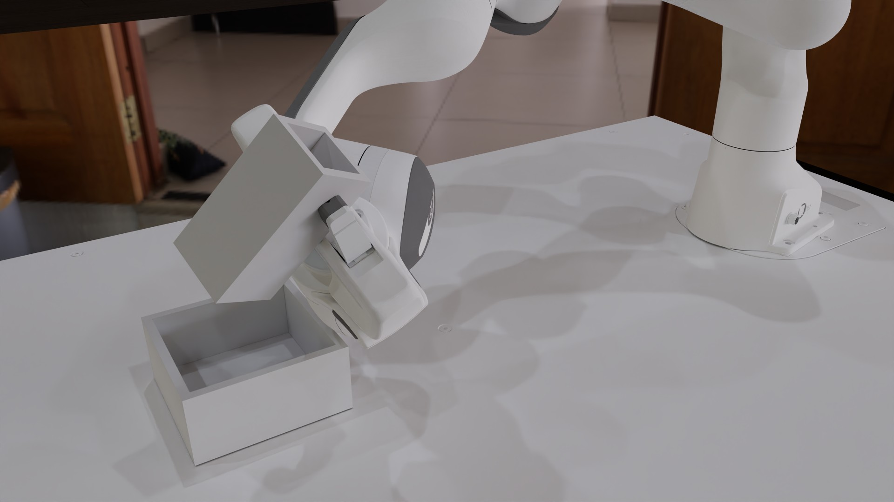
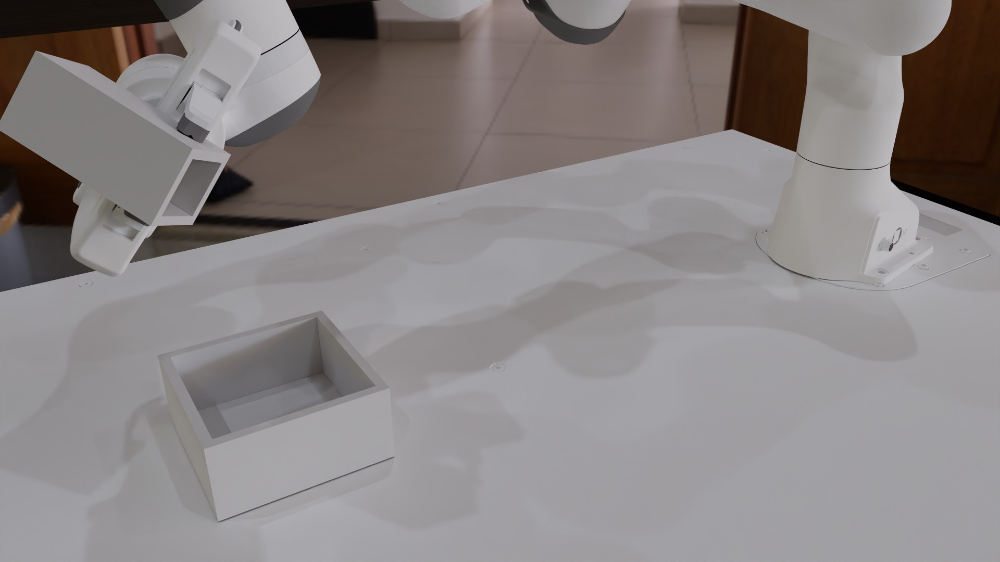
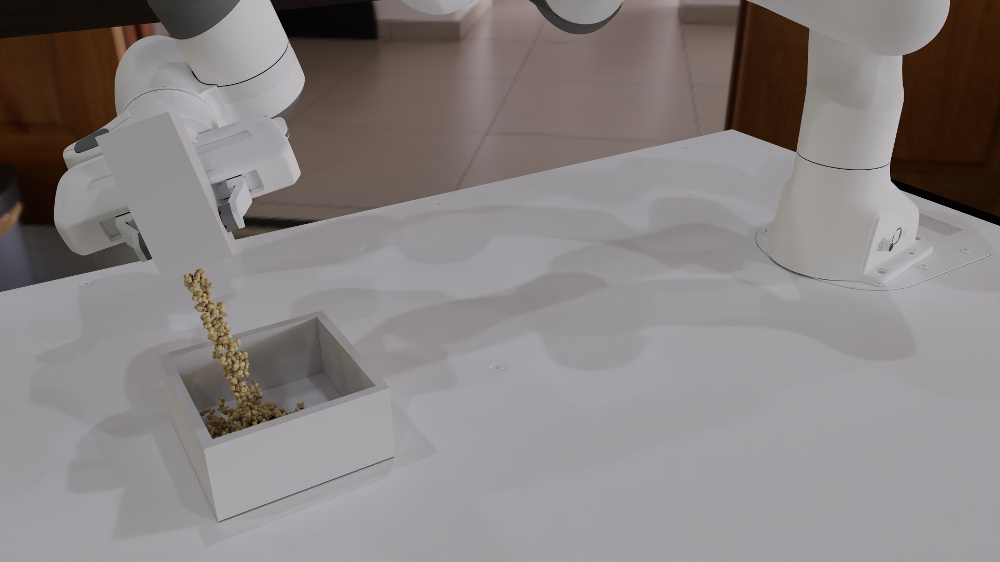
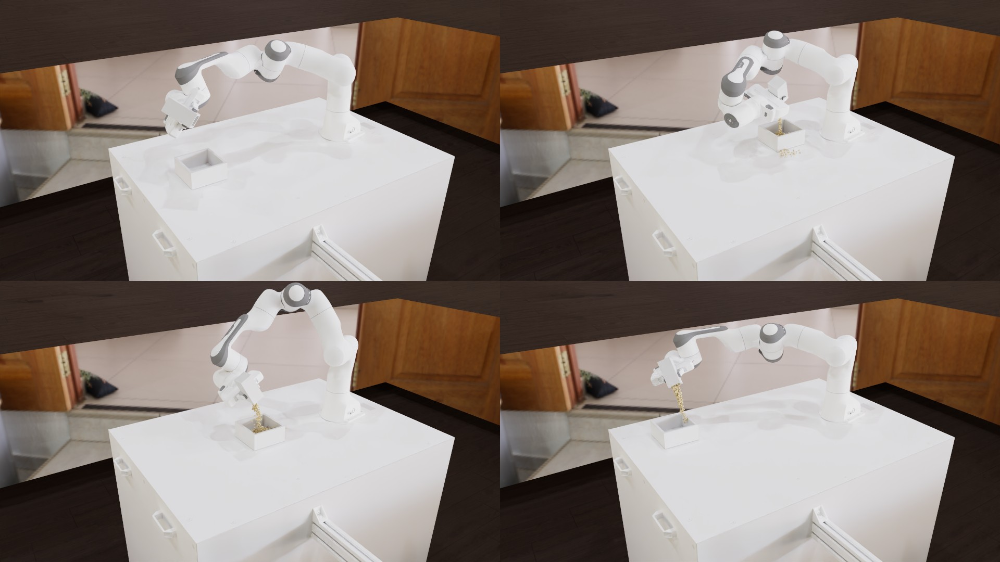

# Franka-Pour: a metalsim render

A Franka Panda grasps a cup holding 735 MPM particles of granular media and pours them into a second cup: Isaac Lab 3.0-EA's `IsaacContrib-Franka-Pour` task on metalsim (Newton 1.5.2 coupled MuJoCo Warp + implicit MPM on Metal), driven by a policy trained here with Isaac's PPO configuration.

**hero** (105 frames, 3.5 s at 30 fps): [video](franka_pour.mp4) (0.4 MB, H.264)

**grid** (105 frames, 3.5 s at 30 fps): [video](franka_pour_grid.mp4) (0.2 MB, H.264)






## What is shown

- 24 envs simulated, filmed: 8, 6, 16, 17 (selection: automatic, the adapter ranking).
  - env 8: success True, time_out False, category 0, length 75, source_frac 0.033, target_frac 0.789, spill_frac 0.000, end_frame 74
  - env 6: success True, time_out False, category 1, length 52, source_frac 0.072, target_frac 0.750, spill_frac 0.035, end_frame 51
  - env 16: success True, time_out False, category 1, length 19, source_frac 0.098, target_frac 0.705, spill_frac 0.003, end_frame 18
  - env 17: success True, time_out False, category 1, length 60, source_frac 0.059, target_frac 0.769, spill_frac 0.000, end_frame 59
- Policy: `runs/franka_pour/logs/m414_2048_model_299.pt` (iteration 300); physics: Newton 1.5.2 SolverCoupledProxy: MuJoCo Warp arm + implicit MPM media (metalsim.learn.franka_pour_scene).

## Performance

Measured on the machine below; one frame = one policy step (Isaac Lab's `render_fps` = 1 / step_dt).

| stage | measurement |
|---|---|
| simulate (record) | 360 frames x 24 envs: 172 ms/frame mean (150 median, first 8587 incl. graph capture), 62.0 s total; env build 9.2 s; stage wall 75.4 s |
| render twin (CPU) | 64 geoms, 63 meshes, 0 textures; build 0.7 s, poses 0.1 s |
| particles | 735 per env, radius 2.50 mm |
| render: hero | 1920x1080 (1x1 panels of 1920x1080), tier 2 path tracing, 256 spp (64 passes x 4), 4 bounces, denoiser oidn; 3.96 s/frame mean (3.98 median, 4.04 max), 6.9 min for 105 frames; first frame: one pass 150 ms, 56 ms per further pass; set-up 6.4 s |
| encode: hero | 1.5 s (master CRF 16 + docs copy CRF 22, libx264 slow) |
| render: grid | 1920x1080 (2x2 panels of 960x540), tier 2 path tracing, 256 spp (64 passes x 4), 4 bounces, denoiser oidn; 3.06 s/frame mean (3.04 median, 3.19 max), 5.4 min for 105 frames; first frame: one pass 137 ms, 43 ms per further pass; set-up 9.1 s |
| encode: grid | 1.2 s (master CRF 16 + docs copy CRF 22, libx264 slow) |
| end to end | 13.8 min (record + render + encode, sum of stage walls) |

## Hardware and pins

- Mac16,5 (Apple M4 Max, 40 GPU cores, 64 GB), macOS 26.7.1 (25G241).
- metalsim `cb76304fe6`; record stage (newton152 venv): warp 1.18.0.dev20260917 (`52c09cdd82`), newton 1.5.2 (`addd10cbeb`), mujoco 3.11.0, mujoco_warp 3.11.0, torch 2.14.0, numpy 2.5.3.
- render stage (main venv): warp 1.18.0.dev20260917 (`52c09cdd82`), mujoco 3.14.0, numpy 2.5.3.

## Assets

| asset | source | licence | where from |
|---|---|---|---|
| Franka Emika Panda (USD, Isaac 6.1 asset root; converted by NVIDIA from MuJoCo Menagerie's mjx_panda) | NVIDIA Isaac Sim assets | NVIDIA Isaac Sim asset terms (fetched, not redistributed) | https://omniverse-content-production.s3-us-west-2.amazonaws.com/Assets/Isaac/6.1/Isaac/IsaacLab/Robots/FrankaEmika/franka_panda.usda (`scripts/fetch_isaac_assets.sh`) |
| Panda description the USD derives from (MuJoCo Menagerie franka_emika_panda) | Google DeepMind | Apache-2.0 | https://github.com/google-deepmind/mujoco_menagerie/tree/main/franka_emika_panda |
| Source and receiver cups (franka_pour_cups.usda, variants source / target) | NVIDIA Isaac Lab 3.0-EA | NVIDIA Isaac Sim asset terms (fetched, not redistributed) | https://omniverse-content-production.s3-us-west-2.amazonaws.com/Assets/Isaac/6.1/Isaac/IsaacLab/Contrib/MPM/Pour/franka_pour_cups.usda (`scripts/fetch_isaac_assets.sh`) |
| SeattleLab table (table_instanceable.usd) | NVIDIA Isaac Sim assets | NVIDIA Isaac Sim asset terms (fetched, not redistributed) | https://omniverse-content-production.s3-us-west-2.amazonaws.com/Assets/Isaac/6.1/Isaac/Props/Mounts/SeattleLabTable/table_instanceable.usd (`scripts/fetch_isaac_assets.sh`) |
| Reset dataset (20,000 start states, reset_dataset.pt) | NVIDIA Isaac Lab 3.0-EA | NVIDIA Isaac Sim asset terms (fetched, not redistributed) | https://omniverse-content-production.s3-us-west-2.amazonaws.com/Assets/Isaac/6.1/Isaac/IsaacLab/Contrib/MPM/Pour/reset_dataset.pt (`scripts/fetch_isaac_assets.sh`) |
| Studio HDRI (poly_haven_studio, 2k) | Poly Haven | CC0 1.0 (Poly Haven; fetched, not committed) | https://polyhaven.com/a/poly_haven_studio (`scripts/fetch_polyhaven_assets.sh train`) |
| Floor texture (laminate_floor_02, 1k diffuse) | Poly Haven | CC0 1.0 (Poly Haven; fetched, not committed) | https://polyhaven.com/a/laminate_floor_02 (`scripts/fetch_polyhaven_assets.sh train`) |
| Granular media: 735 MPM particles per cup, density 1500 kg/m^3, friction 0.7, 5 mm lattice; render grains coloured with Isaac's visual_color (0.85, 0.72, 0.45) | Isaac Lab 3.0-EA task config (pour_env_cfg.py:97-100, 152-156; media.py) | BSD-3-Clause | https://github.com/isaac-sim/IsaacLab (`procedural (metalsim.learn.franka_pour_scene.media_lattice)`) |
| Policy checkpoint m414_2048_model_299.pt (trained on metalsim) | this repository | this repository's licence | `runs/franka_pour/logs/m414_2048_model_299.pt` (`committed`) |

## How it was made

**The policy.** Trained on metalsim on the 14-inch M4 Max: 2,048 envs, 300 iterations of the task's rsl_rl PPO
configuration (96 steps per env per iteration, MLP 512-256-128-64, learning rate 1.5e-4; 59.0 M env steps, about
16.4 h at ~945 env-steps/s; `runs/franka_pour/logs/m414_2048_config.json`, `m414_2048_log.jsonl`). Logged training
success over the last iteration's 1,704 episodes: 63 %. Evaluated over 2,048 first episodes (seed 7, uniform reset
rows as in Isaac's play mode, the actor's mean action): **47.7 % success**, 82.2 % for episodes that start with the
cup already grasped and 15.2 % for those that start before the grasp
(`runs/franka_pour/eval/eval_2048_isaac_budget.json`). Learning against Isaac Lab on the L4 at matched settings:
`docs/PARITY.md` §1b.5. The film simulates 24 envs with the evaluation's seed and films the best-ranked: successful
episodes that start before the grasp first (approach, grasp, lift and pour in one take), then successful ones that
start with the cup in hand.

**How Isaac Lab presents the task** (research, `upstream/IsaacLab3` at `ae37b028`). `pour_env_cfg.py` sets a default
viewer at eye (1.4, 1.4, 0.9) looking at (0.5, 0, 0.1) in env 0's frame, and its play mode (one env) a closer camera
at eye (0.9, 0.65, 0.5) with the Newton RTX visualizer drawing the media as particles of the media's `visual_color`
(0.85, 0.72, 0.45). Videos come from `VideoRecorderCfg` at `render_fps` = 1 / step_dt = 30 fps. The scene is lit by a
grey dome light (colour 0.75, intensity 3000). The hero shot here uses the play-mode camera, the grid shot the default
viewer, both with Kit's default perspective lens (36 deg vertical at 16:9) and one frame per policy step (30 fps).

**Rendering.** As the ANYmal-on-sand demo (`scripts/particle_demo/`): simulate first, render offline. Tier 2 (the path
tracer) is the best tier that draws MPM particles with full lighting (tier 1 draws them without ray-traced shadows,
`docs/RENDER_COVERAGE.md` §1c). The physics model loads colliders only, as Isaac's Newton path does, so the render
twin is built by the same scene builder with Isaac's USD visual meshes loaded (Newton 1.5.2's USD importer) and its
bodies matched one to one to the simulated world's; a body that has visual meshes hides its colliders. Each MPM
particle (radius 2.5 mm) is drawn as 4 render grains (`metalsim/render/PARTICLES.md`). Lighting is a Poly Haven studio
HDRI as an importance-sampled dome instead of Isaac's plain grey dome (it gives the metal and plastic reflections);
the floor texture sits on Isaac's ground plane 1.05 m below the tabletop. OIDN denoiser, ACES tone map, sRGB.
The tool is generic: `python -m metalsim.render.film <task>`; a task adds a `FilmTask` entry and a small recorder
adapter (`metalsim/render/film/`).

## Reproduce

```bash
scripts/fetch_isaac_assets.sh                # NVIDIA assets (not redistributed)
scripts/fetch_polyhaven_assets.sh train      # CC0 HDRI and textures
python -m metalsim.render.film franka_pour   # record, render, encode, doc (main venv)
# or stage by stage (resumable):
python -m metalsim.render.film franka_pour --stage record   # runs in the .venv-newton152 venv
python -m metalsim.render.film franka_pour --stage render
python -m metalsim.render.film franka_pour --stage encode
python -m metalsim.render.film franka_pour --stage doc
```

Generated by `python -m metalsim.render.film franka_pour --stage doc` from the stage logs (`runs/film/franka_pour/rec/rec.json`, `render.json`, `render_frames.jsonl`, `encode.json` per shot).
