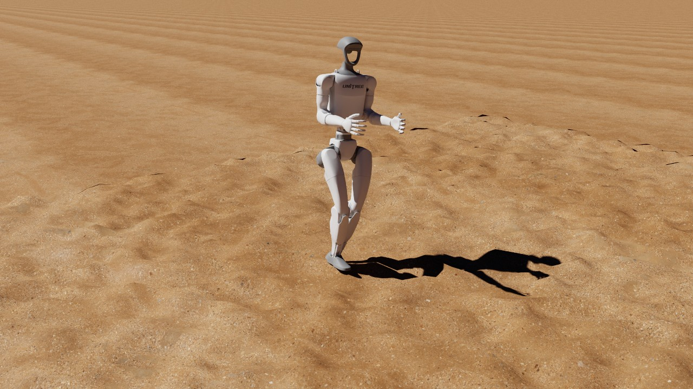
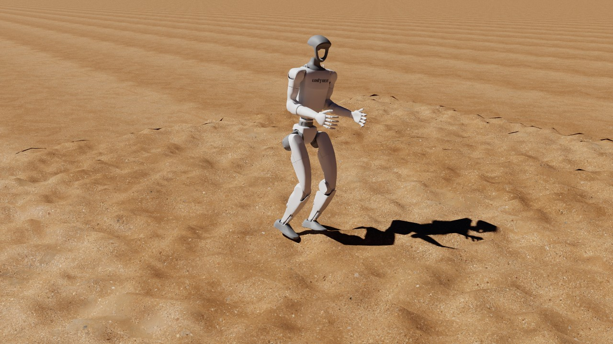
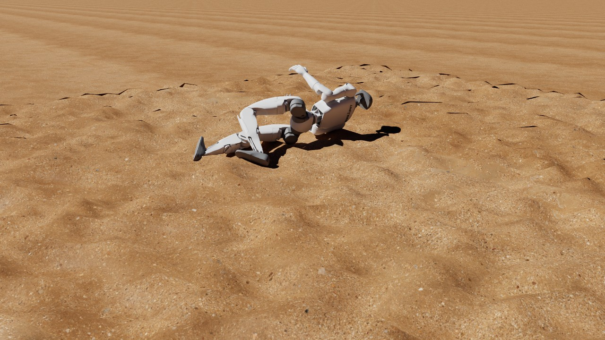

# G1 on rough ground, Unitree's policy: a metalsim render

Unitree G1 walking onto [Isaac Lab](https://github.com/isaac-sim/IsaacLab)'s random rough ground (the `random_rough` sub-terrain of `ROUGH_TERRAINS_CFG`: bumps of 2 to 10 cm every 0.1 m) with Unitree's own pretrained walking policy, which is blind and was trained on flat ground ([unitree_rl_gym](https://github.com/unitreerobotics/unitree_rl_gym), `deploy/pre_train/g1/motion.pt`, BSD-3-Clause), played by Unitree's [MuJoCo](https://github.com/google-deepmind/mujoco) sim2sim loop ported to [my fork of MuJoCo Warp](https://github.com/pulipakaa24/mujoco_warp/tree/metalsim) on Metal (whose heightfield contacts match the exact geometry), on Unitree's own G1 model, and rendered by metalsim's path tracer. Rendered on the 14-inch MacBook Pro (Mac16,6), not in a timing run, so its Performance table is not a timing figure.

**hero** (401 frames, 8.0 s at 50 fps): [video](g1_bumps.mp4) (4.7 MB, H.264)





## What is shown

- 16 envs simulated, filmed: 6 (selection: automatic, the adapter ranking).
  - env 6: terminated True, base_z 0.375, end_frame 266
- Policy: `assets/unitree_rl_gym/deploy/pre_train/g1/motion.pt` (torchscript); physics: MuJoCo Warp BatchSim (metalsim.physics.batch), Unitree's scene.xml; Unitree's PD torque every physics step (Warp kernel: before the first step of a policy step, then BatchSim.add_substep_hook after each).

## Performance

Measured on the machine below; one frame = one policy step ([Isaac Lab](https://github.com/isaac-sim/IsaacLab)'s `render_fps` = 1 / step_dt).

| stage | measurement |
|---|---|
| simulate (record) | 401 frames x 16 envs: 66 ms/frame mean (68 median, first 77 incl. graph capture), 26.6 s total; env build 3.0 s; stage wall 30.8 s |
| render twin (CPU) | 61 geoms, 27 meshes, 2 textures; build 0.0 s, poses 0.0 s |
| render: hero | 1280x720 (1x1 panels of 1280x720), tier 2 path tracing, 64 spp (16 passes x 4), 3 bounces, denoiser oidn; 0.43 s/frame mean (0.42 median, 0.48 max), 2.8 min for 401 frames; first frame: one pass 63 ms, 19 ms per further pass; set-up 1.7 s |
| encode: hero | 5.4 s (master CRF 16 + docs copy CRF 22, libx264 slow) |
| render: readme | 640x480 (1x1 panels of 640x480), tier 2 path tracing, 64 spp (16 passes x 4), 3 bounces, denoiser oidn; 0.16 s/frame mean (0.16 median, 0.18 max), 65.7 s for 401 frames; first frame: one pass 22 ms, 7 ms per further pass; set-up 1.3 s |
| end to end | 4.6 min (record + render + encode, sum of stage walls) |

## Hardware and pins

- Mac16,6 (Apple M4 Max, 40 GPU cores, 64 GB), macOS 27.0.1 (26A434).
- Power as each stage stamped it (`pmset -g batt` and `pmset -g`; `hardware.power`: the record stage's when it wrote rec.json, a render shot's at its first frame): record: on AC power (89 %, charging), power-mode setting High Power (pmset `powermode 2`), 2026-10-31 23:37 (-0700); render hero: on AC power (89 %, charging), power-mode setting High Power (pmset `powermode 2`), 2026-10-31 23:37 (-0700); render readme: on AC power (89 %, charging), power-mode setting High Power (pmset `powermode 2`), 2026-10-31 23:40 (-0700).
- metalsim [`e67efcb9f9+dirty`](https://github.com/pulipakaa24/MetalSim/commit/e67efcb9f92455f1dc723b3f9c7d7ba2ad85856e); record stage (main venv): warp 1.18.0.dev20260917 ([`52c09cdd82`](https://github.com/pulipakaa24/warp/commit/52c09cdd82f79e8564b5ae17cdcee7b52d10d075)), mujoco 3.14.0, mujoco_warp 3.14.0 ([`787a5b3a37`](https://github.com/pulipakaa24/mujoco_warp/commit/787a5b3a37acc2551ffc8a2c1af1e9781d76723f)), torch 2.14.0, numpy 2.5.3.
- render stage (main venv): warp 1.18.0.dev20260917 ([`52c09cdd82`](https://github.com/pulipakaa24/warp/commit/52c09cdd82f79e8564b5ae17cdcee7b52d10d075)), mujoco 3.14.0, numpy 2.5.3.

## Assets

| asset | source | licence | where from |
|---|---|---|---|
| Unitree G1, 12-dof legs model (g1_12dof.xml in scene.xml) and its STL meshes | Unitree Robotics unitree_rl_gym | BSD-3-Clause | https://github.com/unitreerobotics/unitree_rl_gym/blob/276801e46c5d433564f24658bac64f254b7d2d4b/resources/robots/g1_description (`scripts/fetch_unitree_rl_gym.sh`) |
| Policy: Unitree's pretrained G1 walking policy deploy/pre_train/g1/motion.pt (TorchScript; sha256 cf668f75...) | Unitree Robotics unitree_rl_gym | BSD-3-Clause | https://github.com/unitreerobotics/unitree_rl_gym/blob/276801e46c5d433564f24658bac64f254b7d2d4b/deploy/pre_train/g1/motion.pt (`scripts/fetch_unitree_rl_gym.sh`) |
| Sim2sim playback loop and config (deploy_mujoco.py, configs/g1.yaml), ported to MuJoCo Warp | Unitree Robotics unitree_rl_gym | BSD-3-Clause | https://github.com/unitreerobotics/unitree_rl_gym/blob/276801e46c5d433564f24658bac64f254b7d2d4b/deploy/deploy_mujoco (`scripts/fetch_unitree_rl_gym.sh`) |
| Terrain: Isaac Lab 2.3.2 ROUGH_TERRAINS_CFG['random_rough'] (HfRandomUniformTerrainCfg, noise_range (0.02, 0.10), noise_step 0.02, border_width 0.25), one 8 x 8 m tile with the generator's 20 m border, 0.1 m / 5 mm scales, env seed 0 | Isaac Lab task config (port: metalsim.learn.isaac_terrain) | BSD-3-Clause | https://github.com/isaac-sim/IsaacLab (`procedural (metalsim.render.film.unitree.random_rough_tile)`) |
| Outdoor HDRI (goegap, 8k; Namaqualand, South Africa; its sun drawn as an analytic light) | Poly Haven (Greg Zaal) | CC0 1.0 (Poly Haven; fetched, not committed) | https://polyhaven.com/a/goegap (`scripts/fetch_polyhaven_assets.sh demo`) |
| Ground texture (sandy_gravel_02, 2k diffuse; scanned 2.53 x 2.53 m, Namaqualand collection) | Poly Haven (Dario Barresi) | CC0 1.0 (Poly Haven; fetched, not committed) | https://polyhaven.com/a/sandy_gravel_02 (`scripts/fetch_polyhaven_assets.sh demo`) |

## How it was made

**What this film is.** The policy of the G1 flat film ([G1_UNITREE.md](G1_UNITREE.md)): Unitree's own pretrained G1
walking policy, `deploy/pre_train/g1/motion.pt` from `unitree_rl_gym`
(<https://github.com/unitreerobotics/unitree_rl_gym>, BSD-3-Clause, commit
[`276801e`](https://github.com/unitreerobotics/unitree_rl_gym/commit/276801e46c5d433564f24658bac64f254b7d2d4b), sha256
`cf668f75b90d1abf73d2b87612a6e76bccc61ff7e083b63582d3f6aaa3c1759d`), played by Unitree's MuJoCo sim2sim loop
(`deploy/deploy_mujoco/deploy_mujoco.py`, `configs/g1.yaml`, command (0.5, 0, 0)) ported to [my fork of MuJoCo
Warp](https://github.com/pulipakaa24/mujoco_warp/tree/metalsim), as in the G1 flat film, with one change: Unitree's
floor plane is Isaac Lab's random rough ground. The policy is blind (47 observations: body rates, gravity, command,
joint state, last action, gait clock; no height scan) and Unitree trained it on flat ground only (`legged_gym`,
`legged_robot_config.py` line 15 `mesh_type = 'plane'`, not overridden by `g1_config.py`), with pushes, friction and
mass randomization. Nothing is tuned, and the robot falls: this page shows what happens.

**Terrain.** Isaac Lab 2.3.2's `ROUGH_TERRAINS_CFG["random_rough"]` (`isaaclab/terrains/config/rough.py`):
`HfRandomUniformTerrainCfg(proportion=0.2, noise_range=(0.02, 0.10), noise_step=0.02, border_width=0.25)`, on one 8 x 8
m tile at the generator's horizontal scale 0.1 m and vertical scale 5 mm (slope threshold 0.75), with the generator's 20
m flat border around it, built by MetalSim's port of Isaac's terrain generator (`metalsim.learn.isaac_terrain`, the
generator of the G1 rough film) for env seed 0 (`unitree.random_rough_tile`). Isaac's `random_uniform_terrain`
ignores its difficulty (`height_field/hf_terrains.py`, its docstring: "The difficulty parameter is ignored for this
terrain"): at every curriculum level every 0.1 m grid point is an independent uniform draw from 2, 4, 6, 8 or 10 cm
(`downsampled_scale` defaults to the horizontal scale, so the spline interpolation changes nothing). So Isaac Lab has
one random rough terrain, not a range of levels: bumps 2 to 10 cm high every 0.1 m, up to 8 cm between neighbours, on
a 0.25 m flat rim (z = 0) around the 7.5 m rough square. This film uses exactly that terrain; the levels in the table
below with a lower ceiling are variants made here to see how the outcome depends on bump height, not Isaac's. The
tile enters Unitree's `scene.xml` as a MuJoCo heightfield (481 x 481 samples, 48 m with the border) that replaces the
`floor` plane: the same geom, name and contact parameters (MuJoCo's defaults, as Unitree's plane), type heightfield
(`unitree.unitree_terrain_spec`). Isaac builds a triangle mesh from the height field, in which the 1014 of 12,960 grid
edges whose height jump exceeds the slope threshold (a 2 cm sample next to a 10 cm one: 8 cm over 0.1 m) become
vertical walls; MuJoCo's heightfield interpolates them as 0.1 m ramps (the grid heights are the top of Isaac's mesh,
`isaac_terrain.height_field_surface`). Everything else in Unitree's loop is unchanged. For the picture only, an
infinite plane 2 mm under the flat border continues the ground to the horizon (`backdrop`; it collides with nothing).

**Where the robots start.** 16 robots, each on its own lane across the tile: pelvis at x = -2 m, y from -3 to 3 m in
0.4 m steps, all walking towards +x. Each starts in Unitree's start pose (`qpos0`: joints at zero, sole spheres 1.1 mm
above the floor), raised by the highest terrain under either sole at its spot, so its soles start 1.1 mm above every
bump under them (`unitree.unitree_start_qpos`), as Isaac spawns a robot above the highest point near its terrain
origin. In 8 s at the commanded 0.5 m/s a robot covers about 4 m in x, which keeps it on the rough square, but a
robot that veers can leave it sideways: on Isaac's terrain the robot on the outermost lane y = -3 m crossed the
square's edge (|y| > 3.75 m) at 2.38 s and fell 0.3 s later in the MetalSim measurement run, and in CPU MuJoCo both
outermost robots did (at 2.34 and 4.64 s; down 0.7 and 0.2 s later), near the tile's 0.25 m flat rim. (The outer
lanes were a poor choice; `measure.py` keeps them so the takes and the measurements stay comparable.)

**Physics: MetalSim's MuJoCo Warp.** The film plays Unitree's loop on [my fork of MuJoCo
Warp](https://github.com/pulipakaa24/mujoco_warp/tree/metalsim) (`metalsim.physics.batch.BatchSim`, 16 worlds of
Unitree's model with the heightfield; `unitree.UnitreeG1`: the PD torque before every 2 ms physics step, the policy
every tenth), the port the G1 flat film plays. On flat ground it matches Unitree's own CPU MuJoCo run: re-checked on my
fork, the pelvis agrees to the printed 0.1 mm at every checkpoint from 0.02 to 8 s and every gait figure is equal
(`runs/film/g1_bumps/measure/mjw_787a5b3/flat_sim2sim_compare.json`, G1_UNITREE.md). My fork's `metalsim` branch has
heightfield contacts checked against the exact geometry
([`93e5ce1`](https://github.com/pulipakaa24/mujoco_warp/commit/93e5ce18e76854c430ce669314af00ddceb92147),
docs/research/hfield_contacts_2026-10-31.md) and EPA's horizon built as MuJoCo C builds it. Those fixes are why this
film can run on MetalSim's physics. The G1's feet collide through four 5 mm spheres each, and on this tile a sphere in a
crease between two bumps touches two faces at once. Before the fixes my fork lost such contacts and kept most robots
walking (54 of 288 robots fell, 18.8 %, at
[`8eb51fe`](https://github.com/pulipakaa24/mujoco_warp/commit/8eb51fe637437108185f5a4750b7f5f64ef26624), over tile seeds
0 to 4; research note section 8.3), so the first take of this film (2026-10-31, afternoon) ran Unitree's loop on CPU
MuJoCo instead (`adapter_kw["engine"] = "mujoco_c"`). A static check on this tile
(`runs/film/g1_bumps/measure/contact_check.py`; `mjw_787a5b3/contact_check.json`; the "before" row from the first take's
`contact_check.json`): 3,000 spheres pressed 0.5 to 3 mm into the triangulated surface at random spots, each engine's
contacts compared with the exact contact set (every distinct closest point of the surface's triangles within the sphere;
661 of the 3,000 touch two or more faces).

| | contacts per sphere equal to the exact set | spheres with fewer contacts | spheres with no contact | contacts more than 10 deg off the nearest true normal |
|---|---|---|---|---|
| CPU MuJoCo 3.14 | 99.6 % (11 spheres get a duplicate) | 0 | 0 | 0 of 3,736 |
| MetalSim's MuJoCo Warp, my fork (this film) | 99.5 % | 14 (13 of them touch 5 or 6 faces, more than the 4 contacts MuJoCo keeps per pair) | 0 | 1 of 3,707 |
| MetalSim's MuJoCo Warp before the fixes (my fork at [`8eb51fe`](https://github.com/pulipakaa24/mujoco_warp/commit/8eb51fe637437108185f5a4750b7f5f64ef26624)) | 88.8 % (211 spheres get extra contacts) | 126 | 0 | 6.1 % of 3,781 |

(The first take's page listed 81.9 % for "MetalSim's MuJoCo Warp"; that run had imported a stale checkout of my fork,
[`07a51a6`](https://github.com/pulipakaa24/mujoco_warp/commit/07a51a63bce527d2d26b363a32c52765df4412fc): research note
section 2.)

**Measured before filming** (`runs/film/g1_bumps/measure/measure.py`: `cpu_levels.json`, the first take's CPU MuJoCo
run; `mjw_787a5b3/gpu_levels.json`, MetalSim on my fork). Per level 16 robots for 8 s, the lanes above,
command (0.5, 0, 0), tile seed 0. A fall: the pelvis below 0.4 m (`unitree.FALLEN_Z`; the robot is on the ground;
Unitree's training ends an episode on pelvis contact). Gait per robot from 1 s to its fall or to 8 s
(`record.gait_metrics`), the foot's height taken above the highest terrain under its sole (a 1 cm grid over the
quadrilateral of its four sole spheres, `unitree.sole_grid`); medians over the robots with at least 2 s of walking
(all 16, except 14 for MetalSim on Isaac's terrain). Swing apex: 95th percentile of the sole's height above its stance
height. Forward: pelvis x at the fall, or at 8 s, minus the start. On flat ground (G1_UNITREE.md): 1.25 Hz, 1.14 /
1.29 touch-downs per second, apex 4.2 / 4.4 cm, 3.65 m forward in 8 s, in both engines.

| bumps (noise_range) | engine | falls of 16 | first / median fall | gait cycles per s, L / R | touch-downs per s, L / R | swing apex, L / R | forward, median (range) |
|---|---|---|---|---|---|---|---|
| 2 to 4 cm (0.02, 0.04), variant | CPU MuJoCo | 2 | 6.58 / 7.08 s | 1.25 / 1.25 | 1.29 / 1.29 | 4.7 / 5.1 cm | 3.42 m (1.62 to 3.74) |
| | MetalSim | 1 | 5.82 / 5.82 s | 1.25 / 1.25 | 1.14 / 1.29 | 4.5 / 4.9 cm | 3.41 m (2.64 to 3.60) |
| 2 to 6 cm (0.02, 0.06), variant | CPU MuJoCo | 6 | 3.34 / 6.78 s | 1.26 / 1.25 | 1.36 / 1.29 | 5.0 / 5.6 cm | 2.96 m (0.18 to 4.25) |
| | MetalSim | 4 | 3.80 / 4.58 s | 1.25 / 1.25 | 1.29 / 1.29 | 5.6 / 5.8 cm | 3.08 m (0.35 to 4.01) |
| 2 to 8 cm (0.02, 0.08), variant | CPU MuJoCo | 7 | 3.46 / 5.06 s | 1.25 / 1.26 | 1.43 / 1.29 | 6.4 / 6.2 cm | 2.63 m (0.58 to 3.43) |
| | MetalSim | 9 | 3.40 / 6.22 s | 1.24 / 1.26 | 1.39 / 1.35 | 5.6 / 6.1 cm | 2.56 m (0.65 to 3.41) |
| **2 to 10 cm (0.02, 0.10), Isaac's** | CPU MuJoCo | **11** | 3.02 / 4.62 s | 1.17 / 1.25 | 1.71 / 1.44 | 7.0 / 6.5 cm | 1.95 m (-0.55 to 3.87) |
| | MetalSim | **10** | 2.66 / 5.11 s | 1.25 / 1.26 | 1.43 / 1.29 | 6.8 / 6.2 cm | 2.07 m (-0.30 to 3.55) |

Each row is one run. The two engines agree in the aggregate, not robot by robot: on Isaac's terrain 7 of the 16 lanes
have a different outcome in the two runs. The touch-down rate and the swing apex grow with the bump height; in the
frames the extra touch-downs are short catching steps after a stumble (a reading of the frames, not a separate
measurement). On Isaac's terrain 15 of 16 robots also touch the terrain with some geom other than a sole sphere (a
mesh of the leg, arm or body; for some within the first 0.2 s, so this is not by itself a stumble) within the 8 s, in
both engines (`nonfoot_contacts`).

**How often it falls, over five tiles** (the research note's protocol, section 8.3: Isaac's terrain, tile seeds 0 to
4, 16 robots each, 8 s; `mjw_787a5b3/falls_summary.json`, `mjw_787a5b3/falls/`). MuJoCo Warp on Metal is not
run-to-run repeatable here (the order in which the GPU accumulates contacts varies, and a stumbling gait amplifies
the difference), so each tile is run three times; CPU MuJoCo is deterministic, so its spread comes from nudging the
start joints by 1e-6 rad.

| engine | runs | falls of 16, tile seed 0 / 1 / 2 / 3 / 4 (each run) | falls per 80-robot run | total |
|---|---|---|---|---|
| CPU MuJoCo 3.14 | 1 | 11 / 10 / 14 / 12 / 8 | 55 | 55 / 80 = 68.8 % |
| CPU MuJoCo, start joints + N(0, 1e-6 rad) | 3 | 12, 11, 10 / 13, 12, 11 / 13, 11, 11 / 11, 11, 10 / 10, 13, 5 | 59, 58, 47 | 164 / 240 = 68.3 % |
| MetalSim's MuJoCo Warp, my fork (this film) | 3 | 11, 11, 11 / 13, 15, 15 / 12, 12, 12 / 15, 11, 11 / 9, 11, 11 | 60, 60, 60 | 180 / 240 = 75.0 % |
| MetalSim's MuJoCo Warp before the fixes (my fork at [`8eb51fe`](https://github.com/pulipakaa24/mujoco_warp/commit/8eb51fe637437108185f5a4750b7f5f64ef26624)) | 3 to 6 | 2, 5, 4, 3, 1, 3 / 3, 3, 6 / 1, 6, 5 / 3, 1, 4 / 1, 1, 2 | 10, 12, 20 | 54 / 288 = 18.8 % |

MetalSim's robots fall a little more often than CPU MuJoCo's over the five tiles (60 against 55 per 80 robots, less
than one standard deviation of CPU MuJoCo's own nudged runs, 6.7) and as often on the film's tile (seed 0: 10 to 12 of
16 in the six MetalSim runs listed on this page, 10 to 12 in CPU MuJoCo). The research note names float32 against
float64 and MuJoCo C's duplicate contacts at shared edges as candidates for the remaining gap; it is not resolved.

**The take.** The level is Isaac's own terrain because it is the only one Isaac Lab defines, not because of its outcome;
its bumps (2 to 10 cm) are clearly visible. The record stage is one more run of the 16 lanes on [my fork of MuJoCo
Warp](https://github.com/pulipakaa24/mujoco_warp/tree/metalsim), so its outcome is one draw from the spread above: 12 of
16 robots fall in it (the four measurement runs of this tile: 10, 11, 11 and 11). The film shows the record's typical
outcome (`adapter_kw["pick"] = "typical"`, `UnitreeG1._rank_typical`): as at least half of the 16 fell, the fallen robot
whose fall time is nearest the median fall time of all 12 (5.27 s), among the lanes from y = -1.4 to 1.0 m
(`film_lanes`: there the camera, which stands 2 m to the robot's right, sees the rough tile around the robot rather than
its flat border; the lane decides which bumps a robot meets, not how hard they are). That is the robot on lane y = -0.6
m, which walks 0.87 m forward over the bumps while veering 1.29 m to its left (2.88 m of path) and is down at 5.34 s
(frame 266), falling backwards. The film does not stop at the fall: Unitree's playback has no termination or reset, so
the policy keeps acting on the ground (in the clip one leg swings up about 0.3 s after it lands), and the render plays
the recorded simulation to 8 s (`FilmCfg.after_end = "play"`). Whether the filmed robot itself is typical was checked
before rendering, against a rule set before this record ran: re-record only if its own outcome contradicts its lane's
outcome in every one of the four MetalSim measurement runs of this tile (`measure.py` and the three seed-0 runs above).
Its lane, y = -0.6 m, fell in 1 of those 4 runs (and in CPU MuJoCo, at 5.82 s) and walked in the other 3: a lane where
falling and walking both happen, not one that always walks. An earlier record, also 12 falls of 16, was not rendered: a
first, stricter rule (the record's fall count within the four measurement runs' 10 to 11) rejected it, and was then
replaced by the rule above because a count range from four runs is narrower than the spread between runs; under the rule
above that record would have passed too (its filmed robot, lane y = 0.2 m, fell in all four measurement runs). The
rejected record is not kept in the repository.

**Gait of the filmed robot** (`rec.json` `gait`, 1 s to its fall at 5.34 s): 0.57 m/s along its path at a commanded
0.50; 1.10 / 1.23 gait cycles per second (touch-downs 1.84 / 1.61 per s, left / right); swing apex 10.4 / 10.3 cm above
the highest terrain under the sole (4.2 / 4.4 cm on flat ground): high, stumbling steps; stance slip 0.021 / 0.058 m/s.

**What the model cannot show.** Only the four sole spheres of each foot collide; the visual sole between them does
not. On bumps 10 cm apart a bump can rise between the spheres: in stance on Isaac's terrain the terrain stands above
the quadrilateral of the sphere bottoms by 15 mm at the median, 44 mm at the 95th percentile and 81 mm at most in the
MetalSim measurement run (`mjw_787a5b3/gpu_levels.json` `sole_penetration_m`; CPU MuJoCo 15, 49 and 77 mm), so a bump
can show through a foot. In the hero frames checked at full resolution (100 to 111 and 180, both feet) the planted
foot's toe or heel looks a little sunk into the ground at times, no foot floats in stance, and no bump shows through a
sole. That is Unitree's model, unchanged.

**Look.** Outdoors: Poly Haven's `goegap` HDRI (Goegap Nature Reserve, Namaqualand; 8k) as an importance-sampled dome,
its sun split out as an analytic directional light (`look.sun`), and the CC0 Poly Haven ground texture `sandy_gravel_02`
(Namaqualand too) on the heightfield and the backdrop at its scanned size, 2.53 x 2.53 m per image (Poly Haven's
`dimensions`; `ground_tile_m` 2.53, which the film tool turns into MuJoCo's `texrepeat` 2 / 2.53: MuJoCo lays a
`texuniform` texture once per 2 / `texrepeat` m on planes and heightfields alike). The HDRI's sun stands 46.5 deg high,
which the photo fixes; the dome's yaw (`hdri_yaw_deg` 0) puts it 89 deg to the left of the hero camera's view, so it
rakes across the bumps and every bump has a lit and a shadowed side. The camera is lower than the G1 films' (eye 0.75 m
above the pelvis instead of 1.3 m, looking 0.35 m below it, 18.5 deg down instead of 22): the bumps read in profile
around the feet. On screen they read as uneven, shadow-dappled ground and in the robot's ragged shadow, softer than
their 8 cm of relief: the path tracer shades a heightfield with smooth vertex normals
(`metalsim/render/scene_tables.py`, `hfield_mesh`), and the texture adds its own pebbles. Beyond the tile the flat
ground repeats the 2.53 m texture image, which shows as regular stripes over the far ground, plainly in the hero frames
and still visible in the README clip at 320x240. Thin black slits show on some bumps in the middle distance (seen in
this take's frames and in the first take's, which had the same terrain and renderer); their cause is not investigated.

**Camera.** Both shots track the pelvis as Isaac's `ViewerCfg(origin_type="asset_body", body_name="pelvis")` does, the
tracked point smoothed by a centred 1 s moving average, with Kit's default perspective lens (36 deg vertical field of
view), as in the G1 films (G1_UNITREE.md), but lower. `hero` (1280x720; the video and stills on this page): eye (2.6,
-2.0, 0.75) m from the pelvis, looking at (0, 0, -0.35) m, 3.46 m away, 18.5 deg down. `readme` (640x480, 4:3, for
the README grid): the same direction and elevation at 0.75 times the distance (2.60 m), looking at (0, 0, -0.15) m so
the standing robot fits the 4:3 frame, plus MuJoCo Warp's README orbit of 10 deg/s about the vertical through the
look-at point, symmetric about the middle of the 8 s film: -40 deg at 0 s, 0 at 4 s (the hero's direction), +40 deg at
8 s, counter-clockwise seen from above (`mujoco_warp/record.py` in upstream MuJoCo Warp at
[`d41a47c0`](https://github.com/google-deepmind/mujoco_warp/commit/d41a47c0837fc71abb44d7d4799bf85ca19ff7ab), lines 43
and 142: 0.05 deg per 5 ms physics step). When the robot falls the tracked pelvis drops with it, and so does the camera.

**Rendering.** Tier 2 (the path tracer), 64 samples per pixel (16 passes x 4), 3 bounces, [Open Image
Denoise](https://www.openimagedenoise.org), ACES tone map, sRGB. The render twin is Unitree's `scene.xml` with the
heightfield and the backdrop plane, its STL meshes posed per frame from the recorded joint state; the colliding copies
and the foot spheres are hidden (`rec.json` `twin.visibility`), and the meshes keep Unitree's two greys.

**README clip.** [g1_bumps.webp](g1_bumps.webp) is the `readme` shot from 1.0 s to 6.0 s (frames 50 to 299), so that the
clip holds the fall at 5.34 s and the robot on the ground after it (the first take's clip ran from 0.5 s, its fall being
earlier), resampled from 50 to 30 fps and written as MuJoCo Warp writes its README clips: 320x240 (Lanczos), lossy
animated WebP from [Pillow](https://github.com/python-pillow/Pillow) at quality 70, 33 ms per frame, looping; 150
frames. Command, run from the repository root after the render stage: `python -m metalsim.render.film.encode webp
runs/film/g1_bumps/readme/frames docs/renders/g1_bumps.webp --start 1.0 --seconds 5 --src-fps 50 --fps 30`.

**This take, and where its timings come from.** Recorded, rendered and encoded on 2026-10-31 on the 14-inch MacBook Pro
(Mac16,6), at metalsim
[`e67efcb9`](https://github.com/pulipakaa24/MetalSim/commit/e67efcb9f92455f1dc723b3f9c7d7ba2ad85856e) plus the
uncommitted G1 bumps work (hence `+dirty` in the pins), on [my fork of MuJoCo
Warp](https://github.com/pulipakaa24/mujoco_warp/tree/metalsim) (with [my fork of
Warp](https://github.com/pulipakaa24/warp/tree/metalsim)). This was not a timing run: MetalSim's timing runs are made on
the 16-inch MacBook Pro through the GPU queue's timing kind (`scripts/gpu_run.sh`), and its throughput figures are in
`docs/PARITY.md` §1.4 and §1.8; quote nothing on this page as MetalSim's speed. Power, as the stages stamped it
("Hardware and pins" below): on AC power and charging at every stamp (89 % when the record stage wrote `rec.json` at
23:37, 89 % at the hero shot's first frame at 23:37 and 89 % at the readme shot's at 23:40, local time), with pmset's
power-mode setting at High Power (`powermode 2`: the configured setting, which does not show that the machine ran in
High Power Mode); the encode and doc stages stamp nothing. The measurements, the record stage and the render stage (both
shots) ran as GPU-queue jobs of kind render into `runs/film/g1_bumps`, one at a time, the record and the render in one
job after the take check; then `--stage encode --shots hero`, the README WebP command above and `--stage doc` (CPU). A
new recording is another take, not this one: the GPU rollout is not bitwise repeatable, so how many robots fall, which
one is filmed, and its path can change.

## Reproduce

```bash
scripts/fetch_unitree_rl_gym.sh              # Unitree's unitree_rl_gym at a pinned commit (BSD-3)
scripts/fetch_polyhaven_assets.sh demo       # CC0 HDRI and textures
python -m metalsim.render.film g1_bumps   # record, render, encode, doc (main venv)
# or stage by stage (resumable):
python -m metalsim.render.film g1_bumps --stage record   # runs in the .venv venv
python -m metalsim.render.film g1_bumps --stage render
python -m metalsim.render.film g1_bumps --stage encode
python -m metalsim.render.film g1_bumps --stage doc
```

Generated by `python -m metalsim.render.film g1_bumps --stage doc` from the stage logs (`runs/film/g1_bumps/rec/rec.json`, `render.json`, `render_frames.jsonl`, `encode.json` per shot).
