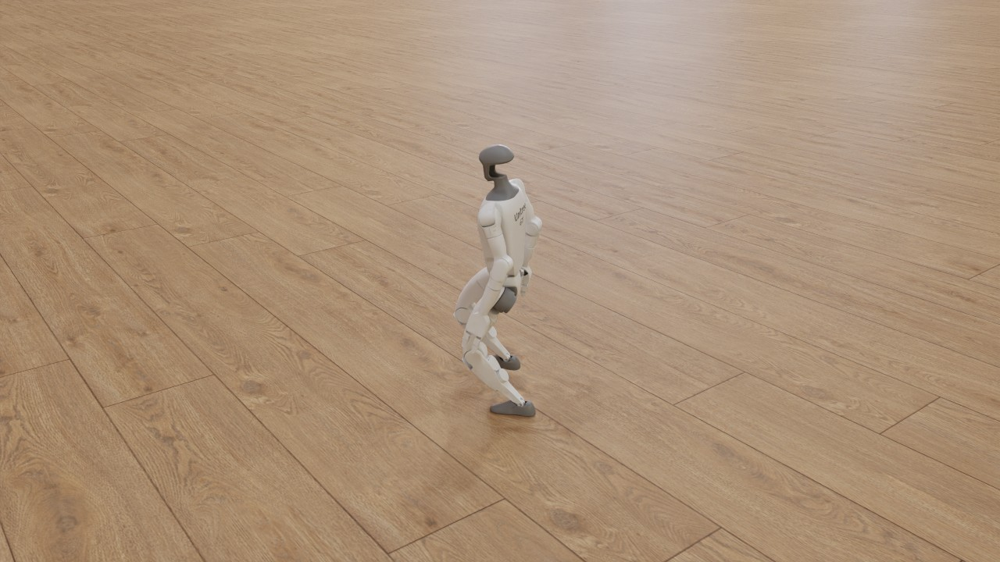
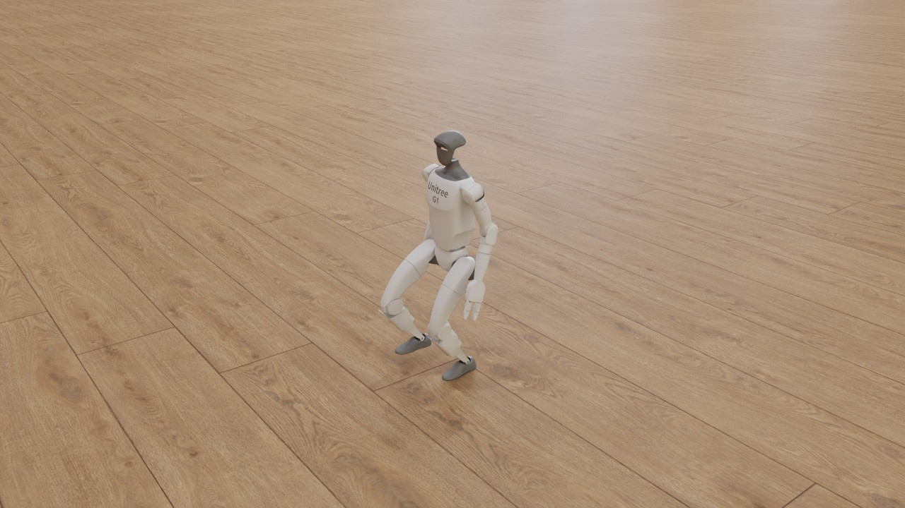
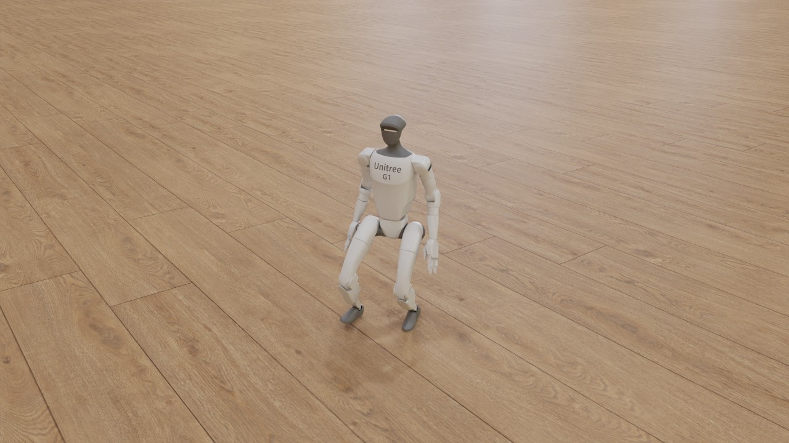

# G1 flat-terrain walk: a metalsim render

Unitree G1 walking on flat ground: Isaac Lab's G1 flat velocity task on metalsim (MuJoCo Warp on Metal), driven by a policy trained here with the task's PPO settings. This take was filmed on the 14-inch M4 Max on battery in Low Power Mode, so its Performance table is not a timing figure.

**hero** (301 frames, 6.0 s at 50 fps): [video](g1_flat.mp4) (2.0 MB, H.264)





## What is shown

- 16 envs simulated, filmed: 6, 2, 3, 0 (selection: automatic, the adapter ranking).
  - env 6: terminated False, time_out False, base_z 0.000, level 0, col 0, end_frame -1
  - env 2: terminated False, time_out False, base_z 0.000, level 0, col 0, end_frame -1
  - env 3: terminated False, time_out False, base_z 0.000, level 0, col 0, end_frame -1
  - env 0: terminated False, time_out False, base_z 0.000, level 0, col 0, end_frame -1
- Policy: `runs/g1regress/ckpt14/flat_main_s0.pt` (iteration 500); physics: MuJoCo Warp BatchSim (metalsim.learn.g1_velocity).

## Performance

Measured on the machine below; one frame = one policy step (Isaac Lab's `render_fps` = 1 / step_dt).

| stage | measurement |
|---|---|
| simulate (record) | 301 frames x 16 envs: 42 ms/frame mean (42 median, first 96 incl. graph capture), 12.8 s total; env build 9.7 s; stage wall 26.5 s |
| render twin (CPU) | 47 geoms, 46 meshes, 0 textures; build 0.5 s, poses 0.0 s |
| render: hero | 1280x720 (1x1 panels of 1280x720), tier 2 path tracing, 64 spp (16 passes x 4), 3 bounces, denoiser oidn; 0.24 s/frame mean (0.24 median, 0.26 max), 73.6 s for 301 frames; first frame: one pass 53 ms, 7 ms per further pass; set-up 1.0 s |
| encode: hero | 3.1 s (master CRF 16 + docs copy CRF 22, libx264 slow) |
| render: readme | 640x480 (1x1 panels of 640x480), tier 2 path tracing, 64 spp (16 passes x 4), 3 bounces, denoiser oidn; 0.11 s/frame mean (0.11 median, 0.12 max), 32.8 s for 301 frames; first frame: one pass 19 ms, 4 ms per further pass; set-up 0.8 s |
| end to end | 2.3 min (record + render + encode, sum of stage walls) |

## Hardware and pins

- Mac16,6 (Apple M4 Max, 40 GPU cores, 64 GB), macOS 27.0.1 (26A434).
- metalsim `687f3d7b1d+dirty`; record stage (main venv): warp 1.18.0.dev20260917 (`4127c48183`), mujoco 3.14.0, mujoco_warp 3.14.0 (`07a51a63bc`), torch 2.14.0, numpy 2.5.3.
- render stage (main venv): warp 1.18.0.dev20260917 (`4127c48183`), mujoco 3.14.0, numpy 2.5.3.

## Assets

| asset | source | licence | where from |
|---|---|---|---|
| Unitree G1 (g1_minimal.usd, Isaac 5.1 asset root) | NVIDIA Isaac Lab assets | NVIDIA Isaac Sim asset terms (fetched, not redistributed) | https://omniverse-content-production.s3-us-west-2.amazonaws.com/Assets/Isaac/5.1/Isaac/IsaacLab/Robots/Unitree/G1/g1_minimal.usd (`scripts/fetch_isaac_assets.sh`) |
| Studio HDRI (poly_haven_studio, 2k) | Poly Haven | CC0 1.0 (Poly Haven; fetched, not committed) | https://polyhaven.com/a/poly_haven_studio (`scripts/fetch_polyhaven_assets.sh train`) |
| Floor texture (laminate_floor_02, 1k diffuse) | Poly Haven | CC0 1.0 (Poly Haven; fetched, not committed) | https://polyhaven.com/a/laminate_floor_02 (`scripts/fetch_polyhaven_assets.sh train`) |
| Policy checkpoint flat_main_s0.pt (trained on metalsim, 500 iterations; sha256 6fbfbfe8...) | this repository | this repository's licence | `runs/g1regress/ckpt14/flat_main_s0.pt` (`committed`) |

## How it was made

**The policy.** `runs/g1regress/ckpt14/flat_main_s0.pt`, sha256
`6fbfbfe8b950ab27e82afc912fbc3d5484c5b5050dc288cdecd32350b9917057` (675,619 bytes; the record stage writes the same
hash into `rec.json`). Trained on main on 2026-10-13 on the 14-inch M4 Max with the documented G1 flat run's
settings (`runs/ellip_default/run.sh`: `python -m metalsim.learn.g1_velocity 4096 flat train 500 <log> <checkpoint>
0.0025 --reward_cfg flat --seed 0`): 4,096 envs, physics dt 2.5 ms with decimation 8 (50 Hz control), rollouts of 24
steps, 500 iterations (49.2 M env steps), actor MLP 256-128-128 on a 123-dim observation, the elliptic contact
default (`contact_cfg="recommended"`). Training log: `runs/g1regress/ckpt14/flat_main_s0.log` (its header has every
setting; iteration 500: return +18.64, episode length 996 of 1,000 control steps).
`docs/research/ppowarp_checkpoint_load_2026-10-13.md` compares the curve with the three documented elliptic-default
seeds of 2026-09-26 (`runs/ellip_default/g1_flat_ellip_default_s{0,1,2}.log`, `docs/PARITY.md` §1.5: +17.0 to +17.4
at iteration 500) and replays the policy on the 16-inch: 1,012 of 1,024 episodes run to the 20 s time-out, 17 falls
over 1,200 control steps (`runs/g1regress/replay_main_flat_it500.log`; the replay checks that the loaded weights are
the ones that run, after the PPOWarp load bug that note fixes; the film's adapter evaluates its own torch module and
was never affected). The file is the training run's output, copied unchanged (the log's last line names it) and
tracked so that a fresh clone can film. It replaces `runs/policies/g1_flat_1500.pt`, the earlier default, which has
no training log and falls in 16 of 16 envs within 8 s (`docs/research/readme_media_plan_2026-10-31.md` section 2,
defect 1).

**Task settings.** `metalsim.learn.g1_velocity.G1VelocityTask(16, terrain="flat", seed=3)` with the settings saved
in the checkpoint (`reward_cfg="flat"`, `contact_cfg="recommended"`, base and feet-slide velocities at the COM, no
Isaac Lab 3 events; `rec.json` `adapter.saved_task_settings`) plus the one it does not
save, physics dt 2.5 ms, from the training log's header (`G1_TRAIN_TASK_KW`). `rec.json` `adapter.task_resolved`
lists what ran. The policy acts with its actor's mean. Commands are the task's own, as in training (Isaac's uniform
velocity command with a heading target, resampled every 10 s). An episode ends on the task's terminations (torso
contact above 1 N, a non-finite state) or its 20 s time-out. The film is 6 s: 301 frames, one per 20 ms policy step
(50 fps).

**How the env was chosen.** 16 envs are simulated, and `envs="auto"` lets the adapter rank them (`G1Flat.rank`):
first the envs whose first episode was not ended by a termination, then those whose pelvis never dropped more than
0.25 m below its start (a robot down without torso contact, which the task does not terminate), then the longest
path. The record stage refuses to film an env whose first episode terminated unless `--allow-early-end` is given.
In this take none of the 16 terminated, the largest pelvis drop was 0.11 m, and env 6, filmed, walked the longest
path: 5.61 m in 6 s (`rec.json` `adapter.first_episode`). Under "What is shown", `base_z`, `level` and `col` are
written only when an episode ends; with `end_frame` -1 (still running when the film ends) their zeros are
placeholders. That list is the top four of the ranking (the record keeps spares); both shots film one env, the first
(`render.json` `envs`).

**Camera.** Both shots track the pelvis as Isaac's `ViewerCfg(origin_type="asset_body", body_name="pelvis")` does,
the tracked point smoothed by a centred 1 s moving average (`smooth_s`), with Kit's default perspective lens (36 deg
vertical field of view). `hero` (1280x720; the video and stills on this page): eye (2.6, -2.0, 1.3) m from the pelvis,
looking at (0, 0, -0.05) m, 3.55 m away. `readme` (640x480, 4:3, for the README grid): the same direction and
look-at at 0.75 times the distance (eye (1.95, -1.5, 0.98) m, 2.66 m), so the robot fills about three quarters of the
frame height, plus a slow orbit of 10 deg/s about the vertical through the look-at point, symmetric about the middle
of the film: -30 deg at 0 s, 0 at 3 s (the hero's direction), +30 deg at 6 s, counter-clockwise seen from above, as
MuJoCo's azimuth grows. The orbit copies MuJoCo Warp's README clips: `mujoco_warp/record.py` (google-deepmind/
mujoco_warp at `d41a47c0`, lines 43 and 142) sets `cam.azimuth = 90 + (step - nstep / 2) * cam_azimuth_speed` with
0.05 deg per physics step, and its G1 scenes step at 5 ms (`benchmarks/unitree_g1/unitree_g1_mjlab.xml`, line 14),
so 10 deg/s.

**Rendering.** Tier 2 (the path tracer), 64 samples per pixel (16 passes x 4), 3 bounces, Open Image Denoise, ACES
tone map, sRGB; lit by a Poly Haven studio HDRI as an importance-sampled dome, with a laminate floor texture on the
task's ground instead of Isaac's grey ground. The render twin is the task's own G1 model with Isaac's visual meshes
(`build_g1_model(visuals=True)`), posed per frame from the recorded joint state. On bodies that have visual meshes the
colliders are hidden (the three `*Cube` boxes, `rec.json` `twin.visibility`), and the touch-sensor sites are hidden:
one of them, `torso_link_touch`, was the grey box of the earlier G1 film. The ray tracer's env cell is sized up front
from the recorded geometry and the whole camera path, so the floor is drawn complete to the horizon (`render.json`
`env_grid.growths` 0). Each `render.json` carries a `cache_key`, a hash of the recording and of every setting that
changes a pixel, so a re-recording into the same directory re-renders rather than reusing old frames
(`docs/research/readme_media_plan_2026-10-31.md` section 2, defects 2, 3 and 5).

**README clip.** [g1_flat.webp](g1_flat.webp) is the `readme` shot from 0.5 s to 5.5 s (frames 25 to 274), resampled
from 50 to 30 fps and written as MuJoCo Warp writes its README clips: 320x240 (Lanczos), lossy animated WebP from
Pillow at quality 70, 33 ms per frame, looping; 150 frames. Command (re-run on 2026-10-31 from `runs/film/g1_flat`, byte
for byte the same file):
`python -m metalsim.render.film.encode webp runs/film/g1_flat/readme/frames docs/renders/g1_flat.webp --start 0.5
--seconds 5 --src-fps 50 --fps 30`. The film tool's route, `python -m metalsim.render.film g1_flat --stage encode
--shots readme --webp --webp-window 0.5:5`, uses the same encoder but names its output `g1_flat_readme.webp` and also
writes a `g1_flat_readme.mp4` and a still.

**This take, and where its timings come from.** Recorded, rendered and encoded on 2026-10-31 on the 14-inch M4 Max
(Mac16,6) **on battery in Low Power Mode**, at metalsim `687f3d7b` plus the uncommitted film-tool fixes (hence
`+dirty` in the pins). The Performance table above records how long each stage took there. It is not a timing figure:
quote nothing on this page as MetalSim's speed. MetalSim's throughput figures are in `docs/PARITY.md` §1.4 and §1.8
(16-inch, on power). Record and render ran as GPU-queue jobs of kind render, one at a time: `--stage record` into
`runs/readme_media/film/g1_flat`, then `--stage render` for both shots there. The take was then moved to
`runs/film/g1_flat` (the tool's default `--out`), where `--stage encode --shots hero` and `--stage doc` ran (CPU).
Nothing was re-recorded. A new recording is another take of the same policy, not this one: the GPU rollout is not
bitwise repeatable, so which env is filmed, and its path, can change.

## Reproduce

```bash
scripts/fetch_isaac_assets.sh                # NVIDIA assets (not redistributed)
scripts/fetch_polyhaven_assets.sh train      # CC0 HDRI and textures
python -m metalsim.render.film g1_flat   # record, render, encode, doc (main venv)
# or stage by stage (resumable):
python -m metalsim.render.film g1_flat --stage record   # runs in the .venv venv
python -m metalsim.render.film g1_flat --stage render
python -m metalsim.render.film g1_flat --stage encode
python -m metalsim.render.film g1_flat --stage doc
```

Generated by `python -m metalsim.render.film g1_flat --stage doc` from the stage logs (`runs/film/g1_flat/rec/rec.json`, `render.json`, `render_frames.jsonl`, `encode.json` per shot).
