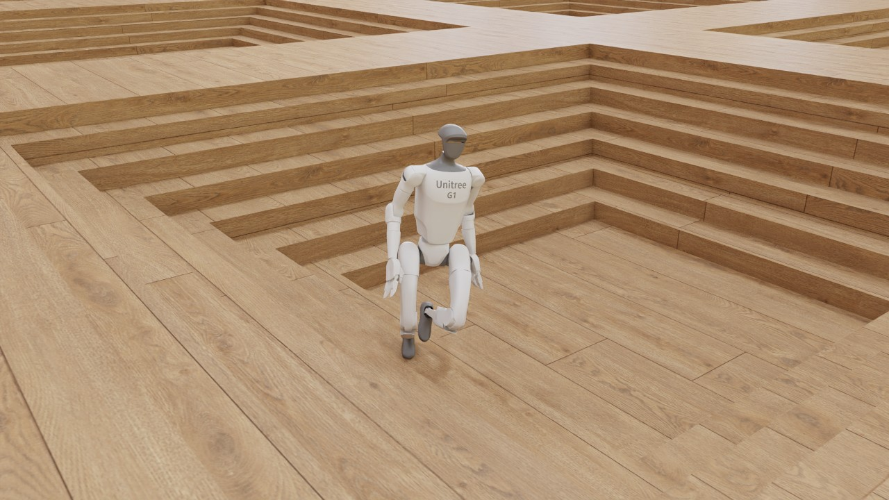
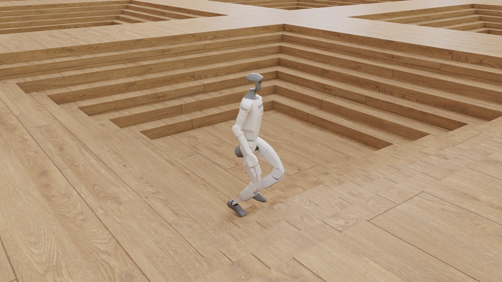
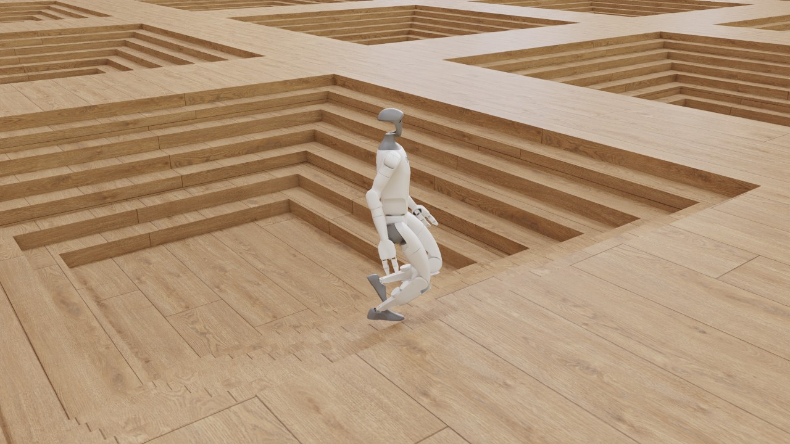

# G1 rough-terrain walk: a metalsim render

Unitree G1 climbing Isaac Lab's rough terrain: the G1 rough velocity task (stairs, slopes, boxes, height scan) on metalsim (MuJoCo Warp on Metal), driven by NVIDIA's published Isaac Lab 2.3 policy for the task (rsl_rl, iteration 2999, trained in PhysX), played without retraining. Rendered on the 14-inch MacBook Pro (Mac16,6), not in a timing run, so its Performance table is not a timing figure.

**hero** (301 frames, 6.0 s at 50 fps): [video](g1_rough.mp4) (2.5 MB, H.264)





## What is shown

- 40 envs simulated, filmed: 8, 15, 14, 12 (selection: automatic, the adapter ranking).
  - env 8: terminated False, time_out False, base_z 0.000, level 0, col 0, end_frame -1
  - env 15: terminated False, time_out False, base_z 0.000, level 0, col 0, end_frame -1
  - env 14: terminated False, time_out False, base_z 0.000, level 0, col 0, end_frame -1
  - env 12: terminated False, time_out False, base_z 0.000, level 0, col 0, end_frame -1
- Policy: `assets/isaac/pretrained/rsl_rl/Isaac-Velocity-Rough-G1-v0/checkpoint.pt` (iteration 2999); physics: MuJoCo Warp BatchSim (metalsim.learn.g1_velocity).

## Performance

Measured on the machine below; one frame = one policy step (Isaac Lab's `render_fps` = 1 / step_dt).

| stage | measurement |
|---|---|
| simulate (record) | 301 frames x 40 envs: 67 ms/frame mean (67 median, first 87 incl. graph capture), 20.2 s total; env build 3.0 s; stage wall 27.7 s |
| render twin (CPU) | 48 geoms, 47 meshes, 0 textures; build 0.6 s, poses 0.0 s |
| render: hero | 1280x720 (1x1 panels of 1280x720), tier 2 path tracing, 64 spp (16 passes x 4), 3 bounces, denoiser oidn; 0.44 s/frame mean (0.44 median, 0.52 max), 2.2 min for 301 frames; first frame: one pass 66 ms, 22 ms per further pass; set-up 1.8 s |
| encode: hero | 3.2 s (master CRF 16 + docs copy CRF 22, libx264 slow) |
| render: readme | 640x480 (1x1 panels of 640x480), tier 2 path tracing, 64 spp (16 passes x 4), 3 bounces, denoiser oidn; 0.17 s/frame mean (0.17 median, 0.24 max), 51.3 s for 301 frames; first frame: one pass 23 ms, 8 ms per further pass; set-up 1.7 s |
| end to end | 3.6 min (record + render + encode, sum of stage walls) |

## Hardware and pins

- Mac16,6 (Apple M4 Max, 40 GPU cores, 64 GB), macOS 27.0.1 (26A434).
- Power as each stage stamped it (`pmset -g batt` and `pmset -g`; `hardware.power`: the record stage's when it wrote rec.json, a render shot's at its first frame): record: on battery (60 %, discharging), power-mode setting High Power (pmset `powermode 2`), 2026-10-31 04:54 (-0700); render hero: on battery (59 %, discharging), power-mode setting High Power (pmset `powermode 2`), 2026-10-31 04:58 (-0700); render readme: on battery (52 %, discharging), power-mode setting High Power (pmset `powermode 2`), 2026-10-31 05:00 (-0700).
- metalsim `ef346e7efc+dirty`; record stage (main venv): warp 1.18.0.dev20260917 (`4127c48183`), mujoco 3.14.0, mujoco_warp 3.14.0 (`07a51a63bc`), torch 2.14.0, numpy 2.5.3.
- render stage (main venv): warp 1.18.0.dev20260917 (`4127c48183`), mujoco 3.14.0, numpy 2.5.3.

## Assets

| asset | source | licence | where from |
|---|---|---|---|
| Unitree G1 (g1_minimal.usd, Isaac 5.1 asset root) | NVIDIA Isaac Lab assets | NVIDIA Isaac Sim asset terms (fetched, not redistributed) | https://omniverse-content-production.s3-us-west-2.amazonaws.com/Assets/Isaac/5.1/Isaac/IsaacLab/Robots/Unitree/G1/g1_minimal.usd (`scripts/fetch_isaac_assets.sh`) |
| Studio HDRI (poly_haven_studio, 2k) | Poly Haven | CC0 1.0 (Poly Haven; fetched, not committed) | https://polyhaven.com/a/poly_haven_studio (`scripts/fetch_polyhaven_assets.sh train`) |
| Floor texture (laminate_floor_02, 1k diffuse) | Poly Haven | CC0 1.0 (Poly Haven; fetched, not committed) | https://polyhaven.com/a/laminate_floor_02 (`scripts/fetch_polyhaven_assets.sh train`) |
| Rough terrain: Isaac Lab 2.3.2 ROUGH_TERRAINS_CFG (10 x 20 sub-terrains of 8 m), generated from the task seed | Isaac Lab task config (port: metalsim.learn.isaac_terrain) | BSD-3-Clause | https://github.com/isaac-sim/IsaacLab (`procedural (metalsim.learn.terrain)`) |
| Policy: Isaac Lab 2.3 pretrained rsl_rl checkpoint (Isaac-Velocity-Rough-G1-v0, iteration 2999; sha256 d85a9ade...) | NVIDIA Isaac Lab | NVIDIA Isaac Sim asset terms (fetched, not redistributed) | https://omniverse-content-production.s3-us-west-2.amazonaws.com/Assets/Isaac/5.1/Isaac/IsaacLab/PretrainedCheckpoints/rsl_rl/Isaac-Velocity-Rough-G1-v0/checkpoint.pt (`scripts/fetch_isaac_assets.sh`) |

## How it was made

**The policy.** NVIDIA's published Isaac Lab 2.3 checkpoint for `Isaac-Velocity-Rough-G1-v0`: rsl_rl, iteration
2999, the last of the task's 3,000 (`assets/isaac/g1_rsl_rl_ppo_cfg.py`, `G1RoughPPORunnerCfg`), trained by NVIDIA in
Isaac Sim with PhysX on Isaac's terrain curriculum. MetalSim plays it as published, without retraining or fine-tuning.
Source:
<https://omniverse-content-production.s3-us-west-2.amazonaws.com/Assets/Isaac/5.1/Isaac/IsaacLab/PretrainedCheckpoints/rsl_rl/Isaac-Velocity-Rough-G1-v0/checkpoint.pt>
(the path Isaac Lab's `--use_pretrained_checkpoint` resolves, `isaaclab_rl/utils/pretrained_checkpoint.py`, under
the Isaac 5.1 asset root), sha256 `d85a9adea70e5476675f130cbc70f41bdef7a28d52f443fae902afc0e2358851`, 7,842,530
bytes. It is NVIDIA's file under NVIDIA's asset terms: `scripts/fetch_isaac_assets.sh` downloads it to
`assets/isaac/pretrained/rsl_rl/Isaac-Velocity-Rough-G1-v0/checkpoint.pt` and checks the hash; `.gitignore` (`*.pt`)
keeps it out of the repository. The record stage refuses a file whose sha256 is not the published one and writes the
source URL, the published hash, the format and the iteration into `rec.json` `checkpoint` (`in_repo` false). The
actor is an ELU MLP, 310 -> 512-256-128 -> 37 with no observation normaliser (123 inputs as on flat ground plus the
187-ray height scan), read from the checkpoint's `actor.*` weights with `torch.load(weights_only=True)`
(`adapters.load_g1_checkpoint`); the film plays the actor's mean. NVIDIA publishes no training log for it (the
checkpoint's `infos` is None).

Our own checkpoint stays selectable and tracked: `--checkpoint runs/g1regress/ckpt14/rough_main_s0.pt` (1,000 iterations trained
in MetalSim, its training log beside it) films it with the task settings that checkpoint saved, and this page's text
then does not describe the policy that ran. The previous take of this page, in git history at `ef346e7e`, filmed it.

**Task settings.** `metalsim.learn.g1_velocity.G1VelocityTask(40, terrain="rough", seed=0)` with the settings Isaac's
checkpoint implies (`adapters.ISAAC_TASK_SETTINGS["rough"]`: `reward_cfg="rough_isaac"`, the exact port of
`G1RoughEnvCfg`, forward and turning commands only; height-scan ray order `xy`, Isaac's, which the adapter requires
for an Isaac policy) and the task's defaults (exact height scan, terrain collision `boxes_local`,
`contact_cfg="recommended"`, velocities at the COM), plus physics dt 2.5 ms with decimation 8 (`G1_TRAIN_TASK_KW`).
The exact scan and `boxes_local` collision are what `scripts/diagnostics/g1_rough_transfer.py` played Isaac's rough
checkpoints with (that tool read the base velocity at the pelvis origin, the film at the COM as Isaac Lab 2.3.2 does):
the final one of the project's L4 run fell 0 times in 32 wall-cell episodes (`docs/PARITY.md` §1.5, "Transfer of
Isaac's checkpoints on the wall cells"). `rec.json` `adapter.task_resolved` lists what ran.
The policy's observation is Isaac's policy group in Isaac's order (base linear and angular velocity, projected
gravity, command, joint positions, joint velocities, last action; on rough terrain then the 187 height-scan rays in
Isaac's "xy" order), computed by the task's own kernel. The joint blocks and the actions are in Isaac's joint order
(PhysX's breadth-first articulation order, `adapters.ISAAC_G1_JOINTS`), mapped to MetalSim's by joint name as
`metalsim/parity/side_by_side.py` does; the actions are Isaac's joint-position targets (scale 0.5 about the default
pose). The task always applies Isaac's training observation noise, which Isaac's PLAY configuration turns off; on flat
ground that changed no measured gait figure (`runs/readme_media/handoff/isaac-pretrained.md`, Verified B). The terrain is Isaac Lab 2.3.2's
`ROUGH_TERRAINS_CFG` (10 difficulty rows by 20 columns of 8 m sub-terrains; by column, pyramid stairs, inverted
pyramid stairs, random boxes, random rough ground, slopes and inverted slopes), generated from task seed 0, whose
origin table equals Isaac's at env seed 0 (`docs/PARITY.md` §1.5). Which random draw NVIDIA trained on is not
published. `adapter_kw["terrain_level"] = 5` starts every env on difficulty row 5 instead of the task's random rows 0
to 5: Isaac Lab's own training of this task holds a mean terrain level of 5.9 to 6.0 from about iteration 750
(`docs/PARITY.md` §1.5, the like-for-like rough table), and on this row the inverted stairs have risers of 0.14 to
0.16 m. The 40 envs sit two per column (`rec.json` `adapter.terrain_types`). Actions, commands, terminations and the
6 s, 50 fps film are as in the flat film.

**How the env was chosen.** `envs="auto"` ranks the 40 envs (`G1Rough.rank`). First come the envs whose first episode
was not ended by a termination, then the natural-gait preference of the flat film (`adapters.natural_gait`: lower
swing apex at least the candidates' median and larger stance slip at most their median), then the highest climb of
the pelvis above its start, then the longest path. The record stage refuses to film an env whose first episode
terminated unless `--allow-early-end` is given. In this take none of the 40 terminated, and 10 envs passed the gait
preference (`rec.json` `gait.natural_gait_envs`). Env 8, filmed, is on column 4 (inverted pyramid stairs) and climbed
out of the pit: its pelvis rose 0.97 m, about six risers, over a 5.11 m path, the highest climb of all 40 envs (next
among the preferred: env 15, 0.79 m; env 14, 0.65 m; `rec.json` `adapter.first_episode`). Under "What is shown",
`base_z`, `level` and `col` are written only when an episode ends; with `end_frame` -1 (still running when the film
ends) their zeros are placeholders, not the env's level (5) or column (4). That list is the top four of the ranking
(the record keeps spares); both shots film one env, the first (`render.json` `envs`).

**Gait.** Measured as on flat ground (`rec.json` `gait`, with its definition; `record.GAIT_DEFINITION`), with each
foot's height taken above the highest terrain under its footprint. Env 8, filmed: 0.88 m/s at a commanded 0.89 m/s;
3.19 / 3.39 touch-downs per second (left / right), about 0.27 m per gait cycle; stance slip 0.043 / 0.044 m/s;
airborne 57 / 65 % of the time. While it climbs, the foot rises from the lower tread over the next riser, so its swing
apex, 28 / 27 cm, includes the riser, and the foot-height spectrum mixes the climb with the steps (its peak, 2.6 Hz,
is not the cadence: read the touch-downs). Medians over the 40 envs, most of them not on stairs: 0.48 m/s (commanded
0.40), 3.39 touch-downs per second on each foot (spectral peak 3.31 / 3.30 Hz), apex 11.9 / 13.7 cm, slip 0.049 /
0.029 m/s.

**The quick, short-stepping gait is Isaac's own.** Isaac Lab's G1 policies walk this way in PhysX too. Checkpoints of
the flat task trained with Isaac Lab in Isaac Sim (this project's L4 training run, iterations 500 / 1000 / 1499,
played in Isaac Sim at 0.5 m/s) step at 3.85 / 3.60 / 3.23 Hz with 0.108 / 0.110 / 0.123 m per gait cycle
(`docs/research/speculative_contacts_2026-09-27.md`, Verdict 1 and the cadence table of §2). MuJoCo Warp adds 3.4 to
5.9 % to the cadence of the same checkpoints under every contact setting measured (same note). NVIDIA's published
checkpoint itself was not played in PhysX for this page: Isaac Sim does not run on this machine.

**Terrain in the render.** The twin carries the task's own collision surface: its heightfield (2001 x 1201 samples
at 0.1 m) and Isaac's 14,080 terrain boxes merged into one mesh, `terrain_boxes`, with planar UVs on each face so
that the floor texture lies flat on treads and risers; both take the laminate texture (`ground_geoms`).

**Camera.** Both shots track the pelvis as Isaac's `ViewerCfg(origin_type="asset_body", body_name="pelvis")` does,
the tracked point smoothed by a centred 1 s moving average (`smooth_s`), with Kit's default perspective lens (36 deg
vertical field of view). `hero` (1280x720; the video and stills on this page): eye (2.6, -2.0, 1.3) m from the pelvis,
looking at (0, 0, -0.05) m, 3.55 m away. `readme` (640x480, 4:3, for the README grid): the same direction and
look-at at 0.75 times the distance (eye (1.95, -1.5, 0.98) m, 2.66 m), so the robot fills about three quarters of the
frame height, plus a slow orbit of 10 deg/s about the vertical through the look-at point, symmetric about the middle
of the film: -30 deg at 0 s, 0 at 3 s (the hero's direction), +30 deg at 6 s, counter-clockwise seen from above, as
MuJoCo's azimuth grows. The orbit copies MuJoCo Warp's README clips: `mujoco_warp/record.py` (google-deepmind/
mujoco_warp at `d41a47c0`, lines 43 and 142) sets `cam.azimuth = 90 + (step - nstep / 2) * cam_azimuth_speed` with
0.05 deg per physics step, and its G1 scenes step at 5 ms (`benchmarks/unitree_g1/unitree_g1_mjlab.xml`, line 14),
so 10 deg/s.

**Rendering.** Tier 2 (the path tracer), 64 samples per pixel (16 passes x 4), 3 bounces, Open Image Denoise, ACES
tone map, sRGB; lit by a Poly Haven studio HDRI as an importance-sampled dome, with a laminate floor texture on the
task's ground instead of Isaac's grey ground. The render twin is the task's own G1 model with Isaac's visual meshes
(`build_g1_model(visuals=True)`), posed per frame from the recorded joint state. On bodies that have visual meshes the
colliders are hidden (the three `*Cube` boxes, `rec.json` `twin.visibility`), and the touch-sensor sites are hidden:
one of them, `torso_link_touch`, was the grey box of the earlier G1 film. The ray tracer's env cell is sized up front
from the recorded geometry and the whole camera path, so the floor is drawn complete to the horizon (`render.json`
`env_grid.growths` 0). Each `render.json` carries a `cache_key`, a hash of the recording and of every setting that
changes a pixel, so a re-recording into the same directory re-renders rather than reusing old frames
(`docs/research/readme_media_plan_2026-10-31.md` section 2, defects 2, 3 and 5).

**README clip.** [g1_rough.webp](g1_rough.webp) is the `readme` shot from 0.5 s to 5.5 s (frames 25 to 274), resampled
from 50 to 30 fps and written as MuJoCo Warp writes its README clips: 320x240 (Lanczos), lossy animated WebP from
Pillow at quality 70, 33 ms per frame, looping; 150 frames. Command, run from the repository root after the render
stage: `python -m metalsim.render.film.encode webp runs/film/g1_rough/readme/frames docs/renders/g1_rough.webp --start 0.5
--seconds 5 --src-fps 50 --fps 30`. The film tool's route, `python -m metalsim.render.film g1_rough --stage encode
--shots readme --webp --webp-window 0.5:5`, uses the same encoder but names its output `g1_rough_readme.webp` and also
writes a `g1_rough_readme.mp4` and a still.

**This take, and where its timings come from.** Recorded, rendered and encoded on 2026-10-31 on the 14-inch MacBook
Pro (Mac16,6), at metalsim `ef346e7e` plus the uncommitted switch to Isaac's checkpoints (hence `+dirty` in the pins).
This was not a timing run: MetalSim's timing runs are made on the 16-inch through the GPU queue's timing kind
(`scripts/gpu_run.sh <name> timing <minutes> -- <command>`, which waits for an idle device), and its throughput
figures are in `docs/PARITY.md` §1.4 and §1.8. The Performance table above records how long each stage took here;
quote nothing on this page as MetalSim's speed. Power, as the stages stamped it (`pmset -g batt` and `pmset -g`;
"Hardware and pins" below): on battery and discharging at every stamp (60 % when the record stage wrote `rec.json` at 04:54, 59 % at the hero shot's first frame at 04:58 and 52 % at the readme shot's at 05:00, local time), with pmset's power-mode setting at High Power (`powermode 2`: the configured setting, which does not show that the machine ran in High Power Mode); the encode and doc stages stamp nothing. Record and render ran as GPU-queue jobs of kind render, one at a time,
into `runs/film/g1_rough` (the tool's default `--out`): `--stage record`, then `--stage render` (both shots); then
`--stage encode --shots hero`, the README WebP command above and `--stage doc` (CPU). A new recording is another take
of the same policy, not this one: the GPU rollout is not bitwise repeatable, so which env is filmed, and its path, can
change.

## Reproduce

```bash
scripts/fetch_isaac_assets.sh                # NVIDIA assets (not redistributed)
scripts/fetch_polyhaven_assets.sh train      # CC0 HDRI and textures
python -m metalsim.render.film g1_rough   # record, render, encode, doc (main venv)
# or stage by stage (resumable):
python -m metalsim.render.film g1_rough --stage record   # runs in the .venv venv
python -m metalsim.render.film g1_rough --stage render
python -m metalsim.render.film g1_rough --stage encode
python -m metalsim.render.film g1_rough --stage doc
```

Generated by `python -m metalsim.render.film g1_rough --stage doc` from the stage logs (`runs/film/g1_rough/rec/rec.json`, `render.json`, `render_frames.jsonl`, `encode.json` per shot).
