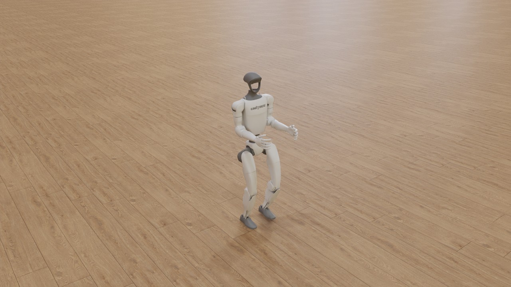
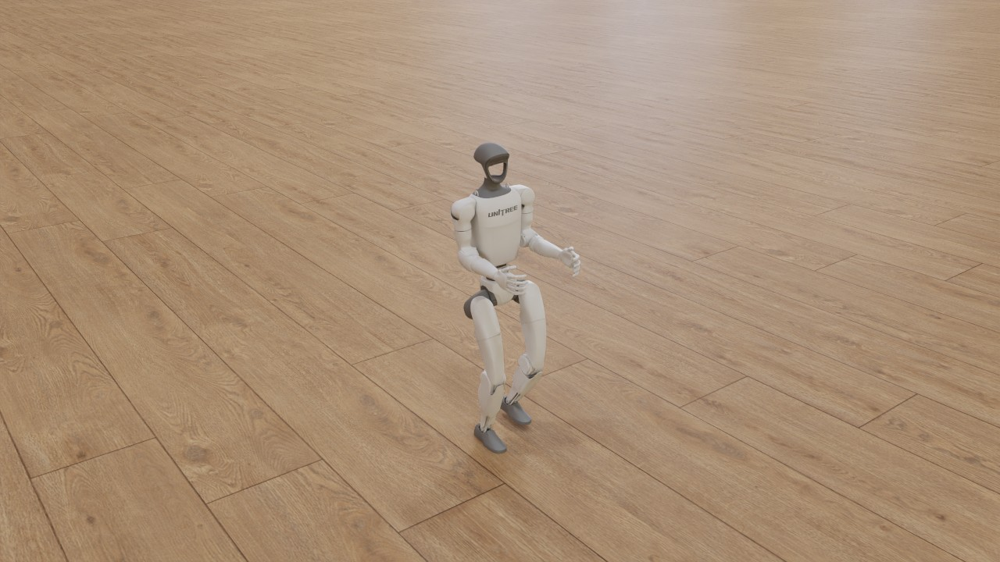
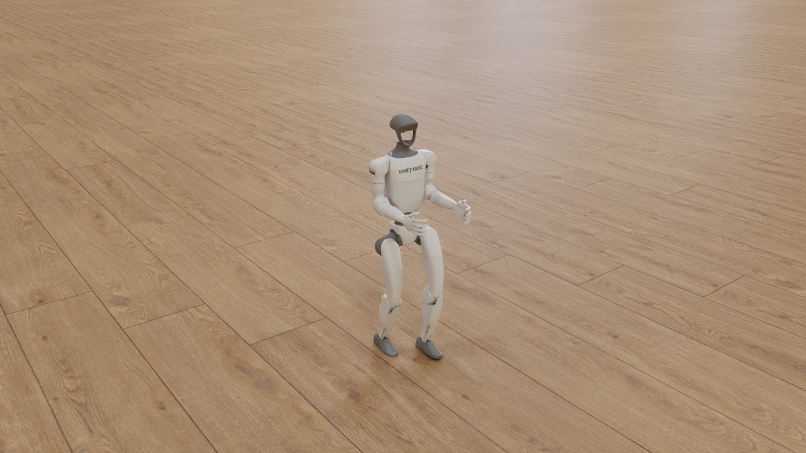

# G1 walk, Unitree's policy: a metalsim render

Unitree G1 walking on flat ground with Unitree's own pretrained walking policy ([unitree_rl_gym](https://github.com/unitreerobotics/unitree_rl_gym), [`deploy/pre_train/g1/motion.pt`](https://github.com/unitreerobotics/unitree_rl_gym/blob/276801e46c5d433564f24658bac64f254b7d2d4b/deploy/pre_train/g1/motion.pt), BSD-3-Clause), played by Unitree's [MuJoCo](https://github.com/google-deepmind/mujoco) sim2sim loop ([`deploy_mujoco.py`](https://github.com/unitreerobotics/unitree_rl_gym/blob/276801e46c5d433564f24658bac64f254b7d2d4b/deploy/deploy_mujoco/deploy_mujoco.py), [`configs/g1.yaml`](https://github.com/unitreerobotics/unitree_rl_gym/blob/276801e46c5d433564f24658bac64f254b7d2d4b/deploy/deploy_mujoco/configs/g1.yaml)) ported to [my fork of MuJoCo Warp](https://github.com/pulipakaa24/mujoco_warp/tree/metalsim) on Metal, on Unitree's own G1 model and meshes. Rendered on the 14-inch MacBook Pro (Mac16,6), not in a timing run, so its Performance table is not a timing figure.

**hero** (301 frames, 6.0 s at 50 fps): [video](g1_unitree.mp4) (1.5 MB, H.264)





## What is shown

- 4 envs simulated, filmed: 2, 1, 3, 0 (selection: automatic, the adapter ranking).
  - env 2: terminated False, base_z 0.000, end_frame -1
  - env 1: terminated False, base_z 0.000, end_frame -1
  - env 3: terminated False, base_z 0.000, end_frame -1
  - env 0: terminated False, base_z 0.000, end_frame -1
- Policy: `assets/unitree_rl_gym/deploy/pre_train/g1/motion.pt` (torchscript; not in the repository: `scripts/fetch_unitree_rl_gym.sh` fetches it); physics: MuJoCo Warp BatchSim (metalsim.physics.batch), Unitree's scene.xml; Unitree's PD torque every physics step (Warp kernel: before the first step of a policy step, then BatchSim.add_substep_hook after each).

## Performance

Measured on the machine below; one frame = one policy step ([Isaac Lab](https://github.com/isaac-sim/IsaacLab)'s `render_fps` = 1 / step_dt).

| stage | measurement |
|---|---|
| simulate (record) | 301 frames x 4 envs: 47 ms/frame mean (47 median, first 81 incl. graph capture), 14.0 s total; env build 1.7 s; stage wall 16.8 s |
| render twin (CPU) | 60 geoms, 27 meshes, 2 textures; build 0.0 s, poses 0.0 s |
| render: hero | 1280x720 (1x1 panels of 1280x720), tier 2 path tracing, 64 spp (16 passes x 4), 3 bounces, denoiser oidn; 0.25 s/frame mean (0.25 median, 0.34 max), 74.4 s for 301 frames; first frame: one pass 51 ms, 8 ms per further pass; set-up 1.2 s |
| encode: hero | 3.1 s (master CRF 16 + docs copy CRF 22, libx264 slow) |
| render: readme | 640x480 (1x1 panels of 640x480), tier 2 path tracing, 64 spp (16 passes x 4), 3 bounces, denoiser oidn; 0.11 s/frame mean (0.11 median, 0.12 max), 32.8 s for 301 frames; first frame: one pass 19 ms, 4 ms per further pass; set-up 0.9 s |
| end to end | 2.2 min (record + render + encode, sum of stage walls) |

## Hardware and pins

- Mac16,6 (Apple M4 Max, 40 GPU cores, 64 GB), macOS 27.0.1 (26A434).
- Power as each stage stamped it (`pmset -g batt` and `pmset -g`; `hardware.power`: the record stage's when it wrote rec.json, a render shot's at its first frame): record: on battery (86 %, discharging), power-mode setting High Power (pmset `powermode 2`), 2026-10-31 15:52 (-0700); render hero: on AC power (79 %, charging), power-mode setting High Power (pmset `powermode 2`), 2026-10-31 21:48 (-0700); render readme: on AC power (79 %, charging), power-mode setting High Power (pmset `powermode 2`), 2026-10-31 21:50 (-0700).
- metalsim [`ed66d8ef3e+dirty`](https://github.com/pulipakaa24/MetalSim/commit/ed66d8ef3ecd7f17aa16207231000b1d22ff7812); record stage (main venv): warp 1.18.0.dev20260917 ([`4127c48183`](https://github.com/pulipakaa24/warp/commit/4127c4818334080de6f3d23aef522e582ff6a2a7)), mujoco 3.14.0, mujoco_warp 3.14.0 ([`8eb51fe637`](https://github.com/pulipakaa24/mujoco_warp/commit/8eb51fe637437108185f5a4750b7f5f64ef26624)), torch 2.14.0, numpy 2.5.3.
- render stage (main venv): warp 1.18.0.dev20260917 ([`52c09cdd82`](https://github.com/pulipakaa24/warp/commit/52c09cdd82f79e8564b5ae17cdcee7b52d10d075)), mujoco 3.14.0, numpy 2.5.3.

## Assets

| asset | source | licence | where from |
|---|---|---|---|
| Unitree G1, 12-dof legs model (g1_12dof.xml in scene.xml) and its STL meshes | Unitree Robotics unitree_rl_gym | BSD-3-Clause | https://github.com/unitreerobotics/unitree_rl_gym/blob/276801e46c5d433564f24658bac64f254b7d2d4b/resources/robots/g1_description (`scripts/fetch_unitree_rl_gym.sh`) |
| Policy: Unitree's pretrained G1 walking policy deploy/pre_train/g1/motion.pt (TorchScript; sha256 cf668f75...) | Unitree Robotics unitree_rl_gym | BSD-3-Clause | https://github.com/unitreerobotics/unitree_rl_gym/blob/276801e46c5d433564f24658bac64f254b7d2d4b/deploy/pre_train/g1/motion.pt (`scripts/fetch_unitree_rl_gym.sh`) |
| Sim2sim playback loop and config (deploy_mujoco.py, configs/g1.yaml), ported to MuJoCo Warp | Unitree Robotics unitree_rl_gym | BSD-3-Clause | https://github.com/unitreerobotics/unitree_rl_gym/blob/276801e46c5d433564f24658bac64f254b7d2d4b/deploy/deploy_mujoco (`scripts/fetch_unitree_rl_gym.sh`) |
| Studio HDRI (poly_haven_studio, 2k) | Poly Haven | CC0 1.0 (Poly Haven; fetched, not committed) | https://polyhaven.com/a/poly_haven_studio (`scripts/fetch_polyhaven_assets.sh train`) |
| Floor texture (laminate_floor_02, 1k diffuse) | Poly Haven | CC0 1.0 (Poly Haven; fetched, not committed) | https://polyhaven.com/a/laminate_floor_02 (`scripts/fetch_polyhaven_assets.sh train`) |

## How it was made

**The policy.** Unitree's own pretrained G1 walking policy from Unitree's `unitree_rl_gym`
(<https://github.com/unitreerobotics/unitree_rl_gym>, BSD-3-Clause, commit
[`276801e`](https://github.com/unitreerobotics/unitree_rl_gym/commit/276801e46c5d433564f24658bac64f254b7d2d4b)):
[`deploy/pre_train/g1/motion.pt`](https://github.com/unitreerobotics/unitree_rl_gym/blob/276801e46c5d433564f24658bac64f254b7d2d4b/deploy/pre_train/g1/motion.pt), the file both of Unitree's playback
scripts load, the MuJoCo sim2sim one
([`deploy/deploy_mujoco/configs/g1.yaml`](https://github.com/unitreerobotics/unitree_rl_gym/blob/276801e46c5d433564f24658bac64f254b7d2d4b/deploy/deploy_mujoco/configs/g1.yaml), `policy_path`) and the
one for the real robot ([`deploy/deploy_real/configs/g1.yaml`](https://github.com/unitreerobotics/unitree_rl_gym/blob/276801e46c5d433564f24658bac64f254b7d2d4b/deploy/deploy_real/configs/g1.yaml#L10),
line 10). sha256 `cf668f75b90d1abf73d2b87612a6e76bccc61ff7e083b63582d3f6aaa3c1759d`, 145,745 bytes, as fetched. It is a
TorchScript module: an LSTM (47 inputs, 64 hidden) and an ELU MLP 64 -> 32 -> 12, loaded with `torch.jit.load` and
played as published. Unitree trained it with `legged_gym` on [Isaac Gym](https://developer.nvidia.com/isaac-gym)
([`legged_gym/envs/g1/g1_config.py`](https://github.com/unitreerobotics/unitree_rl_gym/blob/276801e46c5d433564f24658bac64f254b7d2d4b/legged_gym/envs/g1/g1_config.py), `G1RoughCfg` / `G1RoughCfgPPO`:
`ActorCriticRecurrent`, plane terrain, friction and added-mass randomization, pushes every 5 s; physics 5 ms x
decimation 4, so 50 Hz). Its gait is set by the training task, not left to the policy:
[`g1_env.py`](https://github.com/unitreerobotics/unitree_rl_gym/blob/276801e46c5d433564f24658bac64f254b7d2d4b/legged_gym/envs/g1/g1_env.py) feeds a fixed gait clock (period 0.8 s, so 1.25 gait cycles
per second; the right leg half a cycle behind the left) to the policy as sin / cos of the phase, and rewards foot
contact in the stance part of each leg's cycle (phase < 0.55, `_reward_contact`) and an 8 cm swing height of the
ankle-roll link (`_reward_feet_swing_height`). `scripts/fetch_unitree_rl_gym.sh` fetches the repository at that commit
into `assets/unitree_rl_gym/` (git-ignored, not committed); the record stage checks the policy's sha256 and writes the
repository, commit, file, licence and hash into `rec.json` `checkpoint` and `adapter`.

**Unitree's loop, on MuJoCo Warp.** Unitree plays the policy in MuJoCo with
[`deploy/deploy_mujoco/deploy_mujoco.py`](https://github.com/unitreerobotics/unitree_rl_gym/blob/276801e46c5d433564f24658bac64f254b7d2d4b/deploy/deploy_mujoco/deploy_mujoco.py) and
[`configs/g1.yaml`](https://github.com/unitreerobotics/unitree_rl_gym/blob/276801e46c5d433564f24658bac64f254b7d2d4b/deploy/deploy_mujoco/configs/g1.yaml): physics step 2 ms, a policy step every 10 physics steps (50 Hz), PD gains kp (100, 100, 100,
150, 40, 40) and kd (2, 2, 2, 4, 2, 2) per leg (hip pitch, roll, yaw, knee, ankle pitch, roll), default angles
(-0.1, 0, 0, 0.3, -0.2, 0) per leg, scales: angular velocity 0.25, joint position 1, joint velocity 0.05, action 0.25,
command (2, 2, 0.25); 12 actions, 47 observations, command (0.5, 0, 0) m/s, m/s, rad/s. The model is Unitree's
[`resources/robots/g1_description/scene.xml`](https://github.com/unitreerobotics/unitree_rl_gym/blob/276801e46c5d433564f24658bac64f254b7d2d4b/resources/robots/g1_description/scene.xml)
(`g1_12dof.xml`: the 12 leg joints; Euler integrator, pyramidal cones,
Newton solver, MuJoCo's defaults; four 5 mm collision spheres under each foot; `<motor>` actuators whose torque the
joints' `actuatorfrcrange` clamps). The film runs the same loop on MetalSim's MuJoCo Warp (`metalsim.physics.batch.BatchSim`,
4 worlds of that model; `metalsim/render/film/unitree.py`, `UnitreeG1`): Unitree computes the PD torque from
`d.qpos` / `d.qvel` before every `mj_step`, and so does the film, every 2 ms physics step: a Warp kernel before the
first physics step of each policy step and, through `BatchSim.add_substep_hook`, after every physics step inside the
captured step graph (`metalsim/physics/batch.py`, `_launch_substeps`), so each step is driven by the torque of the
state it starts from. The observation is built from the state after the tenth step, as Unitree's, in float64 and
stored as float32, with the gait clock read from the physics step counter (`counter * 0.002`). The policy keeps its
LSTM state inside the module (batch 1), so each world has its own loaded copy. No episode ends: Unitree's playback
has no termination or reset (a pelvis below 0.4 m would be reported as down; none was).

**Against Unitree's own run.** Unitree's loop itself (`deploy_mujoco.py`'s code unchanged, without its viewer and
wall-clock sleep) on CPU MuJoCo 3.14.0, 8 s, against the film's adapter on MuJoCo Warp with 4 worlds, both measured
with the same code (`record.gait_metrics`, window 1 to 8 s). Scripts and results: `runs/film/g1_unitree/sim2sim_check/`
(`reference.py`, CPU only, writes `reference.json`; `compare.py`, a GPU-queue job, writes `compare.json`).

| | Unitree's loop, CPU MuJoCo | MetalSim, MuJoCo Warp (4 worlds) |
|---|---|---|
| pelvis at 5 s (x, y, z) | (2.2244, -0.0988, 0.7703) m | the same to 0.1 mm; distance 1.4 to 1.8 um |
| pelvis at 8 s | (3.6469, -0.2573, 0.7723) m | distance 3.8 to 4.4 um |
| gait cycles per second (FFT of foot height), left / right | 1.251 / 1.251 | 1.251 / 1.251 |
| touch-downs per second, left / right | 1.14 / 1.29 | 1.14 / 1.29 |
| swing apex above stance (sole), left / right | 4.2 / 4.4 cm | 4.2 / 4.4 cm |
| ankle-roll link height in swing (95th percentile), left / right | 7.7 / 8.1 cm | 7.7 / 8.1 cm |
| stance slip, left / right | 0.004 / 0.004 m/s | 0.004 / 0.004 m/s |
| pelvis speed (command 0.5 m/s) | 0.48 m/s | 0.48 m/s |
| foot contact, frame by frame | | identical in all 400 frames |

The two runs are not bitwise equal (MuJoCo Warp computes in float32, MuJoCo in float64; the four GPU worlds also
differ from one another by a few micrometres), but no gait figure differs at the printed precision, and the largest
difference in any policy output over the 400 policy steps is 3e-5.

**Gait.** Measured by the record stage on every simulated world from 1 s to the end of the 6 s film (`rec.json`
`gait`, with its definition, `record.GAIT_DEFINITION`). A foot's point is the mean of its four collision spheres'
centres, 5 mm above the floor in stance, and it is in contact when one of them touches the floor
(`unitree.unitree_feet`, `unitree_contacts`). The filmed world: 0.48 m/s at a commanded 0.50 m/s; 1.245 gait cycles
per second on both feet (the 0.8 s clock's 1.25 Hz; touch-downs 1.20 / 1.39 per second, left / right, 6 and 7 in the
5 s window); swing apex 4.2 / 4.4 cm of sole clearance, which puts the ankle-roll link at about 8 cm, Unitree's swing
target; stance slip 0.004 m/s; airborne 43 / 47 % of the time; 0.386 m covered per gait cycle. The four worlds agree
to the printed precision. The arms do not move: in Unitree's 12-dof model they are fixed to the pelvis.

**How the world was chosen.** Unitree's playback has one start (the model's `qpos0`: pelvis at 0.793 m, joints at
zero, PD targets at the default angles until the first policy step at 20 ms), so the four worlds are copies of it and
differ only by float noise. `envs="auto"` ranks them as the G1 films do (`UnitreeG1.rank`: not down, then the
natural-gait preference, then the longest path): the four tie on gait, and world 2's path was longest by float noise.
Under "What is shown", `base_z` is written only when an episode ends; with `end_frame` -1 (still walking when the
film ends) its 0 is a placeholder (the pelvis stays near 0.77 m). Both shots film one world, the first of that list
(`render.json` `envs`).

**Camera.** Both shots track the pelvis as Isaac's `ViewerCfg(origin_type="asset_body", body_name="pelvis")` does,
the tracked point smoothed by a centred 1 s moving average (`smooth_s`), with Kit's default perspective lens (36 deg
vertical field of view). `hero` (1280x720; the video and stills on this page): eye (2.6, -2.0, 1.3) m from the pelvis,
looking at (0, 0, -0.05) m, 3.55 m away. `readme` (640x480, 4:3, for the README grid): the same direction and
look-at at 0.75 times the distance (eye (1.95, -1.5, 0.98) m, 2.66 m), so the robot fills about three quarters of the
frame height, plus a slow orbit of 10 deg/s about the vertical through the look-at point, symmetric about the middle
of the film: -30 deg at 0 s, 0 at 3 s (the hero's direction), +30 deg at 6 s, counter-clockwise seen from above, as
MuJoCo's azimuth grows. The orbit copies MuJoCo Warp's README clips:
[`mujoco_warp/record.py`](https://github.com/google-deepmind/mujoco_warp/blob/d41a47c0837fc71abb44d7d4799bf85ca19ff7ab/mujoco_warp/record.py) (upstream MuJoCo Warp at
[`d41a47c0`](https://github.com/google-deepmind/mujoco_warp/commit/d41a47c0837fc71abb44d7d4799bf85ca19ff7ab), lines 43
and 142) sets `cam.azimuth = 90 + (step - nstep / 2) * cam_azimuth_speed` with 0.05 deg per physics step, and its G1
scenes step at 5 ms ([`benchmarks/unitree_g1/unitree_g1_mjlab.xml`](https://github.com/google-deepmind/mujoco_warp/blob/d41a47c0837fc71abb44d7d4799bf85ca19ff7ab/benchmarks/unitree_g1/unitree_g1_mjlab.xml#L14),
line 14), so 10 deg/s.

**Rendering.** Tier 2 (the path tracer), 64 samples per pixel (16 passes x 4), 3 bounces,
[Open Image Denoise](https://www.openimagedenoise.org), ACES tone map, sRGB; lit by the Poly Haven studio HDRI as an
importance-sampled dome, with the laminate floor texture on the scene's `floor` plane in place of Unitree's
checker, at its real size (Poly Haven's `laminate_floor_02`: 1.70 m
per image, eight 21 cm planks; `ground_tile_m`), the same look as the G1 flat film.
The render twin is Unitree's own `scene.xml` with its STL meshes, posed per frame from the recorded joint state.
Unitree's model gives each link a visual mesh and a colliding copy; the colliding copies and the foot spheres are hidden
(`rec.json` `twin.visibility`), and the meshes keep Unitree's two greys. The scene's own lights, sky and checker floor
are replaced by the film's look.

**README clip.** [g1_unitree.webp](g1_unitree.webp) is the `readme` shot from 0.5 s to 5.5 s (frames 25 to 274),
resampled from 50 to 30 fps and written as MuJoCo Warp writes its README clips: 320x240 (Lanczos), lossy animated
WebP from [Pillow](https://github.com/python-pillow/Pillow) at quality 70, 33 ms per frame, looping; 150 frames.
Command, run from the repository root after the render stage: `python -m metalsim.render.film.encode webp
runs/film/g1_unitree/readme/frames docs/renders/g1_unitree.webp --start 0.5 --seconds 5 --src-fps 50 --fps 30`.

**This take, and where its timings come from.** Recorded, rendered and encoded on 2026-10-31 on the 14-inch MacBook Pro
(Mac16,6), at metalsim
[`ed66d8ef`](https://github.com/pulipakaa24/MetalSim/commit/ed66d8ef3ecd7f17aa16207231000b1d22ff7812) plus uncommitted
changes (hence `+dirty` in the pins), on [my fork of MuJoCo
Warp](https://github.com/pulipakaa24/mujoco_warp/tree/metalsim) at
[`8eb51fe`](https://github.com/pulipakaa24/mujoco_warp/commit/8eb51fe637437108185f5a4750b7f5f64ef26624), not the commit
MetalSim's install pins (README.md's `pip install` line) (with [my fork of
Warp](https://github.com/pulipakaa24/warp/tree/metalsim) at
[`4127c481`](https://github.com/pulipakaa24/warp/commit/4127c4818334080de6f3d23aef522e582ff6a2a7), not the commit
MetalSim's install pins (`scripts/setup_warp.sh`)). It replaces a take recorded at 13:55 the same day on a stale
checkout of my fork
([`07a51a6`](https://github.com/pulipakaa24/mujoco_warp/commit/07a51a63bce527d2d26b363a32c52765df4412fc)); the two
recordings differ by at most 2 um in any body position. The frames on this page were rendered again on 2026-10-31 at
21:48 from that same recording (`rec.npz`, `rec.json` and `twin.xml` unchanged; that render ran on my fork of Warp, as
the render stage's pins above say), after the film tool started laying the floor texture at its real size
(`ground_tile_m`; the earlier frames drew it 2.35 times too large, as 50 cm planks). This was not a timing run:
MetalSim's timing runs are made on the 16-inch MacBook Pro through the GPU queue's timing kind (`scripts/gpu_run.sh`),
and its throughput figures are in `docs/PARITY.md` §1.4 and §1.8; quote nothing on this page as MetalSim's speed. Power,
as the stages stamped it ("Hardware and pins" below): on battery, 86 %, discharging, when the record stage wrote
`rec.json` at 15:52; on AC power, 79 %, charging, at the hero shot's first frame at 21:48 and on AC power, 79 %,
charging, at the readme shot's at 21:50 (local time; the two render stamps are the re-render's), with pmset's power-mode
setting at High Power at every stamp (`powermode 2`: the configured setting, which does not show that the machine ran in
High Power Mode); the encode and doc stages stamp nothing. Record and render ran as GPU-queue jobs of kind render, one
at a time, into `runs/film/g1_unitree`: `--stage record`, then `--stage render` (both shots); later a second `--stage
render` job (both shots, the real-size floor); then `--stage encode --shots hero`, the README WebP command above and
`--stage doc` (CPU).

## Reproduce

```bash
scripts/fetch_unitree_rl_gym.sh              # Unitree's unitree_rl_gym at a pinned commit (BSD-3)
scripts/fetch_polyhaven_assets.sh train      # CC0 HDRI and textures
python -m metalsim.render.film g1_unitree   # record, render, encode, doc (main venv)
# or stage by stage (resumable):
python -m metalsim.render.film g1_unitree --stage record   # runs in the .venv venv
python -m metalsim.render.film g1_unitree --stage render
python -m metalsim.render.film g1_unitree --stage encode
python -m metalsim.render.film g1_unitree --stage doc
```

Generated by `python -m metalsim.render.film g1_unitree --stage doc` from the stage logs (`runs/film/g1_unitree/rec/rec.json`, `render.json`, `render_frames.jsonl`, `encode.json` per shot).
