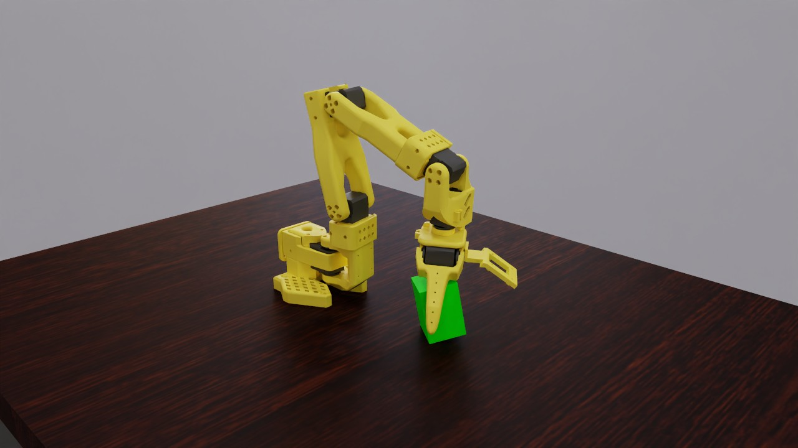
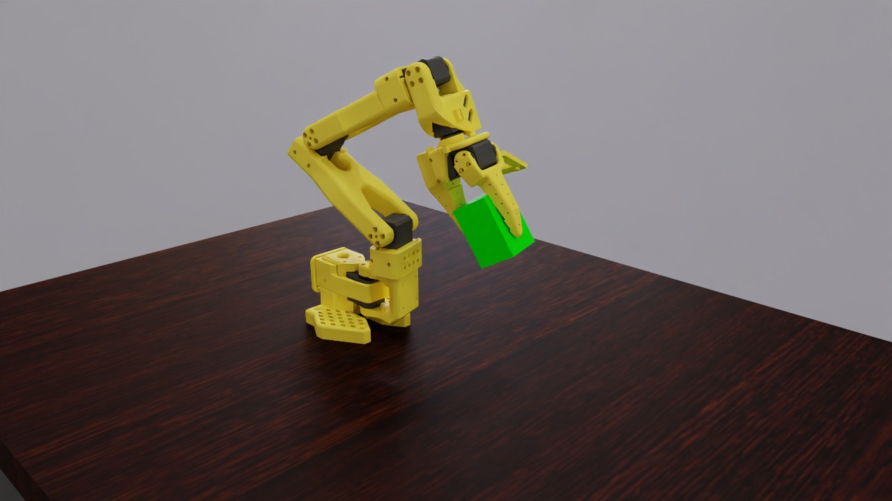
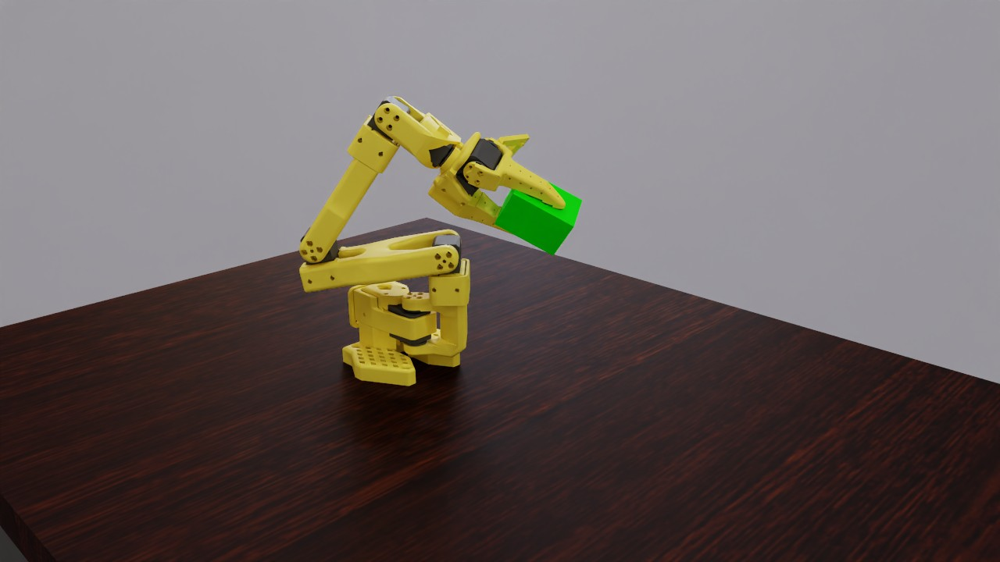

# SO-101 cube lift: a metalsim render

The Robot Studio's SO-101 arm grasps a 4 x 4 x 6 cm box and lifts it: so101Sim's state-based cube-lift task and its PPO teacher (trained on CPU MuJoCo in so101Sim), played on metalsim (MuJoCo Warp on Metal) through so101Sim's own observation, action and control loop. The realism check below finds the motion beyond what the standard SO-101 follower's servos can do. Rendered on the 14-inch MacBook Pro (Mac16,6), not in a timing run, so its Performance table is not a timing figure.

**hero** (300 frames, 6.0 s at 50 fps): [video](so101_lift.mp4) (0.7 MB, H.264)





## What is shown

- 16 envs simulated, filmed: 13, 1, 7, 15 (selection: automatic, the adapter ranking).
  - env 13: terminated False, success True, success_t 38, hmax 0.162, height 0.158, lifted True, end_frame 299
  - env 1: terminated False, success True, success_t 38, hmax 0.159, height 0.150, lifted True, end_frame 299
  - env 7: terminated False, success True, success_t 48, hmax 0.194, height 0.167, lifted True, end_frame 299
  - env 15: terminated False, success True, success_t 36, hmax 0.164, height 0.146, lifted True, end_frame 299
- Policy: `runs/film/so101_lift/policy/so101_lift_ppo.pt` (so101_lift_sb3_mlp_v1 (plain torch tensors from SB3 PPO model.zip + VecNormalize vecnorm.pkl)); physics: MuJoCo Warp BatchSim (metalsim.physics.batch), so101Sim's control loop: ctrl from the action, 4 physics steps of 5 ms; box mass and friction per world (no set_const, as so101Sim).

## Performance

Measured on the machine below; one frame = one policy step (Isaac Lab's `render_fps` = 1 / step_dt).

| stage | measurement |
|---|---|
| simulate (record) | 300 frames x 16 envs: 9 ms/frame mean (9 median, first 15 incl. graph capture), 2.7 s total; env build 1.2 s; stage wall 4.8 s |
| render twin (CPU) | 55 geoms, 18 meshes, 1 textures; build 0.0 s, poses 0.0 s |
| render: hero | 1280x720 (1x1 panels of 1280x720), tier 2 path tracing, 64 spp (16 passes x 4), 4 bounces, denoiser oidn; 0.27 s/frame mean (0.27 median, 0.36 max), 81.7 s for 300 frames; first frame: one pass 51 ms, 10 ms per further pass; set-up 0.8 s |
| encode: hero | 1.8 s (master CRF 16 + docs copy CRF 22, libx264 slow) |
| render: readme | 640x480 (1x1 panels of 640x480), tier 2 path tracing, 64 spp (16 passes x 4), 4 bounces, denoiser oidn; 0.12 s/frame mean (0.12 median, 0.21 max), 36.3 s for 300 frames; first frame: one pass 19 ms, 4 ms per further pass; set-up 0.7 s |
| end to end | 2.1 min (record + render + encode, sum of stage walls) |

## Hardware and pins

- Mac16,6 (Apple M4 Max, 40 GPU cores, 64 GB), macOS 27.0.1 (26A434).
- Power as each stage stamped it (`pmset -g batt` and `pmset -g`; `hardware.power`: the record stage's when it wrote rec.json, a render shot's at its first frame): record: on AC power (88 %, charging), power-mode setting High Power (pmset `powermode 2`), 2026-10-31 14:53 (-0700); render hero: on AC power (89 %, charging), power-mode setting High Power (pmset `powermode 2`), 2026-10-31 14:54 (-0700); render readme: on AC power (89 %, charging), power-mode setting High Power (pmset `powermode 2`), 2026-10-31 14:54 (-0700).
- metalsim `ed66d8ef3e+dirty`; record stage (main venv): warp 1.18.0.dev20260917 (`4127c48183`), mujoco 3.14.0, mujoco_warp 3.14.0 (`07a51a63bc`), torch 2.14.0, numpy 2.5.3.
- render stage (main venv): warp 1.18.0.dev20260917 (`4127c48183`), mujoco 3.14.0, numpy 2.5.3.

## Assets

| asset | source | licence | where from |
|---|---|---|---|
| SO-101 arm MJCF and STL meshes (MuJoCo Menagerie robotstudio_so101; assets/so101/so101.xml) | Google DeepMind MuJoCo Menagerie, from The Robot Studio's SO-ARM100 | Apache-2.0 | https://github.com/google-deepmind/mujoco_menagerie/tree/main/robotstudio_so101 (`committed`) |
| Lift scene: the arm, a 4 x 4 x 6 cm box on a free joint, the floor (assets/so101/scene_box_rl.xml; physics equal to so101Sim's scene_box_rl.xml) | this repository / so101Sim | Apache-2.0 | `assets/so101/scene_box_rl.xml` (`committed`) |
| Task, reset distribution and control loop (SO101LiftEnv), ported | so101Sim (pulipakaa24) | no licence file published; the owner's project, used with the owner's approval | https://github.com/pulipakaa24/so101Sim/blob/d4c2990/rl/native/so101_lift.py |
| Policy: so101Sim's PPO lift teacher (run 1 + run 2, 8 M steps), extracted to plain torch weights | so101Sim (pulipakaa24), trained on CPU MuJoCo | no licence file published; the owner's project, used with the owner's approval | `runs/film/so101_lift/policy/so101_lift_ppo.pt` (`runs/film/so101_lift/port/extract_policy.py`) |
| Studio HDRI (poly_haven_studio, 2k) | Poly Haven | CC0 1.0 (Poly Haven; fetched, not committed) | https://polyhaven.com/a/poly_haven_studio (`scripts/fetch_polyhaven_assets.sh train`) |
| Table texture (wood_table_001, 1k diffuse) | Poly Haven | CC0 1.0 (Poly Haven; fetched, not committed) | https://polyhaven.com/a/wood_table_001 (`scripts/fetch_polyhaven_assets.sh train`) |

## How it was made

**The policy.** so101Sim's state-based lift teacher (<https://github.com/pulipakaa24/so101Sim>, the owner's project, commit
`d4c2990`): stable-baselines3 PPO, `MlpPolicy` with two 256-unit tanh layers for actor and critic, 12
`SubprocVecEnv` workers with `VecNormalize`, on CPU MuJoCo (`rl/native/train_lift.py`). so101Sim trained it in two
runs (`docs/AGENT_CONTEXT.md` section 6): run 1, 0 to 3 M steps, plateaued at 13 % success because success ended the
episode, so hovering just under the lift height paid more than lifting; run 2, 3 to 8 M steps from run 1's checkpoint
with a non-terminating success and a per-step bonus while the box is up (`rl/native/continue_lift.py`), reached 98 %
within 300 k steps, and so101Sim reports a deterministic 100/100 (mean lift height 0.17 m, 0.95 s to lift). Run 2's
output is not published: it is in neither so101Sim's git nor its LFS, and not on this machine. Run 1's checkpoint is
tracked there (`rl/runs/lift_ppo_run1_backup`, 3,004,416 steps, training success 0.13 at its end). **Run 2 was reproduced here** with
so101Sim's own code on the CPU and no tracked file changed: the run 1 checkpoint copied to the untracked
`rl/runs/lift_ppo` its scripts read, then `continue_lift.py` with its default 5 M extra steps (8.2 min, 12 workers),
then `eval_lift_native.py 100`: **100/100, mean lift height 0.170 m (lowest 0.148 m), 0.95 s to lift**, the documented
figures (training success 0.94 at 3.10 M steps and 0.95 to 1.00 from then on; `runs/film/so101_lift/port/repro/`: `run.json`, `progress.txt`,
`eval_lift_native.log`). The film plays that checkpoint (8,005,632 steps; SB3 `model.zip` sha256 `1ddf1bc3...`,
`vecnorm.pkl` `ce78ad44...`) through plain torch weights: `runs/film/so101_lift/port/extract_policy.py` (run in so101Sim's environment)
writes the actor's three layers and VecNormalize's observation mean and variance as tensors to
`runs/film/so101_lift/policy/so101_lift_ppo.pt` (sha256 `9dfdea71...`, 296,754 bytes; `torch.load(weights_only=True)`, no stable-baselines3 needed); on 4,096
observations its output differs from SB3's `predict(deterministic=True)` by at most 2.0e-6. The action is the actor's
mean clipped to [-1, 1], after so101Sim's eval normalisation, clip((obs - mean) / sqrt(var + 1e-8), -10, 10). The
repository's `.gitignore` ignores `*.pt` files unless they are listed; without the weights file, rebuild it from
so101Sim (the reproduction above, then `extract_policy.py`; `runs/film/so101_lift/port/repro/run.json` lists the commands).

**so101Sim's task on MuJoCo Warp.** `metalsim/render/film/so101.py`, `SO101Lift`: so101Sim's `SO101LiftEnv`
(`rl/native/so101_lift.py`) on `metalsim.physics.batch.BatchSim`, 16 worlds. Per 20 ms control step the action sets
each position servo's target, a = -1 to 1 across the actuator's control range, then 4 physics steps of 5 ms. The
21 observations are so101Sim's: the six joint positions and velocities, the box position, the box minus the gripper
frame site, and the box's linear velocity, read after the step from the same MuJoCo fields (joint state after the
integration; the box and site positions and the box velocity from the last substep's kinematics, as MuJoCo's `mj_step`
leaves them). The reset is so101Sim's `reset(seed=...)`, the same random draws in the same order (box 0.15 to 0.26 m
from the base within +-0.7 rad, random yaw; +-0.08 rad on the five arm joints; box mass x 0.7 to 1.4 and friction x
0.7 to 1.3, set per world without recomputing derived constants, as so101Sim does); over seeds 10000 to 10099 the start
states equal so101Sim's to float32 rounding (3e-8). Success is so101Sim's: the box centre above 0.10 m for 10 control
steps in a row (it does not end the episode); an episode ends at 300 steps (6 s) or when the box leaves a 0.45 m
radius. The scene is `assets/so101/scene_box_rl.xml` (MuJoCo Menagerie's SO-101 with the box and floor). so101Sim's
own `scene_box_rl.xml` is not published (the README's "known gaps"); compiled with so101Sim's MuJoCo 3.10.0, every
numeric model array of the two is equal except the floor plane's render size, the box's colour, the box's position
before the reset overwrites it, a keyframe and a skybox (`runs/film/so101_lift/port/scene_diff.py`, output in `repro/scene_diff.txt`).
MetalSim compiles it with MuJoCo 3.14.0, which recentres the meshes differently from 3.10.0 (mesh geom frames differ
by up to 1.3e-3 in quaternion, mesh vertices by up to 46 um; inertia frames by 3e-6).

**Against so101Sim's own CPU run.** `runs/film/so101_lift/port/reference.py` runs so101Sim's `SO101LiftEnv` unchanged on CPU MuJoCo
3.10.0 with the extracted weights and `eval_lift_native.py`'s seeds and loop (`reference.json`; with the weights it
gives so101Sim's own eval figures). `runs/film/so101_lift/port/compare.py` runs the film's adapter on the same 100 seeds, one MuJoCo
Warp world each (`compare.json`, a GPU-queue job).

| 100 episodes, seeds 10000-10099 | so101Sim, CPU MuJoCo 3.10.0 | MetalSim, MuJoCo Warp | MetalSim, three re-runs |
|---|---|---|---|
| success (box above 0.10 m for 10 steps) | 100 | 98 (seeds 10021, 10027: the box tipped onto its side at the grasp) | 98, 97, 98 |
| box still above 0.10 m when the episode ends (6 s) | 99 | 94 | 92, 94, 94 |
| mean of the highest box height | 0.170 m | 0.166 m | 0.166, 0.165, 0.167 m |
| time to lift, mean over successes | 0.95 s | 0.91 s | 0.94, 0.90, 0.93 s |
| same outcome, seed by seed | | 98 of 100 | 98, 97, 98 (10021 and 10027 each time, 10098 once) |

The GPU rollout is not bitwise repeatable from run to run (float atomics accumulate in arrival order; `docs/GAPS.md`),
so each MetalSim figure is one draw. The re-runs (2026-10-31, MuJoCo Warp fork `8eb51fe637` on Warp `4127c48183`;
`runs/film/so101_lift/port/compare.py` twice and `runs/film/so101_lift_74v/port/compare_servo.py 12v` once; `runs/readme_media/handoff/revalidate.md`) put
MetalSim at **97 to 98 successes in 100 over three runs** (92 to 94 boxes still up at 6 s); the first column's run was
on the earlier fork checkout `07a51a63`.

The trajectories agree until the jaws touch the box: on seeds 10000 to 10004 the box positions differ by less than
1 mm up to 0.26 to 0.36 s (first jaw contact: 0.24 s, median), then by centimetres (median over the 100 seeds: 1.3 cm
at 0.5 s, 2.4 cm at 1 s, 3.8 cm at 6 s). The policy amplifies float differences before that, too: its actions are
mostly at +-1 (realism check below), so a pre-activation near zero flips a joint's command from one end of its range
to the other (seed 10002: a difference of 1.91 in one action within the first 10 steps, before contact). For scale,
so101Sim's CPU run itself, restarted with the start state rounded to float32 or with 1e-7 / 1e-6 rad of noise on the
arm joints (11 runs of 100 episodes, `runs/film/so101_lift/port/perturbed/perturbed.json`), gives 99 to 100 successes and 95 to 99
boxes still up at 6 s. MetalSim's 97 to 98 and 92 to 94 (four runs) are at or just below the low end of that spread; whether float32 contact
on the GPU makes the grasp slightly less reliable or this is the spread is not settled. MuJoCo Warp also flags its
solver-iteration caps (the model's 10 iterations and 20 line-search iterations) during the run: the iteration cap in
12 of the 100 worlds and the line-search cap in all of them, at some step (`compare.json` `capacity_overflow`; warnings,
no contact or row was dropped). CPU MuJoCo reached its 10-iteration cap on 0.03 % of control steps (the last physics
step of each, 20 episodes; an experiment in the scratch area, not kept).

**Realism check: beyond the standard SO-101 follower.** Measured on so101Sim's CPU run (`runs/film/so101_lift/port/realism.py`,
`realism.json`; 100 episodes, every 5 ms physics step). The SO-101 follower uses six Feetech STS3215 servos, the 7.4 V
1/345 C001 in The Robot Studio's bill of materials (<https://github.com/TheRobotStudio/SO-ARM100>); a 12 V version
is the alternative. C001 at 7.4 V: 19.5 kg.cm = 1.91 N.m stall torque, 52 rpm = 5.45 rad/s no-load speed (Feetech
datasheet "STS3215 200620a"); 12 V (C018): 30 kg.cm = 2.94 N.m, 0.222 s/60 deg = 4.72 rad/s (vendor listings). The
scene's actuators are Menagerie's: position servos with kp 998.22, kv 2.731 and a 2.94 N.m force limit, and joint
damping 0.6 N.m.s/rad. Servo force minus damping is a motor line from 2.94 N.m at rest to zero at 4.9 rad/s, so the
model is the 12 V servo. A DC servo at full voltage is bounded by |tau / tau_stall + omega / omega_0| <= 1 (all four
quadrants); the table counts physics steps outside that bound by more than 2 %, with tau the servo force minus
damping.

| joint | peak speed | episode peak (median) | steps at the 2.94 N.m limit | outside the 12 V C018 bound | outside the 7.4 V C001 bound (p99 ratio) |
|---|---|---|---|---|---|
| shoulder pan | 5.01 rad/s | 4.00 rad/s | 99.7 % | 2.5 % | 99.4 % (1.84) |
| shoulder lift | 5.14 rad/s | 4.45 rad/s | 98.4 % | 3.8 % | 98.1 % (1.83) |
| elbow flex | 5.40 rad/s | 5.14 rad/s | 99.8 % | 3.5 % | 98.6 % (1.80) |
| wrist flex | 5.18 rad/s | 5.01 rad/s | 19.6 % | 6.5 % | 16.3 % (1.76) |
| wrist roll | 4.99 rad/s | 4.79 rad/s | 100 % | 6.5 % | 96.2 % (1.85) |
| gripper | 5.65 rad/s | 4.77 rad/s | 100 % | 6.7 % | 96.4 % (1.67) |

- **Speeds** are within what the servos turn at: above the 12 V no-load speed on at most 1.4 % of steps, above the
  7.4 V C001's 5.45 rad/s once (the gripper, 5.65 rad/s).
- **Torques** are the 12 V servo's, flat out: five joints sit at the 2.94 N.m limit for 98 to 100 % of the episode,
  and the motion stays within the 12 V motor line to about 4 % (p99 ratio 1.03 to 1.04). The standard 7.4 V follower
  cannot supply it: on five joints it would need 1.67 to 1.85 times its servos' bound (p99) for 96 to 99 % of the
  episode.
- **The policy is bang-bang.** 80 % of all actions are at +-1 (the ends of each joint's command range); the median
  command jump is 1.96 rad per 20 ms step. While it holds the box, the arm joints' commands switch between the two ends
  of their range on 68 % of steps (median over episodes), close to a 25 Hz square wave, and the joints move at a
  median 0.87 rad/s while the arm holds the box up: the servos reverse at full torque nearly every step. No servo controller,
  current limit, backlash or overload protection is modelled; a real STS3215 driven like this runs at stall current
  and its overload protection is likely to cut in.
- **Gripper and contact.** The gripper's command is at one end of its range on 97 % of steps (open on the approach,
  fully closed from the grasp on); it holds the 4 cm box at 0.33 rad, so it squeezes at the full 2.94 N.m for the whole
  hold (106 N summed normal force on the box, median). LeRobot's
  SO-101 driver caps the real gripper at 50 % torque, 25 % when overloaded
  (`lerobot/robots/so_follower/so_follower.py`, `configure`: `Max_Torque_Limit` 500, `Overload_Torque` 25). The box is
  held only by the jaws (12 contacts, median; no contact with the floor or other links during the hold) and ends up
  lying on its side in them (largest tilt during the hold: 84 deg, median). The deepest box penetration per episode
  is 3.2 mm (median), 10.6 mm at most; in three episodes inspected at 3 s the moving jaw's collision mesh carried
  25 to 55 N per contact, at 1.7 to 3.4 mm penetration.
- **Lift.** The box rises at up to 0.86 m/s (median of episode peaks; 1.26 m/s at most) with about 2 g of vertical
  acceleration, and 99 of 100 boxes are still up at 6 s (seed 10014 is dropped after it counted as a success).

Verdict: plausible kinematics, but not the standard SO-101. The motion is what a 12 V SO-101 could do only by running
every servo at its limit with a full-range command switching up to 25 times a second, and with a gripper squeezing
twice as hard as LeRobot lets the real one. The 7.4 V follower in the bill of materials could not follow it. so101Sim
reports 5/5 zero-shot in Unreal (the same MuJoCo physics in URLab), and nothing has run on the physical arm. The film
shows what the simulation does; it is not evidence that the policy works on hardware.

**How the env was chosen.** 16 worlds, seeds 10000 to 10015 (`film.seed` 10000, the first of `eval_lift_native.py`'s
seeds); `envs="auto"` ranks them (`SO101Lift.rank`): episodes that succeeded and still hold the box above 0.10 m at
6 s first, then the smoothest, by the RMS of the six joints' accelerations (finite difference of the joint velocities
per control step), then the seed. In this take all 16 succeeded and still held the box at 6 s; the RMS joint
accelerations span only 67.3 to 70.3 rad/s^2 (every episode chatters), and seed 10013 (world 13) is the smoothest:
lifted at 0.76 s, box up to 0.162 m (`rec.json` `adapter.first_episode`). That list is the top four of the ranking;
both shots film the first.

**Camera and look.** Two fixed cameras in the env frame with Kit's lens (36 deg vertical), on the -y side of the arm,
so the box stays in view through the hold (the arm folds back and holds it out to its +y side; from +y the arm hides
it): `hero`, 1280x720, eye (0.62, -0.48, 0.36) m, looking at (0.12, 0.03, 0.10) m; `readme`, 640x480 (4:3, for the
README grid), eye (0.55, -0.42, 0.32), looking at (0.12, 0.03, 0.11). The render twin is the simulated scene with the
floor plane (z = 0, what the arm and box stand on) replaced by a 0.9 x 0.7 m wooden table top, 4 cm thick, on four
legs, with a grey studio floor 0.75 m below (render-only geoms; `SO101Lift.twin_spec`); Poly Haven's `wood_table_001`
on the top, the box in so101Sim's green (0.1, 0.9, 0.15).

**Rendering.** Tier 2 (the path tracer), 64 samples per pixel (16 passes x 4), 4 bounces, Open Image Denoise, ACES
tone map, sRGB, lit by the Poly Haven studio HDRI as an importance-sampled dome. One frame per 20 ms control step
(50 fps), 300 frames.

**README clip.** [so101_lift.webp](so101_lift.webp) is the `readme` shot from 0 to 5 s (frames 0 to 249), resampled
from 50 to 30 fps and written as MuJoCo Warp writes its README clips: 320x240 (Lanczos), lossy animated WebP from
Pillow at quality 70, 33 ms per frame, looping; 150 frames. Command, from the repository root after the render stage:
`python -m metalsim.render.film.encode webp runs/film/so101_lift/readme/frames docs/renders/so101_lift.webp --start 0
--seconds 5 --src-fps 50 --fps 30`.

**This take, and where its timings come from.** Recorded, rendered and encoded on 2026-10-31 on the 14-inch MacBook
Pro (Mac16,6), at metalsim `ed66d8ef` plus this film's uncommitted files (hence `+dirty` in the pins). This was not a
timing run; quote nothing on this page as MetalSim's speed (MetalSim's timing runs are made on the 16-inch through the
GPU queue's timing kind; throughput figures are in `docs/PARITY.md`). Power, as the stages stamped it: on AC power and
charging at every stamp (88 % when the record stage wrote `rec.json` at 14:53, 89 % at both shots' first frames at
14:54, local time), with pmset's power-mode setting at High Power (`powermode 2`: the configured setting, which does
not show that the machine ran in High Power Mode). Record and render ran as GPU-queue jobs of kind render, one at a
time, into `runs/film/so101_lift`; the render resumed five preview frames (0, 60, 120, 180, 240) rendered with the same
settings. The entry is registered in `tasks.py` (`python -m metalsim.render.film so101_lift`, as below);
`python -m metalsim.render.film.so101 <film-tool args>` also runs the film tool with it. A new recording is another
take: the GPU rollout is not bitwise repeatable.

## 7.4 V servo model

The realism check above finds the motion beyond the standard SO-101 follower's servos. Here the same policy, unchanged
and not retrained, runs on a model of those servos, and the `so101_lift_74v` take films it
(`python -m metalsim.render.film.so101 so101_lift_74v`; adapter option `servo="7v4"`; the default, `"12v"`, is the
scene as it is and everything above).

**The scene's servos and where their numbers come from.** `assets/so101/so101.xml`, class `sts3215` (Menagerie's copy
of SO-ARM100's `so101_new_calib.xml` at `aec17bbc`):

- position actuators, kp 998.22, kv 2.731, force limit +-2.94 N.m: Gregory119's DC-motor derivation for the 12 V
  ST-3215-C047 (30 kg.cm stall and 45 rpm at 12 V, servo P gain 16;
  <https://github.com/Gregory119/RBE501-RL-arm-project>, `gymnasium_env/calc_actuator_model.py` and its README),
  merged by SO-ARM100 PR #141 (2025-11-27), which replaced kp 17.8 and a 3.35 N.m limit;
- joint damping 0.60 N.m.s/rad, frictionloss 0.052 N.m, armature 0.028 kg.m^2: in SO-ARM100's SO-101 MJCF since its
  first version (2025-05-19). They match Rhoban BAM's MuJoCo export of its identified 7.4 V STS3215
  (<https://github.com/Rhoban/bam>, `bam/to_mujoco.py`: damping = viscous friction + kt^2 / R, frictionloss = Coulomb
  friction; `bam/params/feetech_sts3215_7_4V/m1.json`: 0.060 + 1.178^2 / 2.479 = 0.62, 0.052, armature 0.026), as
  do the replaced kp 17.8 and 3.35 N.m (the export's kp and vin kt / R: 18 and 3.5 with today's parameters). That
  origin is inferred from the numbers; no file states it.

MuJoCo clamps the servo's whole force (kp x error - kv x speed) to the force limit, so the actuator has no
speed-dependent limit of its own. Flat out, servo force minus joint damping is the line 2.94 - 0.60 w N.m, zero at
4.9 rad/s.

**What changes for 7.4 V** (`apply_servo` in `metalsim/render/film/so101.py`):

| | 12 V (the scene) | 7.4 V | source |
|---|---|---|---|
| force limit, five arm joints | 2.94 N.m | 1.912 N.m | Feetech datasheet "STS3215 200620a": 19.5 kg.cm at 7.4 V; the follower uses the 7.4 V C001 (SO-ARM100 README, bill of materials) |
| gripper force limit | 2.94 N.m | 0.956 N.m | LeRobot's SO-101 driver sets the gripper's `Max_Torque_Limit` to 500, i.e. 50 % (`lerobot/robots/so_follower/so_follower.py`, `configure`); the datasheet: torque output is the motor's voltage duty cycle, 1000 = 100 % |
| joint damping, six joints | 0.60 N.m.s/rad | 0.351 N.m.s/rad | 1.912 N.m / 5.445 rad/s (datasheet: 52 rpm at 7.4 V), so the flat-out line ends at the datasheet's no-load speed, as the 12 V model's ends at 4.9 rad/s |
| flat-out line reaches zero at | 4.9 rad/s | 5.45 rad/s; gripper 2.72 rad/s | half the duty cycle halves stall torque and no-load speed alike |
| kp, kv, armature, frictionloss | 998.22, 2.731, 0.028, 0.052 | unchanged | kp and kv need the motor's stall and no-load currents, which the C001 datasheet does not give; they act only within force limit / kp (2 mrad) of the target |

Nothing is added that the 12 V model lacks: no overload or over-current protection (LeRobot sets `Overload_Torque`
25 %), current limit, backlash or servo P loop. The damping is the one judgement call. In a DC motor the line's slope
(kt^2 / R) does not change with voltage, and BAM puts it at 0.62; but with the datasheet's stall torque, 0.60 would end
the line at 3.2 rad/s, below both the datasheet's 5.45 rad/s and BAM's 5.3 rad/s. The sensitivity row below keeps 0.60.

**Results**, 100 episodes, seeds 10000 to 10099, the policy unchanged:

- CPU: so101Sim's env on MuJoCo 3.10.0 (`runs/film/so101_lift_74v/port/reference_servo.py`, which runs `runs/film/so101_lift/port/reference.py` with the
  servo model applied to the env's MjModel);
- MetalSim: the film's adapter on MuJoCo Warp, one world per seed (`runs/film/so101_lift_74v/port/compare_servo.py`, which runs
  `runs/film/so101_lift/port/compare.py`; GPU queue);
- tables: `runs/film/so101_lift_74v/port/analysis.py` (`analysis.json`).

| 100 episodes | 12 V, CPU | 7.4 V, CPU | 12 V, MetalSim | 7.4 V, MetalSim |
|---|---|---|---|---|
| success (box above 0.10 m for 10 steps) | 100 | 77 | 98 | 78 (re-runs: 73, 78) |
| box still above 0.10 m at 6 s | 99 | 70 | 94 | 65 (66, 71) |
| mean of the highest box height | 0.170 m | 0.148 m | 0.167 m | 0.147 m (0.140, 0.148 m) |
| time to lift, mean over successes | 0.95 s | 1.62 s | 0.97 s | 1.58 s (1.63, 1.64 s) |
| lifted, then dropped by 6 s | 1 | 8 | 4 | 13 |
| box never above 6 cm | 0 | 21 | 1 | 22 |
| same outcome as CPU, seed by seed | | | 98 | 81 (86, 81) |

The 12 V MetalSim column is a re-run with the servo forces recorded (another GPU take); the first run, in the
comparison above, gave 98, 94, 0.166 m and 0.91 s. Each MetalSim figure is one GPU draw (not bitwise repeatable). The
7.4 V re-runs in brackets are two more runs of `runs/film/so101_lift_74v/port/compare_servo.py 7v4` on MuJoCo Warp `8eb51fe637` (the
column's run was on `07a51a63`; `runs/readme_media/handoff/revalidate.md`): **73 to 78 successes in 100 over two
re-runs** (78 in the first run; 75 in the next section's table, a fourth run). At 12 V the re-runs give 97 to 98 over
three runs (the comparison above).

Fraction of the episode each servo spends at its force limit:

| joint | 12 V, CPU | 7.4 V, CPU | 12 V, MetalSim | 7.4 V, MetalSim |
|---|---|---|---|---|
| shoulder pan | 99.7 % | 90.8 % | 98.9 % | 90.5 % |
| shoulder lift | 98.4 % | 96.9 % | 97.0 % | 95.0 % |
| elbow flex | 99.8 % | 99.9 % | 99.7 % | 99.8 % |
| wrist flex | 19.6 % | 53.4 % | 20.0 % | 55.0 % |
| wrist roll | 100 % | 100 % | 100 % | 100 % |
| gripper | 100 % | 98.6 % | 99.5 % | 98.4 % |

CPU: every 5 ms physics step (`runs/film/so101_lift/port/realism.py`; `runs/film/so101_lift_74v/port/realism_7v4.json`). MetalSim: the last physics step of
each 20 ms control step.

| CPU, 100 episodes | success | still up at 6 s | highest box, mean | time to lift |
|---|---|---|---|---|
| 7.4 V | 77 | 70 | 0.148 m | 1.62 s |
| 7.4 V, damping kept at 0.60 (sensitivity) | 76 | 74 | 0.139 m | 1.91 s |
| 7.4 V, gripper at the full 1.91 N.m (diagnostic, not the follower's setting) | 98 | 96 | 0.171 m | 1.03 s |

**What the failures look like** (CPU, `analysis.json`; MetalSim's counts are in the table):

- The arm is strong enough. With the gripper at full torque (diagnostic row), the 7.4 V arm lifts the box in 98
  episodes, and in failed episodes the gripper still rises to 0.20 to 0.29 m.
- The gripper is what fails. At half the torque and half the speed it opens slowly. When the jaws first touch the box
  (0.24 s, median, as at 12 V), the gripper is open 0.47 rad, against 0.90 rad at 12 V (median). The jaws land on the
  box instead of around it and tip it over: tilted beyond 60 deg while still on the table in 76 episodes, against 43
  at 12 V.
- In 21 episodes the box never rises above 6 cm. It lies on its side on the table, and the policy hovers over it,
  gripper open, and does not pick it up.
- When it does lift the box, the gripper squeezes with a quarter of the force: 27 N summed normal force during the
  hold (median), against 106 N. 8 boxes (13 on MetalSim) slip out of the jaws in the chattering hold before 6 s.
- So the failures come from the gripper's 50 % limit, LeRobot's setting, not from the 7.4 V arm.
- The policy stays bang-bang (66 % of actions at +-1, against 80 %). The joints move more gently: RMS joint
  acceleration 41 to 50 rad/s^2 in the take's 16 worlds, against 67 to 70 at 12 V.

**The take** (`runs/film/so101_lift_74v/`). It uses the so101_lift take's 16 worlds, look, cameras and shots, and
films world 13 (seed 10013), the 12 V take's env, whatever happens in it.

- 12 of the 16 first episodes succeed. In 10007, 10010, 10011 and 10012 the box never rises above 5 cm.
- World 13 succeeds; it is one of the 77 %, not a failure:
  - the gripper comes down over the box only part open;
  - the jaws straddle the box at about 0.4 s and close on it by 0.6 s;
  - the arm lifts the box from about 0.85 s; success is counted at 1.10 s, against 0.76 s at 12 V;
  - the arm holds the box at 0.14 to 0.15 m to the end, hanging tilted in the jaws (at 12 V it lies on its side).
- Clip: [so101_lift_74v.webp](so101_lift_74v.webp), made with the same command and window as so101_lift.webp (`--start
  0 --seconds 5 --src-fps 50 --fps 30`).
- Hero: [so101_lift_74v.mp4](so101_lift_74v.mp4) (0.7 MB) and `so101_lift_74v_still{1,2,3}.jpg` (frames 15, 30
  and 150).
- Recorded and rendered on the 14-inch MacBook Pro (Mac16,6), 2026-10-31, on AC power and charging at every stamp
  (97 to 98 %, 15:17 to 15:19), powermode 2. This was not a timing run.

**Verdict.** On a model of the standard follower's servos, the unchanged policy succeeds 77 times in 100 on CPU (73 to
78 on MetalSim over four runs) instead of 100. It takes 1.6 s instead of 0.95 s to lift, and the box is still up at 6 s
in 65 to 71 episodes. The cause is the weak, slow gripper under LeRobot's 50 % limit. This is still a simulation: the servo's P
loop, current limit, overload protection and backlash are not modelled, and nothing has run on the arm.

## Smooth 7.4 V retrain

The owner's goal for this cell is a realistic control style on the standard follower's 7.4 V servos, and a realistic
simulation that fails beats a working, unrealistic one. So so101Sim's teacher was retrained on the 7.4 V servo model
(`apply_servo(m, "7v4")`, section above) with smoothness penalties: two variants, then stop. The `so101_lift_smooth`
take films the second (`python -m metalsim.render.film.so101 so101_lift_smooth`). **Neither variant reaches a realistic
control style.**

**How control style is measured.** Torque saturation does not separate a smooth controller from a bang-bang one on
these servos: so101Sim's scripted expert (`rl/native/scripted_expert.py`, damped-least-squares IK with each joint
target moving at most 0.06 rad per step; the controller that generated so101Sim's demonstrations) sits at the force
limit 39 to 90 % of the time at 7.4 V, because the servo's proportional band is only force limit / kp = 1.9 mrad. Two
measures do separate them, both on the action the env applies (normalised to [-1, 1]):

- action change per step, the mean of |a(t) - a(t-1)| over the six joints (scripted_expert.py's "mean |dctrl|/tick");
- actions at the limit, the share of action components with |a| > 0.99.

The expert at 7.4 V gives 0.0139 and 0.9 %; the original policy gives 0.68 and 66 %.

**Training, both variants.** The run-2 teacher continued for 10 M steps on the 7.4 V model, with everything else
so101Sim's: `SO101LiftEnv`'s reward, reset and loop, 12 workers, VecNormalize continued from run 2, and run 2's PPO
settings (`runs/film/so101_lift_smooth/train/train_smooth.py`, `smooth_env.py`; run in so101Sim's environment, about
16 minutes each on CPU; logs in `train/runs/<variant>/`). The penalties are Isaac Lab's lift task's
(IsaacLab `source/isaaclab_tasks/isaaclab_tasks/contrib/lift/lift_env_cfg.py`, `RewardsCfg` `action_rate` and
`joint_vel`, `CurriculumCfg`):

- `action_rate_l2`, the sum over the action of (a(t) - a(t-1))^2;
- `joint_vel_l2`, the sum over the joints of qdot^2;
- weights 1e-4 each, raised to 1e-1 after 10,000 of the 36,000 environment steps of its rsl_rl run
  (`config/franka/agents/rsl_rl_ppo_cfg.py`: 1500 iterations x 24 steps); here after 27.8 % of the 10 M steps.

**Variant 1, `isaac_scaled`: no effect.** Isaac Lab's weights times 9/37 (so101Sim's largest task reward per step over
Isaac Lab's), penalising the action after the [-1, 1] clip. The action change per step rose from 0.68 to 0.76 and the
actions at the limit from 66 to 78 %. SB3's exploration noise for wrist flex and wrist roll grew from 0.92 and 2.4 to 16 and 103.
The cause (`runs/film/so101_lift_smooth/eval/raw_actions.py`): the deterministic action is the policy's Gaussian mean
clipped to [-1, 1], and that mean lies outside [-1, 1] on 45 to 86 % of steps per joint for the original policy (median
|mean| 20 for variant 1's wrist flex). A penalty on the clipped action cannot see a mean beyond the clip, nor noise
beyond it. Isaac Lab penalises the raw action: its `ActionManager.process_action` stores the action as the policy
emits it (`source/isaaclab/isaaclab/managers/action_manager.py`), and its rsl_rl wrapper clips nothing unless
`clip_actions` is set (`source/isaaclab_rl/isaaclab_rl/rsl_rl/rl_cfg.py`, default `None`; the lift task does not
set it). Isaac Lab files read at `main` = `6bb65480`.

**Variant 2, `isaac_unscaled_raw`, the filmed one.** Isaac Lab's weights unscaled, on the raw policy output as Isaac
Lab computes them. SB3 passes the Gaussian sample through unclipped (action space widened to +-1000); so101Sim's
`step` still clips it to [-1, 1] for the servo targets, so the arm sees what it saw before. The other candidate,
LeRobot's `max_relative_target`, was not used, for three reasons:

- it is off by default on the SO-101 follower (`None`, `lerobot/robots/so_follower/config_so_follower.py`, lerobot
  0.6.1);
- typical values are 5 degrees (the old Aloha default, `lerobot/common/robot_devices/robots/configs.py` at
  `3c0a209f`) or 10 to 15 degrees (Koch, in LeRobot PR #373's first revision);
- it clamps each goal to the present position +- the limit (`lerobot/robots/utils.py`, `ensure_safe_goal_position`).
  5 degrees is 87 mrad, 45 times the servo's 1.9 mrad proportional band, so the policy's output would be unchanged
  and the servo torque would still switch between its limits.

**Results**, 100 episodes, seeds 10000 to 10099, 7.4 V unless marked, CPU | MetalSim:

| controller | success | box up at 6 s | time to lift | action change per step | actions at the limit | servo at force limit, arm mean / gripper | peak joint speed |
|---|---|---|---|---|---|---|---|
| scripted expert | 20 \| 36 | 17 \| 29 | 4.13 \| 4.20 s | 0.0139 \| 0.0142 | 0.9 \| 0.7 % | 70 / 90 \| 59 / 95 % | 5.19 \| 5.16 rad/s |
| original policy | 77 \| 75 | 70 \| 68 | 1.62 \| 1.50 s | 0.682 \| 0.696 | 65.7 \| 66.3 % | 88 / 99 \| 88 / 98 % | 5.87 \| 6.33 rad/s |
| variant 1, `isaac_scaled` | 77 \| 77 | 75 \| 73 | 1.51 \| 1.65 s | 0.756 \| 0.761 | 77.5 \| 77.0 % | 85 / 99 \| 86 / 100 % | 5.98 \| 6.23 rad/s |
| variant 2, `isaac_unscaled_raw` | 86 \| 92 | 83 \| 85 | 1.36 \| 1.34 s | 0.348 \| 0.355 | 72.4 \| 72.3 % | 72 / 100 \| 72 / 100 % | 6.15 \| 5.96 rad/s |
| original policy, 12 V | 100 \| 98 | 99 \| 97 | 0.95 \| 0.95 s | 0.991 \| 0.982 | 79.6 \| 79.2 % | 83 / 100 \| 83 / 100 % | 5.65 \| 5.53 rad/s |
| scripted expert, 12 V | 95 \| 98 | 86 \| 94 | 1.60 \| 1.37 s | 0.0051 \| 0.0043 | 0.2 \| 0.1 % | 24 / 90 \| 14 / 94 % | 5.39 \| 5.00 rad/s |

How each column is measured:

- **CPU:** so101Sim's env on MuJoCo 3.10.0 with the servo model applied (`eval/eval_cpu.py`). Force and speed are
  read at every 5 ms physics step.
- **MetalSim:** the film's adapter on MuJoCo Warp, one world per seed (`eval/eval_metalsim.py`, GPU queue, MuJoCo
  Warp fork `8eb51fe637`, 2026-10-31 16:13 to 16:14). Force and speed are read at the end of each 20 ms control step.
  The expert runs here on CPU kinematics of each world's state.
- **Tables:** `eval/table.py`, giving `eval/table.md` and `eval/results.json`. The same jobs run at 15:58 gave
  successes within 3 of these: MetalSim is not bitwise repeatable from run to run.
- The section above's MetalSim column for the unchanged policy (78 and 65 at 7.4 V) was measured at 15:17, on
  the earlier fork checkout `07a51a63` (moved to `8eb51fe6` at 15:47, `upstream/mujoco_warp` reflog), with
  `compare_servo.py`; this table's 75 and 68 are from `8eb51fe637`.

**Verdict.**

- **Neither variant reaches a realistic control style.**
- Variant 2 halves the original's action change per step, from 0.68 to 0.35. Its joint targets no longer flip every
  step: the median target change is 0 rad, against 0.67 rad. Instead the policy holds its targets at the joint limits
  and lets the saturated servos make the motion.
- That is still 25 times the expert's action change, and 72 % of its actions sit at +-1, against 0.9 % for the expert.
  The elbow still flips (0.89 per step).
- It costs no success. Variant 2 succeeds more often than the original on the 7.4 V model: 86 against 77 on CPU, 92
  against 75 on MetalSim. It lifts sooner (1.36 s against 1.62 s) and higher (0.185 m against 0.148 m mean highest
  box). The box never rises above 6 cm in 11 episodes, against 21.
- The only realistic controller here is so101Sim's scripted expert, and on the 7.4 V model with LeRobot's 50 %
  gripper limit it succeeds 20 times in 100 on CPU (36 on MetalSim). In 77 of its CPU episodes the box never rises
  above 6 cm.

**The take** (`runs/film/so101_lift_smooth/`): the so101_lift take's 16 worlds, look, cameras and shots, with the
variant-2 weights (`runs/film/so101_lift_smooth/policy/so101_lift_smooth_ppo.pt`, sha256 `4593a0ed...`; extraction
checked against SB3's predict clipped to [-1, 1]: 1.7e-6).

- All 16 first episodes succeed. Their RMS joint acceleration is 28.8 to 41.2 rad/s^2, against 67 to 70 at 12 V and
  41 to 50 for the unchanged policy at 7.4 V.
- The ranking films world 8 (seed 10008), lifted at 0.86 s:
  - the gripper comes down over the box with the jaws open, the fixed jaw meets the box and tips it (0.3 s);
  - the jaws close around it (0.6 s);
  - the arm swings the box up and back over its base by about 1.2 s and holds it there, at about 0.21 m and upright
    in the jaws, to the end;
  - during the hold the wrist and box still turn back and forth by a few degrees from frame to frame.
- Clip: [so101_lift_smooth.webp](so101_lift_smooth.webp), the same command and window as so101_lift.webp.
- Hero: [so101_lift_smooth.mp4](so101_lift_smooth.mp4) (0.6 MB) and `so101_lift_smooth_still{1,2,3}.jpg` (frames
  15, 30 and 150).
- Recorded and rendered on the 14-inch MacBook Pro (Mac16,6), 2026-10-31, 16:14 to 16:17, with MuJoCo Warp at
  `8eb51fe637`, **on battery** (58 to 55 %, discharging), powermode 2. This was not a timing run.

Still a simulation: the servo's P loop, current limit, overload protection and backlash are not modelled, and nothing
has run on the arm.

## Servo model under LeRobot's settings (7v4_real, 7v4_bam)

The owner watched the 7.4 V model above and the motion is wrong: each joint rings about every target, and the arm
moves faster than the servos can. The cause is the scene's actuator, not the policies. `apply_servo(m, "7v4_real")`
(and `"12v_real"`) models the STS3215 as LeRobot drives it; the old options are unchanged. `"7v4_bam"` (the last part of
this section) is the same servo under the same registers with every motor and friction number from Rhoban BAM's
identification, including the gearbox friction that grows with the load. It holds a gravity load far closer to real
followers than 7v4_real does (the shoulder still sags 1.6-2.4 times as much as theirs), and it is the servo of the
`so101_lift_deploy` film.

**What the real servo does.**

- **The firmware loop is soft.** The STS3215 sets its PWM duty to P x position error, about 0.167 duty per rad per
  unit of P, clipped at 0.97. That is Rhoban BAM's identification of the 7.4 V STS3215 with an oscilloscope and a
  pendulum, at P = 4, 8, 16 and 32 with D = 0 (<https://github.com/Rhoban/bam>, `bam/feetech/actuator.py`
  `error_gain` 0.166 and `max_pwm` 0.97, `bam/params/feetech_sts3215_7_4V/m1.json` `error_gain_ratio` 1.005,
  `bam/feetech/record.py`). A third-party STS memory table gives the same gain, "Kp scaled by 1/4": 0.25 per mille of
  duty per encoder step, 0.163 per rad. LeRobot writes P 16, I 0 and D 32 (`so_follower/config_so_follower.py`
  `position_*_coefficient`, `so_follower.py` `configure`).
- **What that means as torque.** At P 16 a 0.06 rad error gives 16 % duty, 0.32 N.m on the 7.4 V servo. The scene's
  kp of 998 N.m/rad comes from Gregory119's derivation, which reads P 16 as 16 V per degree of error, with an assumed
  1 ohm winding. That is about 190 times too stiff, and with only 3.3 N.m.s/rad of damping it rings. SO-ARM100's
  SO-101 model before PR #141 had kp 17.8, which matches BAM's own MuJoCo export at the factory P of 32 (18). That
  match is inferred from the numbers only.
- **The firmware moves its own target.** The loop tracks an internal target that moves toward the goal at no more than
  5.29 rad/s (BAM `max_velocity`, m1). LeRobot also writes Acceleration 254 (`motors/feetech/feetech.py`
  `configure_motors`). At 100 step/s^2 per unit (third-party memory tables) that is 39 rad/s^2.

  Two things support that this register acts in position mode when Goal_Velocity is 0. The datasheet says "Mode 0 ...
  support acceleration movement". LeRobot's first SO-100 calibration (commit 07e87163) wrote Acceleration 10 "to lower
  the acceleration of the motors" before position moves. That it acts here, and the shape of the profile, are
  inference: no source states either.
- **The motor.** The torque-speed line runs through the datasheet's stall torque and no-load speed, friction
  included:

  | | 7.4 V C001 | 12 V C018 |
  |---|---|---|
  | stall torque | 19.5 kg.cm | 30 kg.cm |
  | no-load speed | 52 rpm | 0.222 s/60 deg |

  The back-EMF and viscous friction are a joint damping that acts outside the duty clip, as back-EMF does. MuJoCo then
  produces the four-quadrant line itself. The scene's actuator clamps its whole force, back-EMF term included, so its
  line came from the joint damping alone. Coulomb friction 0.0515 N.m and armature 0.026 kg.m^2 are BAM m1's.

  BAM's own kt/R put the 7.4 V stall at 3.41 N.m, 1.8 times the datasheet. A replay fit on real SO-101 teleop
  episodes (Fontaine blog, 2026-08-11) lands at kp 8.8 and +-1.97 N.m. That is between this model's 5.26 (datasheet
  torque) and BAM's 9.38.
- **Latency.**
  - Servo side: 1.05 ms (BAM m1 `command_delay`). This covers the bus write, the firmware loop and the current
    build-up. The motor's L/R and the 16 or 24 kHz PWM are far below the 5 ms physics step, so torque build-up has no
    model of its own.
  - Host side: 3 ms, for one sync_read and one sync_write of six servos at 1 Mbps through a USB serial adapter. This
    is inference from protocol arithmetic; no published measurement was found.

  The env keeps its 50 Hz control. LeRobot records at 30 fps, which would change the task, not the servo.
- **Not modelled.**
  - D 32: its scale needs the firmware's loop period, which is unpublished. The sensitivity run below bounds it.
  - The gripper's overload protection (LeRobot's Overload_Torque 25 and Protection_Current 250): the datasheet,
    LeRobot's comment and the third-party tables disagree on what the registers do.
  - The 1-step dead zone, the 1.5 mrad encoder step and backlash.

| | kp N.m/rad | force limit N.m | joint damping | firmware target limits | latency |
|---|---|---|---|---|---|
| old 7.4 V (`7v4`) | 998.22, kv 2.731 | 1.912, gripper 0.956 | 0.351 | none | none |
| **`7v4_real`** | 5.26, kv 0 | 1.912, gripper 0.986 (50 % duty) | 0.342 | 5.29 rad/s, 39.0 rad/s^2 | 1.05 + 3 ms |
| `12v_real` | 8.09, kv 0 | 2.942, gripper 1.517 | 0.613 | 5.29 rad/s, 39.0 rad/s^2 | 1.05 + 3 ms |

The layer between the command and `d.ctrl` is `metalsim/physics/actuation.py` (`SetpointLayer`): a fractional command
delay, then the firmware profile. It is open loop in the command, so `SO101Lift` plans each 20 ms period's four targets
on the host and feeds them to the GPU with a substep hook (`CtrlPlanFeeder`). Against CPU MuJoCo with the same layer
and a fixed command schedule, the GPU joint trajectories agree to 8e-7 rad. Holding the first target for all four steps
instead differs by up to 0.09 rad.

**Step response.** The orchestrator's protocol, reproduced for the old model within 4 points of overshoot: so101Sim's
scene, every joint at qpos0, targets equal to positions, 1 s settling, then one joint's target +0.06 rad (the expert's
largest step per tick). Overshoot and crossings are against the final value, with a 0.5 % hysteresis. "Sag" is the
gravity offset before the step.

| servo | joint | overshoot | crossings | settle to 2 % | 90 % at | sag | peak speed / acc, 0.06 rad | peak, 0.5 rad step |
|---|---|---|---|---|---|---|---|---|
| old 12 V | shoulder_lift | 52 % | 6 | 190 ms | 40 ms | 1 mrad | 2.31 rad/s, 96 rad/s^2 | 3.78, 121 |
| old 12 V | elbow_flex | 52 % | 5 | 170 ms | 40 ms | 0 | 2.47, 113 | 3.81, 144 |
| old 12 V | wrist_flex | 33 % | 5 | 120 ms | 35 ms | 0 | 2.49, 130 | 4.39, 180 |
| old 7.4 V | shoulder_lift | 89 % | 6 | 315 ms | 50 ms | 1 mrad | 2.09, 68 | 3.37, 77 |
| old 7.4 V | elbow_flex | 72 % | 6 | 240 ms | 45 ms | 0 | 2.26, 78 | 3.48, 99 |
| old 7.4 V | wrist_flex | 52 % | 5 | 190 ms | 45 ms | 0 | 2.32, 87 | 4.31, 117 |
| 12v_real | shoulder_lift | 0 % | 0 | 275 ms | 235 ms | 79 mrad | 0.35, 6 | 3.04, 28 |
| 12v_real | elbow_flex | 0 % | 0 | 250 ms | 215 ms | 61 mrad | 0.38, 7 | 3.05, 29 |
| 12v_real | wrist_flex | 0 % | 0 | 240 ms | 200 ms | 13 mrad | 0.45, 9 | 3.09, 31 |
| **7v4_real** | shoulder_lift | 0 % | 0 | 310 ms | 275 ms | 121 mrad | 0.31, 5 | 2.81, 22 |
| **7v4_real** | elbow_flex | 0 % | 0 | 280 ms | 245 ms | 96 mrad | 0.31, 5 | 2.95, 26 |
| **7v4_real** | wrist_flex | 0 % | 0 | 255 ms | 220 ms | 21 mrad | 0.41, 7 | 3.24, 30 |

Two published hardware figures check the soft loop:

- lerobot issue #3400 measures a mean settle error of 63 encoder steps (97 mrad) at P 16, against 26.7 at P 32. The
  model's sag is 21-121 mrad, inversely proportional to P. The old model's is 1 mrad.
- The firmware profile caps the target's acceleration at 39 rad/s^2. The model's peak joint accelerations on a
  0.5 rad step are 22-30 rad/s^2; the old model's are 77-180.

**Ablation**, cumulative, then one piece at a time off the full model. The step columns give overshoot and settle;
the last column is the wrist on a 0.5 rad step. The task columns are CPU runs over seeds 10000-10099: so101Sim's
original PPO policy, trained on the old model, and its velocity reversals per second (arm joints).

| 7v4_real variant | lift step | elbow step | wrist step | wrist 0.5 rad: speed, acc | PPO success | PPO reversals /s |
|---|---|---|---|---|---|---|
| firmware gain + motor line only | 0.4 %, 270 ms | 0.3 %, 235 ms | 0.3 %, 215 ms | 3.54, 60 | 86 | 6-32 |
| + (a) servo latency 1.05 ms | 0.4 %, 270 ms | 0.3 %, 240 ms | 0.3 %, 220 ms | 3.54, 60 | 79 | 6-28 |
| + (b) firmware speed + acceleration limits | 0.4 %, 310 ms | 0.3 %, 280 ms | 0.2 %, 255 ms | 3.24, 30 | 11 | 2.0-5.5 |
| + (c) host latency 3 ms (= 7v4_real) | 0.4 %, 310 ms | 0.3 %, 280 ms | 0.2 %, 255 ms | 3.24, 30 | 6 | 2.1-5.9 |
| without (d), the back-EMF line | 33 %, 580 ms | 44 %, 510 ms | 49 %, 460 ms | 5.04, 62 | 1 | 3.0-5.5; peak 16-18 rad/s |
| without the acceleration limit | 0.4 %, 275 ms | 0.3 %, 245 ms | 0.3 %, 225 ms | 3.48, 40 | 24 | 4.1-6.6 |
| D 32 at an assumed 10 ms loop | 0.0 %, 320 ms | 0.0 %, 285 ms | 0.0 %, 265 ms | 3.03, 28 | | |
| BAM's kt/R (stall 3.41 N.m) | 0.7 %, 250 ms | 0.5 %, 230 ms | 0.0 %, 215 ms | 3.31, 33 | | |
| host latency 10 ms | 0.3 %, 320 ms | 0.3 %, 290 ms | 0.2 %, 265 ms | 3.24, 30 | 9 | 2.3-6.2 |

What each piece contributes:

- **The firmware gain** removes the ringing.
- **(d), the back-EMF line,** removes the rest of the overshoot. It also keeps speeds physical: without it the PPO
  policy reaches 16-18 rad/s.
- **(b), the firmware profile,** halves the peak acceleration of large steps. It also turns the PPO policy's 25 Hz
  command flipping (23-32 reversals per second on gains alone) into slow swings.
- **(a) and (c), the latencies,** change nothing visible at these time scales.
- **The D term** at any plausible loop period, and BAM's stronger motor, change the step by at most a few points and
  50 ms.

**Joint-motion smoothness** of every 5 ms physics step, CPU, seeds 10000-10099, per joint (pan / lift / elbow / wrist
flex / wrist roll / gripper):

- RMS acceleration and RMS jerk, by finite differences of qvel;
- velocity reversals per second, counted between stretches faster than 0.05 rad/s;
- the RMS joint velocity above 5 Hz, from an FFT per episode. The task's motion lies below a few Hz; the 5 Hz edge is
  a judgement.

The expert on `7v4_real` is the reference (no published values exist).

| controller | servo | success | RMS acc rad/s^2 | RMS jerk 10^3 rad/s^3 | reversals /s | velocity RMS > 5 Hz, rad/s |
|---|---|---|---|---|---|---|
| scripted expert | old 7.4 V | 20 | 35 / 47 / 47 / 55 / 49 / 19 | 7.0 / 8.4 / 8.5 / 9.9 / 10 / 2.3 | 13 / 7.8 / 8.1 / 9.7 / 13 / 3.0 | 0.42 / 0.57 / 0.54 / 0.72 / 0.51 / 0.27 |
| scripted expert | **7v4_real** | 0 | 4.9 / 8.5 / 11 / 8.5 / 2.7 / 4.1 | 1.4 / 2.5 / 3.3 / 2.5 / 0.4 / 0.2 | 0.19 / 0.29 / 0.34 / 0.82 / 0.21 / 0.17 | 0.03 / 0.05 / 0.07 / 0.05 / 0.02 / 0.03 |
| original PPO | old 7.4 V | 77 | 54 / 55 / 49 / 45 / 60 / 16 | 10 / 10 / 9.1 / 8.4 / 11 / 2.1 | 27 / 26 / 22 / 11 / 27 / 2.5 | 0.49 / 0.50 / 0.49 / 0.48 / 0.55 / 0.19 |
| original PPO | **7v4_real** | 6 | 60 / 77 / 68 / 61 / 36 / 21 | 16 / 21 / 19 / 16 / 6.2 / 3.2 | 3.6 / 5.9 / 5.6 / 4.3 / 2.1 / 2.2 | 0.42 / 0.54 / 0.46 / 0.46 / 0.28 / 0.19 |
| isaac_scaled | old 7.4 V | 77 | 57 / 51 / 48 / 36 / 61 / 16 | 11 / 9.9 / 9.2 / 7.0 / 11 / 2.2 | 27 / 26 / 25 / 7.1 / 29 / 3.0 | 0.54 / 0.45 / 0.45 / 0.38 / 0.56 / 0.17 |
| isaac_scaled | **7v4_real** | 15 | 54 / 72 / 67 / 57 / 37 / 22 | 14 / 19 / 18 / 15 / 6.1 / 3.8 | 3.4 / 5.2 / 5.8 / 4.8 / 2.5 / 2.1 | 0.39 / 0.51 / 0.47 / 0.44 / 0.27 / 0.21 |
| isaac_unscaled_raw | old 7.4 V | 86 | 51 / 37 / 51 / 37 / 41 / 15 | 9.2 / 7.6 / 10 / 7.4 / 7.1 / 2.3 | 16 / 8.6 / 29 / 5.5 / 3.9 / 3.1 | 0.58 / 0.37 / 0.46 / 0.39 / 0.45 / 0.17 |
| isaac_unscaled_raw | **7v4_real** | 4 | 56 / 68 / 61 / 56 / 35 / 22 | 15 / 18 / 16 / 14 / 6.1 / 4.1 | 3.1 / 5.0 / 4.7 / 4.6 / 2.4 / 2.0 | 0.39 / 0.48 / 0.41 / 0.41 / 0.26 / 0.20 |

What the table shows:

- **Old model.** The expert rings: 8-13 reversals per second and 0.4-0.7 rad/s above 5 Hz, at RMS accelerations of
  35-55 rad/s^2. That is what the owner saw. The "smoothness" retrain changed none of it.
- **New model, expert.** Reversals fall 15-60-fold, high-frequency velocity about 10-fold, and RMS acceleration
  4-18-fold.
- **New model, PPO policies.** All three were trained on the old servo; on the new one they no longer chatter at
  25 Hz (2-6 reversals per second). They still drive the joints at 35-77 rad/s^2 RMS, 7-15 times the expert, and
  succeed 4-15 times in 100.

Their peak speeds exceed the 5.45 rad/s no-load speed on 8-14 % of steps (6.2-8.4 rad/s), where the old model's do
on 0.1 %. With gravity and contacts off, bang-bang commands still reach 5.6-6.0 rad/s on the coupled joints, while
wrist roll alone stops at 5.44 (`speed_check.py`). The motor line holds per joint; gravity and the other joints'
inertial coupling drive a joint past it, as they would back-drive a real servo.

**The scripted expert on 7v4_real: 0/100**, seeds 10000-10099, on CPU and on MetalSim, with the same outcome on all
100 seeds. On 80 of them it never leaves the approach phase:

- so101Sim's expert sets each target to the measured joint position plus at most 0.06 rad;
- at P 16 that is at most 0.32 N.m, and holding the arm needs 0.39-0.57 N.m at the shoulder (`qfrc_bias`, the
  `pickup` keyframe and qpos0);
- so the arm sinks until the gripper is near the table, then creeps into a folded pose where gravity needs less.

The real follower under LeRobot (I = 0) would do the same with this expert. The 12 V model also gives 0/100. On
7v4_bam, whose kp is 10.58 N.m/rad, 0.06 rad gives 0.63 N.m; so101Sim's expert has not been run on it. A
deployment-style version of the expert, which streams absolute goals as LeRobot does, succeeds on 7v4_real and on
7v4_bam (next section).

A diagnostic variant builds each target on its previous command instead of the measured position, capped at the
0.363 rad where P 16 saturates the duty. It is not so101Sim's controller (`expert_variants.py`). It reaches the lift
phase in 45/100 episodes but succeeds in only 3. Its jaws are still open (1.0 rad) when the expert's fixed 0.3 s grasp
phase ends, because the gripper servo is slower than the old model's.

**The CPU-vs-MetalSim gap on the old model (20 vs 36) is the evaluation harness, not the simulator.** so101Sim's
expert on CPU reads `env.data` after `mj_step`, so its kinematics (TCP, Jacobian, box pose) are one 5 ms physics step
older than `qpos`. MetalSim's evaluation runs `mj_forward` on each world's state first. With `mj_forward` before the
expert on CPU too, the old model gives 38/100 against MetalSim's 34/100 (this run). The two now agree on 66 seeds,
against 56 before. The stale kinematics matter on the old model because the ringing joints move fast. On 7v4_real both
backends give 0/100.

Preview, MuJoCo's renderer, real time, frame time from `d.time`:

- `runs/readme_media/scratch/ik_preview/expert_7v4_real.mp4`: seeds 10010 and 10000;
- `expert_old_vs_real.mp4`: seed 10010, old model left (lifts at 3.36 s), 7v4_real right.

Scripts and outputs: `runs/readme_media/scratch/so101-servo/` (`stepresp.py`, `eval_cpu.py`, `eval_metalsim.py`,
`gpu_feeder_check.py`, `speed_check.py`, `phases.py`, `smoothness.py`). That directory is not tracked.

### 7v4_bam: BAM's identified servo, with load-dependent gearbox friction

**Why.** Real followers hold a gravity load differently from 7v4_real. Two LeRobot teleoperation datasets of SO-101
followers were measured (`hungho77/so101_left_arm_pick_red_cube_into_pot` and `IlyaGusev/so101_pick_gum`). The steady
error there is action minus state, the follower's own Goal_Position minus Present_Position, so the leader's calibration
does not enter it. A joint stops much nearer its goal after moving with gravity than after moving against it:

| joint | after moving with gravity | after moving against gravity |
|---|---|---|
| shoulder_lift | 5-28 mrad | 26-98 mrad |
| elbow_flex | 7-18 mrad | 55-82 mrad |

That is a static friction band that widens with the load. 7v4_real's band is a constant +-9.8 mrad around gravity / kp
5.26. Its shoulder, which in the datasets mostly stops after lowering, sagged 5-6 times more than the real ones; its
elbow, which mostly stops after rising, agreed only by that coincidence.

**What.** `apply_servo(m, "7v4_bam")` takes every motor and friction number from BAM's m6 identification of the
7.4 V STS3215 (<https://github.com/Rhoban/bam> at `b9e1111`, `bam/params/feetech_sts3215_7_4V/m6.json`; BAM's
best-ranked friction model; paper arXiv 2410.08650). Nothing was fitted to the sag data.

| | 7v4_real | 7v4_bam |
|---|---|---|
| full-duty torque | 1.971 N.m (datasheet stall / 0.97) | 3.43 N.m (kt x 7.4 V / R) |
| kp, N.m/rad (P 16) | 5.26 | 10.58 (m6's `error_gain_ratio` 1.162) |
| force limit (duty clip 0.97), N.m | 1.912, gripper 0.986 | 3.32, gripper 1.71 (LeRobot's 50 %) |
| joint damping (back-EMF + viscous) | 0.342 | 0.619 (kt^2 / R 0.591 + 0.028) |
| no-load speed | 5.45 rad/s (datasheet, 52 rpm) | 5.29 rad/s |
| gearbox friction | constant Coulomb 0.0515 N.m (m1) | m6's load-dependent budget (below) |
| armature | 0.0261 | 0.0216 |
| firmware speed cap | 5.29 rad/s | 5.10 rad/s |
| servo-side delay | 1.05 ms | 4.98 ms |
| registers (P 16, Acceleration 254 = 39 rad/s^2, gripper 500), 3 ms host latency | yes | the same |

**The friction.** BAM's m6 budget per joint is Coulomb 0.053 N.m, a Stribeck term, and terms in the motor torque tau_m and
the external torque tau_e (gravity, contacts, joint limits): |0.244 tau_e - 0.045 tau_m|, |0.142 tau_e - 0.0001 tau_m|
at rest, and a quadratic term (`bam/model.py` `compute_frictions`; our copy equals it exactly on 20,000 random inputs).

- It is written to `dof_frictionloss` before every physics step from the previous step's tau_m and tau_e, as BAM's own
  MuJoCo loop does (`bam/mujoco.py`).
- The friction constraint is BAM's stiff one (solref -5e4, -2e2; solimp 0.99 0.9999 0.001 0.5 2; `bam/mjlab.py`).
  With MuJoCo's default soft one, a held shoulder creeps 11 mrad in 2.5 s.
- On CPU MuJoCo the update is `metalsim.physics.actuation.BamFriction` (`friction_hook(applied, m)`, `update(d)` before
  every `mj_step`).
- On MuJoCo Warp it is `BamFrictionWarp`: a Warp kernel over (world, arm joint), run after every physics substep inside
  BatchSim's step graph, writing a per-world `dof_frictionloss`. `SO101Lift` wires it. Against the CPU update (8
  seeds, 40 control steps) the joint positions agree to 1.9e-6 rad (`tests/test_bam_friction.py` has the kernel and
  GPU checks).
- At reset, the first budget comes from a forward pass with the servos powered on, holding the start pose.

**Against the real arms.** The datasets' own commands were replayed on the simulated follower: free air, each episode
starting from the real follower's state. Median |sim - real| steady error per load bin, mrad:

| joint | 7v4_real | 7v4_bam |
|---|---|---|
| shoulder_lift | 93 | 17 |
| elbow_flex | 9.3 (after moving with gravity: 62) | 12 (14) |
| wrist_flex | 1.9 | 1.1 |

In the heaviest fifth of the shoulder's steady samples, the simulated shoulder sags 1.6 and 2.4 times as much as the
real ones in the two datasets (7v4_real: 5.3 and 6.7 times).

**Open.**

- **The residual is not fitted, on purpose.** The shoulder still sags 1.6-2.4 times real. The real elbow's band is about
  1.7 times wider, and without load the real band is 1.5-3 times wider. That is consistent with more friction on the
  real units than on BAM's one bench servo, and with the MJCF's CAD masses (not weighed); teleop data cannot separate
  the two.
- **The stall torque is unresolved: 3.32 N.m from BAM's kt / R, against the datasheet's 1.91 (19.5 kg.cm).** The sag
  data constrain only the small-signal kp. With BAM's kp and damping kept and the clip set to the datasheet's value, the
  deployment-style expert (next section) still succeeds 100/100 on CPU but lifts later on every seed (median time to
  lift 2.52 s against 2.18) and retries 6 times against 1; its sag in the lift phase is unchanged. A bench test would
  settle it: block a joint, step its goal, read the force at a known lever.
- No 12 V version: BAM has no 12 V identification of the STS3215.

Scripts and outputs: `runs/readme_media/scratch/so101-sag/` (`real_dir.py`, `static_band.py`, `replay.py`,
`compare.py`, `hold_test.py`, `check_budget.py`, `eval_cpu_sag.py`, `table.md`) and
`runs/readme_media/scratch/so101-bam-gpu/` (`gpu_bam_check.py`, `eval_metalsim_bam.py`, `table.md`). Those
directories are not tracked.

## Deployment-style scripted expert on 7v4_bam

The section above leaves no realistic controller on the standard follower's servos as LeRobot sets them: the PPO
policies still drive the joints at 35-77 rad/s^2 RMS and succeed 4-15 times in 100 on `7v4_real`, and so101Sim's
scripted expert, which sets each target at most 0.06 rad beyond the *measured* joint position, sinks under gravity and
succeeds 0 times. The `so101_lift_deploy` take films a deployment-style version of that expert, `DeployExpert`
(`metalsim/render/film/so101_expert.py`), on `7v4_bam`, the servo model with BAM's identified motor and load-dependent
gearbox friction (the last part of the section above): `python -m metalsim.render.film so101_lift_deploy` (adapter
options `servo="7v4_bam"`, `controller="deploy_expert"`). The same expert also runs on `7v4_real`
(`servo="7v4_real"`); its numbers stay below for comparison, and its earlier take was replaced by this one. **It is
scripted, not learned**, and it reads the cube's pose from the simulator, not from a camera.

**How LeRobot commands a real SO-101** (LeRobot at `bf31dd79`):

- every control tick the host writes *absolute* goal positions: `SOFollower.send_action`
  (`src/lerobot/robots/so_follower/so_follower.py`) calls `bus.sync_write("Goal_Position", ...)`, and
  `max_relative_target` is `None` by default (`config_so_follower.py`), so nothing clamps a goal to the present
  position;
- at 30 per second: `DatasetRecordConfig.fps` (`lerobot-record`, `configs/dataset.py`) and the rollout's `fps`
  (`lerobot-rollout`, `rollout/configs.py`) both default to 30;
- the servo's own loop does the rest (P 16, I 0, D 32, Acceleration 254, gripper `Max_Torque_Limit` 500: the section
  above);
- nothing in LeRobot compensates gravity on the SO arms (its only gravity compensation is the Unitree G1's, off by
  default);
- LeRobot's own scripted move, `return_to_initial_position` (`rollout/strategies/core.py`), streams absolute targets
  interpolated from the present position, open loop: the precedent for streaming a planned trajectory.

**What the expert keeps and what changes.** It keeps so101Sim's plan (`rl/native/scripted_expert.py` at `d4c2990`):
the waypoints (10 cm above the cube; 8 mm above its centre to grasp; 0.20 m over the grasp point to lift), the
damped-least-squares IK on the point between the jaws (lambda 1e-4, five arm joints, wrist roll aligned with the cube's
yaw), the phases (approach, descend, grasp, lift, and a retry when the cube is still below 7 cm) and their tolerances.
Its IK step equals so101Sim's bit for bit (4,000 iterations over 100 seeds compared; `check_port.py`). What changes is
the command:

| | so101Sim's expert | DeployExpert | source |
|---|---|---|---|
| command | measured joint position + one IK step, at most 0.06 rad | absolute goal per joint, held between ticks | `send_action` |
| rate | 50 Hz (the env's 20 ms step) | 30 Hz: a tick before physics step round(k x 200 / 30) | LeRobot's 30 fps |
| waypoint goal | one IK step from the measured, sagging pose | the same IK iterated to convergence on the kinematic model, warm-started from the last goal, re-solved every tick for the cube's pose | LeRobot's IK pipeline is kinematic too |
| path to the goal | none (the 0.06 rad cap) | straight line in joint space, synchronised trapezoid, re-targeted every tick | `return_to_initial_position` |
| speed and acceleration limits | | 2.72 / 1.85 / 1.53 / 2.26 / 2.67 rad/s; 21 / 14 / 15 / 28 / 35 rad/s^2 (pan to wrist roll) | 7v4_real's torque budget (below) |
| gripper | open 1.4, close -0.15 rad | the same, as steps | so101Sim; LeRobot's 50 % torque limit is in the servo model |
| next phase | measured TCP within tolerance | the same, or 0.31 s after the command arrived | 7v4_real's 2 % settle time at the shoulder |
| grasp | 0.3 s | at least 0.3 s, then once the jaws stop (below 0.05 rad/s); timeout 0.88 s | |
| gravity compensation | none | none | LeRobot has none |

The limits come from the `7v4_real` servo model. R = 1.912 - 0.0515 - g_max N.m is the torque left after Coulomb
friction and the largest gravity torque on the task's paths (100 seeds, the box at 1.4 times its mass in hand). Half of
it goes to speed (R / 2b, b = 0.342 N.m.s/rad) and half to acceleration (R / 2M, M the largest inertia, armature
included). That split is the time-optimal trapezoid under that budget for moves of 0.3-0.7 rad, the size of the task's
descend and lift moves. None reaches the firmware's caps (5.29 rad/s, 39 rad/s^2). **No parameter was tuned**: the
first full run on 7v4_real gave its CPU row below. Derivation and checks: `runs/readme_media/scratch/so101-expert/`
(`limits.py`, `check_port.py`). **On 7v4_bam the expert is unchanged**, limits and settle time included: they were
derived for 7v4_real's weaker 1.91 N.m clip, so on 7v4_bam's 3.32 N.m (open: the section above) they are conservative.

**In the film tool** (`SO101Lift` with `controller="deploy_expert"`):

- BatchSim steps one 5 ms physics step at a time, four per 20 ms frame.
- Before physics step k, if k is a control tick, each live world's joint state is copied to a CPU `MjData` of the
  model, `mj_forward` gives fresh kinematics, and that world's expert returns its six goals.
- Every physics step the servo layer (command delay, then the firmware's speed and acceleration profile;
  `metalsim/physics/actuation.py`) turns the held goals into `d.ctrl`.
- On 7v4_bam, BAM's friction update runs after every physics step inside BatchSim's step graph (`BamFrictionWarp`,
  per-world `dof_frictionloss`); after the reset's state write, the first budget comes from a forward pass with the
  servos holding the start pose.
- Frames, success and the episode's end are the policy films'.

This is so101-expert's evaluation loop (`runs/readme_media/scratch/so101-expert/eval_metalsim.py`; with the friction,
so101-bam-gpu's `eval_metalsim_bam.py`). On 7v4_real, with a CPU MuJoCo stand-in for BatchSim, the film adapter
reproduces that script's CPU run exactly: the same outcome, retries and phase-change times on all 100 seeds, and the same
arm joint positions at every frame. The option leaves the policy films unchanged: their adapter output is bit for bit
the same as before (60 frames x 4 worlds for each of `so101_lift`, `so101_lift_74v` and `so101_lift_smooth`). Script and
output: `runs/readme_media/scratch/so101-film/cpu_check.py`, `cpu_check.json`.

**Results**, seeds 10000-10099, one world per seed. One run each; CPU MuJoCo is deterministic, each MetalSim run is one
GPU draw:

| run | servo | success | box up at 6 s | time to lift, median (mean) | retries | not lifted |
|---|---|---|---|---|---|---|
| CPU MuJoCo 3.10.0, so101Sim's env (so101-sag `eval_cpu_sag.py`) | 7v4_bam | 100 | 100 | 2.19 s (2.23) | 1 | |
| MetalSim, so101-bam-gpu's evaluation (`eval_metalsim_bam.py`) | 7v4_bam | 100 | 100 | 2.18 s (2.23) | 1 | |
| **MetalSim, this take's own recording (`rec.json`)** | **7v4_bam** | 100 | 100 | 2.18 s (2.23) | 1 | |
| CPU MuJoCo 3.14.0, the film's scene and reset (`eval_metalsim_bam.py --cpu-dry`) | 7v4_bam | 100 | 100 | 2.18 s (2.23) | 1 | |
| CPU MuJoCo 3.10.0, so101Sim's env (`eval_cpu.py`) | 7v4_real | 100 | 100 | 2.46 s (2.61) | 6 | |
| MetalSim, so101-expert's evaluation (`eval_metalsim.py`) | 7v4_real | 98 | 98 | 2.46 s (2.66) | 12 | 10032, 10064 |
| MetalSim, the earlier 7v4_real take's recording (replaced) | 7v4_real | 98 | 98 | 2.46 s (2.66) | 12 | 10032, 10064 |
| CPU MuJoCo 3.14.0, the film's scene and reset (`eval_metalsim.py --cpu-dry`) | 7v4_real | 97 | 97 | 2.46 s (2.64) | 10 | 10032, 10043, 10095 |

- **On 7v4_bam every run agrees on every seed.** The take's own 100 worlds equal so101-bam-gpu's MetalSim evaluation
  seed for seed: the same outcome, time to lift, retries and phase-change times on all 100. Against CPU 3.10 and CPU
  3.14 the outcome and retries are the same on all 100 seeds, and the time to lift is within 0.04 s on every seed
  (identical on 71 and on 86). The one retry is seed 10024 in every run. The take ran on MuJoCo Warp `787a5b3a37` (the
  fork took EPA collision fixes between the two runs), the evaluation on `93e5ce18e7`, both on Warp `52c09cdd82`; the
  rollout is still not bitwise repeatable.
- **On 7v4_real the backends differed on a few seeds**: against CPU 3.10, MetalSim gave the same outcome on 98 seeds
  and time to lift within 0.1 s on 84 of the 98. Its failures, 10032 and 10064, lose the box in a grasp that slips,
  retry, and run out of time; on CPU they lift. On CPU MuJoCo 3.14.0, seed 10095 hits "NaN, Inf or huge value in QVEL"
  on the box's free joint at 2.8 s (not investigated).
- **7v4_bam lifts sooner and retries less**: median time to lift 2.18 s against 2.46 s; 1 retry in 100 against 6-12.
  10th / 90th percentile of time to lift: 2.06 / 2.36 s on CPU 3.10 and on MetalSim (7v4_real: 2.24 / 2.80 s and
  2.24 / 2.90 s).
- MuJoCo Warp flagged its line-search iteration cap (`LS_ITERATIONS`, a convergence warning) in all 100 of the take's
  worlds and its solver iteration cap (`ITERATIONS`) in 2, as in the evaluation; 7v4_real's runs flag `LS_ITERATIONS`
  only. No capacity overflow, so no contact or constraint row was dropped.

**Joint motion and holding**, every 5 ms physics step, MetalSim evaluations, per joint (pan / lift / elbow / wrist flex /
wrist roll / gripper; the measures of the section above):

| | 7v4_real | 7v4_bam |
|---|---|---|
| RMS acceleration, rad/s^2 | 2.1 / 7.2 / 5.5 / 6.3 / 3.6 / 7.6 | 2.3 / 5.0 / 4.5 / 4.5 / 3.2 / 7.6 |
| RMS jerk, 10^3 rad/s^3 | 0.33 / 1.33 / 1.09 / 1.04 / 0.16 / 0.47 | 0.46 / 0.34 / 0.60 / 0.29 / 0.09 / 0.57 |
| velocity reversals per second | 0.39 / 0.81 / 0.53 / 0.59 / 0.32 / 0.60 | 0.44 / 0.72 / 0.18 / 0.38 / 0.01 / 0.17 |
| velocity RMS above 5 Hz, rad/s | 0.017 / 0.046 / 0.035 / 0.039 / 0.013 / 0.087 | 0.019 / 0.023 / 0.031 / 0.021 / 0.018 / 0.083 |
| steady error in the lift phase (box in hand), median, mrad (no gripper) | 5 / 32 / 126 / 46 / 9 | 4 / 6 / 46 / 11 / 1 |
| joint speed, 99th percentile, rad/s (no gripper) | 1.32 / 2.48 / 1.83 / 2.20 / 2.73 | 1.27 / 2.17 / 1.77 / 1.98 / 2.66 |
| lag, mean \|command(t) - position(t + 1)\|, deg (no gripper) | 0.90 / 3.86 / 5.68 / 3.14 / 1.73 | 0.62 / 2.25 / 2.96 / 1.73 / 1.11 |

- On 7v4_bam the motion is as smooth or smoother: jerk at the shoulder lift is a quarter of 7v4_real's, and the elbow,
  wrist roll and gripper reverse direction a third as often or less. Two measures are higher: the pan's jerk (0.46
  against 0.33) and wrist roll's velocity above 5 Hz (0.018 against 0.013 rad/s).
- The original PPO policy on 7v4_real: 36-77 rad/s^2 RMS and 6 successes in 100.
- Real SO-101 followers in the two LeRobot datasets of the section above (`hungho77/so101_left_arm_pick_red_cube_into_pot`,
  50 episodes; `IlyaGusev/so101_pick_gum`, 104 of its 155 episodes): joint speeds 1.1-2.6 rad/s at the 99th
  percentile, and a mean lag of 1.94 and 2.53 deg over the five joints. 7v4_bam's is 1.73 deg (7v4_real's 3.06).
- On 7v4_bam, shoulder lift and elbow use more than the datasheet's 1.912 N.m stall torque on about 3 % of physics
  steps, in all 100 episodes (peaks 2.30 and 2.36 N.m), within the model's 3.32 N.m clip (open, section above). The
  gripper sits at its 1.71 N.m limit on 87 % of steps.

**The take** (`runs/film/so101_lift_deploy/`). The so101_lift take's look, cameras and shots; 100 worlds, seeds 10000 to
10099, so the recording itself gives every seed's outcome (the "this take" row above). It films world 51, seed 10051.

- **Why seed 10051: it is a typical episode**, and the seed of the replaced 7v4_real take. On 7v4_bam it lifts at
  2.26 s in this take and in every other run: the 68th to 72nd percentile, inside the interquartile range (2.10-2.30 s;
  median 2.18 s). It needs no retry; only seed 10024 retries on 7v4_bam.
- What happens. The phase changes are in `rec.json`, `adapter.first_episode.events`, world 51:
  - the arm starts straight out over the table and folds down toward the box;
  - at 0.80 s the measured jaw point is within 2 cm of the approach waypoint and the jaws are aligned with the box,
    and the arm descends;
  - at 1.17 s the jaws close; the box tips in the closing jaws while still on the table, 14 deg by the time the lift
    starts;
  - at 1.74 s the jaws have stopped, and the arm lifts;
  - success (the box above 0.10 m for 10 control steps) is counted at 2.26 s;
  - the box rises to 0.19 m and hangs tilted in the jaws, 43 deg from upright, still 0.19 m up at 6 s.
- Clip: [so101_lift_deploy.webp](so101_lift_deploy.webp), the `readme` shot from 0 to 5 s, made with the same command
  and window as so101_lift.webp (0.66 MB, 150 frames, PSNR 34.9 dB against the source frames).
- Hero: [so101_lift_deploy.mp4](so101_lift_deploy.mp4) (0.6 MB) and `so101_lift_deploy_still{1,2,3}.jpg` (frames 60,
  110 and 199: the open jaws coming down over the box, the box rising, the hold).
- Recorded and rendered on 2026-10-31 in one GPU-queue job of kind render (21:51 to 21:54), on the 14-inch MacBook
  Pro (Mac16,6). At every stage stamp (21:51:30 to 21:53:14) and at the job's start and end it was on AC power and
  charging (79 %), powermode 2. Software: MuJoCo Warp `787a5b3a37`, Warp `52c09cdd82`, MuJoCo 3.14.0, metalsim
  `ed66d8ef` plus uncommitted changes. This was not a timing run.
- Rendering: tier 2, 64 samples per pixel, 4 bounces, Open Image Denoise, the studio HDRI. The table's wood texture is
  at its real size (Poly Haven's 1.5 m tile, `ground_tile_m`).

**Against the 7v4_real take** (the same seed, plan, cameras and frames; `runs/readme_media/scratch/so101-film-bam/`):

- Seed 10051 goes through the same phases at nearly the same times on both servo models (descend 0.80 s, grasp
  1.17 s, lift 1.74 s against 1.77 s) and lifts at 2.26 s against 2.34 s.
- **The arm droops less in the hold.** The takes' recorded joint angles match the evaluations' runs within 8e-5 rad, so
  those runs' commands give the takes' steady error. In this seed's hold (3-6 s), for shoulder lift / elbow / wrist
  flex it is 18 / 123 / 48 mrad on 7v4_real and 0.3 / 45 / 12 mrad on 7v4_bam. The commands differ by at most 9 mrad on those
  joints, so the two poses differ by about the sag: the elbow by 72-75 mrad (4.2 deg), the wrist flex by 44-46 mrad,
  the shoulder lift by 12 mrad.
- On 7v4_real the box rises to 0.20 m and then sinks to 0.17 m as the arm settles; on 7v4_bam it rises to 0.19 m and
  stays there (0.188 m at 6 s). Side by side at frames 149 and 299, the jaws and the box sit visibly higher on 7v4_bam
  and the jaws point more upward; the base and the shoulder look the same.
- **The box tilts more**: 43.5 deg from upright at 6 s, against 35.5 deg in the 7v4_real take; 14 deg against 6 deg
  when the lift starts.

**The grasp and the box in hand** (CPU MuJoCo 3.14.0, the film's scene and reset, 100 seeds, lift phase after 3 s;
`grasp_cpu.py`; on 7v4_bam it gives the evaluations' outcomes, 100/100, median 2.18 s, 1 retry; on 7v4_real 99/100
with 11 retries, against the `--cpu-dry` run's 97 and 10: this harness passes float64 states to the expert where
`--cpu-dry` passes float32, and 7v4_real's slipping grasps are sensitive to small differences):

| | 7v4_real | 7v4_bam |
|---|---|---|
| gripper actuator force in the hold | 0.99 N.m (its limit) | 1.71 N.m (its limit) |
| gripper gearbox friction in the hold | 0.05 N.m | 0.57 N.m (load-dependent) |
| sum of jaw contact normal forces, median | 39 N | 42 N |
| deepest jaw penetration into the box, median / largest | 0.94 / 1.81 mm | 0.94 / 1.57 mm |
| box tilt when the lift starts, median | 5 deg | 11 deg |
| box tilt at 6 s, median / 90th percentile / largest | 29 / 42 / 47 deg | 40 / 50 / 57 deg |
| box moving in the jaws from 3 s to 6 s, median / 90th percentile | 2.5 / 11.7 mm, 6.7 / 15 deg | 1.9 / 2.9 mm, 3.4 / 8.1 deg |

- **The stronger gripper does not squeeze much harder.** Its motor torque is 1.71 N.m against 0.99. On 7v4_bam,
  though, the gripper's own gearbox friction depends on the load too, and with the jaws stopped on the box after
  closing about 0.57 N.m of it holds against the motor, so roughly 1.14 N.m reaches the jaws, against 0.94 on 7v4_real
  (inferred from the friction budget). The measured sum of the jaws' contact forces is 42 N against 39 N, and the
  jaws press 0.94 mm into the box's collision shape at the median on both models. With 7v4_bam's gripper limited to
  7v4_real's 0.986 N.m, its friction holds 0.34 N.m and the sum falls to 25 N, as that reading predicts (ablation,
  `grasp_cpu_bam_grip0986.json`).
- **No visible interpenetration or slip in the take.** The jaws' rendered meshes reach at most 0.6 mm into the box in
  either take (each mesh vertex tested against the box in the recorded poses; `jaw_depth.py`). Where a jaw tip seems
  to overlap the box in a frame, it is in front of the box's face. From 3 s to 6 s the box moves 0.9 mm and turns
  1.7 deg in the jaws (7v4_real take: 2.9 mm, 2.7 deg).
- **The box turns with the hand; it does not swing in the jaws.** Shoulder lift, elbow flex and wrist flex turn about
  parallel axes, and the expert's position-only IK lets the hand pitch as it lifts: from the lift start to 6 s the hand
  pitches by a median 35.8 deg (this seed: 45.7 deg) over the 15 cm lift, and the box's tilt in that plane changes by
  39.2 deg. In the jaws the box turns a median 8 deg (this seed: 4.6 deg), about 5 deg of it MuJoCo's documented slow
  slippage of soft contacts (0.1 deg with noslip, which MuJoCo Warp does not have). Contact settings (condim, torsional
  and sliding friction, solref, impratio, cone) move the 6 s median by at most about 5 deg. Real SO-101 teleop lifts
  pitch the hand the same way: a median 45 deg over 13-18 cm lifts (hungho77's 50 episodes) and 17 deg over 6-12 cm
  (IlyaGusev's 88). So the tilt's size is realistic for this lift. 7v4_real's 29 deg comes from a smaller pitch change
  (31 deg; its elbow and wrist sag more) and a smaller tip while the jaws close (4 against 10.5 deg). It is not the
  stronger gripper: limited to 7v4_real's 0.986 N.m, 7v4_bam still gives 38 deg at 6 s. (CPU MuJoCo 3.14.0, the film's
  scene, 100 seeds; `runs/readme_media/handoff/so101-tilt.md`.)

**Caveats.**

- **Scripted, not learned.** The cube's pose comes from the simulator state at every tick, not from a camera:
  perception is not modelled.
- **The shoulder still sags more than real arms do.** On the real followers' replayed commands 7v4_bam cuts the
  shoulder's steady error from 93 to 17 mrad, but in the heaviest fifth of steady samples its shoulder sags 1.6-2.4
  times as much as theirs (7v4_real: 5-7 times), and the elbow's friction band is narrower than real. Not fitted, on
  purpose (section above).
- **The stall torque is unresolved**: 7v4_bam's 3.32 N.m (BAM's kt / R) against the datasheet's 1.91 N.m. It changes
  this task's timing, not its success: with the datasheet's clip the expert still lifts 100/100 on CPU, later on every
  seed (median 2.52 s against 2.18), with 6 retries. The gripper's 50 % limit follows it (1.71 against 0.99 N.m).
- **The grasp is less realistic than the lift.** The box leans 40 deg at 6 s (median of 100 seeds on CPU; this take
  43.5 deg) because the hand pitches, as real lifts do (above); no real arm has held this box, so that tilt has not
  been measured on one. Two parts are not like a real operator's grasp, both from so101Sim's grasp waypoints (the
  `pickup` keyframe's grasp point and `GRASP_DZ`), kept as they are:
  - the hand comes down 26-28 deg off vertical, where real operators grasp at 4-13 deg, so the box sits about 28 deg
    to the jaws;
  - the closing jaw pushes the box a median 6.6 mm across the table and tips it 10.5 deg before the lift.
- The servo model's inferred parts carry over (section above): the firmware profile's shape, the 3 ms host latency, and
  D 32, which is not modelled.
- Nothing has run on the arm.

Reproduce (main venv; the record and render stages are GPU-queue jobs):

```bash
python -m metalsim.render.film so101_lift_deploy --stage record
python -m metalsim.render.film so101_lift_deploy --stage render
python -m metalsim.render.film so101_lift_deploy --stage encode --shots hero
python -m metalsim.render.film.encode webp runs/film/so101_lift_deploy/readme/frames docs/renders/so101_lift_deploy.webp --start 0 --seconds 5 --src-fps 50 --fps 30
```

Sources: so101-expert's evaluations and measurements in `runs/readme_media/scratch/so101-expert/` (`eval_cpu.py`,
`eval_metalsim.py`, `limits.py`, `check_port.py`, `sag.py`, `real_sag_model.py`, `sim_lag.py`; outputs in `cpu/`,
`metalsim/`, `logs/`); 7v4_bam's in `runs/readme_media/scratch/so101-sag/` and `runs/readme_media/scratch/so101-bam-gpu/`
(the section above); this take's comparison and measurements in `runs/readme_media/scratch/so101-film-bam/`
(`compare_take.py`, `take_measure.py`, `droop.py`, `grasp_cpu.py`, and their JSON outputs); the tilt's decomposition,
contact ablations and real teleop hand pitch in `runs/readme_media/scratch/so101-tilt/` (`tilt_probe.py`,
`real_pitch.py`, `table.md`; summary and sources in `runs/readme_media/handoff/so101-tilt.md`). Those directories are
not tracked.

## Reproduce

```bash
scripts/fetch_polyhaven_assets.sh train      # CC0 HDRI and textures
python -m metalsim.render.film so101_lift   # record, render, encode, doc (main venv)
# or stage by stage (resumable):
python -m metalsim.render.film so101_lift --stage record   # runs in the .venv venv
python -m metalsim.render.film so101_lift --stage render
python -m metalsim.render.film so101_lift --stage encode
python -m metalsim.render.film so101_lift --stage doc
```

Generated by `python -m metalsim.render.film so101_lift --stage doc` from the stage logs (`runs/film/so101_lift/rec/rec.json`, `render.json`, `render_frames.jsonl`, `encode.json` per shot).
