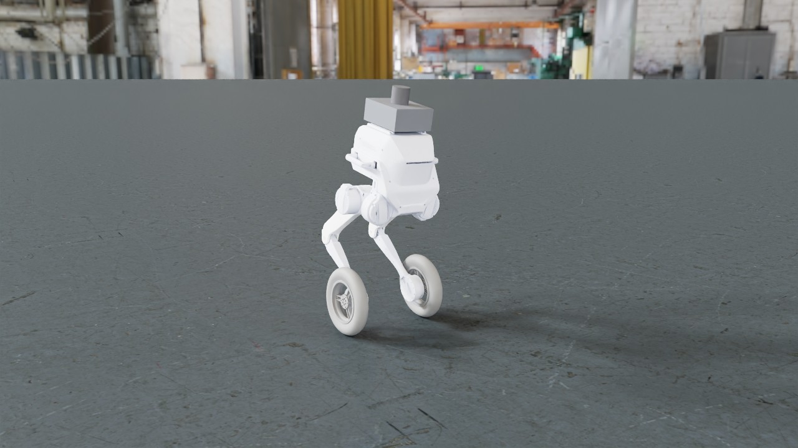
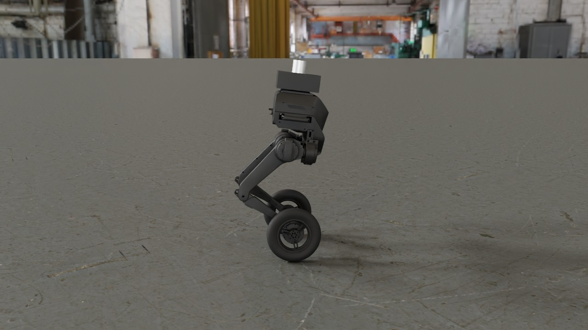
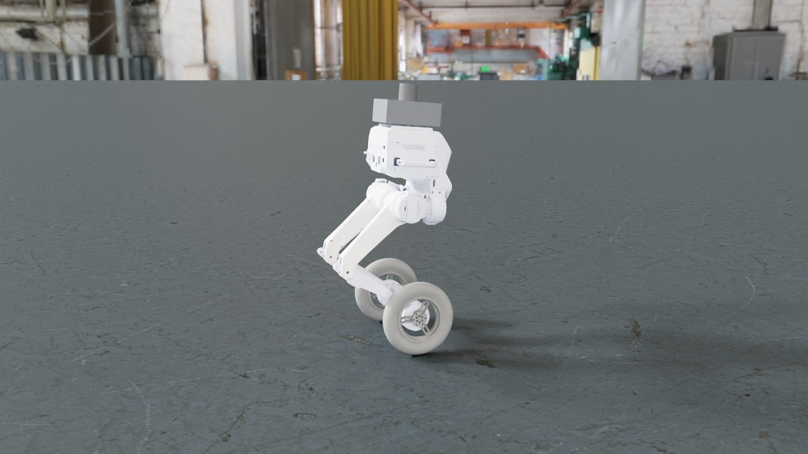

# TRON1 wheel-legged drive, LimX's policy: a metalsim render

LimX's TRON1 wheel-legged robot (WF_TRON1A) driven by LimX's own RL policy (the ONNX policy of LimX's [`tron1-rl-deploy-python`](https://github.com/limxdynamics/tron1-rl-deploy-python), Apache-2.0) in MetalSim's TRON1 simulation at its nominal realism settings (latency, drive model, sensor noise, joint friction, sensor pack), on LimX's own model and meshes: drive forward, turn, slow down, stop. Rendered on the 14-inch MacBook Pro (Mac16,6), not in a timing run, so its Performance table is not a timing figure.

**hero** (351 frames, 7.0 s at 50 fps): [video](tron1.mp4) (1.0 MB, H.264)





## What is shown

- 16 envs simulated, filmed: 9, 6, 13, 10 (selection: automatic, the adapter ranking).
  - env 9: terminated False, base_z 0.000, end_frame -1
  - env 6: terminated False, base_z 0.000, end_frame -1
  - env 13: terminated False, base_z 0.000, end_frame -1
  - env 10: terminated False, base_z 0.000, end_frame -1
- Policy: `assets/tron1/limx_policy/WF_TRON1A/policy/isaacgym/policy.onnx` (onnx (LimX isaacgym export: encoder.onnx + policy.onnx)); physics: metalsim.tron1.sim.Tron1Sim on CPU MuJoCo 3.14.0 (LimX's WF_TRON1A MJCF, physics step 0.5 ms) with MetalSim's TRON1 realism layer at 'nominal' (metalsim.tron1.realism.SimParams.nominal()); controller 500 Hz, policy 50 Hz; one Tron1Sim per env, seeds 0..15.

## Performance

Measured on the machine below; one frame = one policy step ([Isaac Lab](https://github.com/isaac-sim/IsaacLab)'s `render_fps` = 1 / step_dt).

| stage | measurement |
|---|---|
| simulate (record) | 351 frames x 16 envs: 27 ms/frame mean (27 median, first 27 incl. graph capture), 9.6 s total; env build 0.3 s; stage wall 13.9 s |
| render twin (CPU) | 21 geoms, 9 meshes, 2 textures; build 0.0 s, poses 0.0 s |
| render: hero | 1280x720 (1x1 panels of 1280x720), tier 2 path tracing, 64 spp (16 passes x 4), 3 bounces, denoiser oidn; 0.27 s/frame mean (0.27 median, 0.28 max), 93.1 s for 351 frames; first frame: one pass 51 ms, 9 ms per further pass; set-up 0.9 s |
| encode: hero | 2.5 s (master CRF 16 + docs copy CRF 22, libx264 slow) |
| render: readme | 640x480 (1x1 panels of 640x480), tier 2 path tracing, 64 spp (16 passes x 4), 3 bounces, denoiser oidn; 0.11 s/frame mean (0.11 median, 0.12 max), 40.0 s for 351 frames; first frame: one pass 19 ms, 4 ms per further pass; set-up 0.7 s |
| end to end | 2.5 min (record + render + encode, sum of stage walls) |

## Hardware and pins

- Mac16,6 (Apple M4 Max, 40 GPU cores, 64 GB), macOS 27.0.1 (26A434).
- Power as each stage stamped it (`pmset -g batt` and `pmset -g`; `hardware.power`: the record stage's when it wrote rec.json, a render shot's at its first frame): record: on AC power (90 %, charging), power-mode setting High Power (pmset `powermode 2`), 2026-10-31 23:42 (-0700); render hero: on AC power (100 %, finishing charge), power-mode setting High Power (pmset `powermode 2`), 2026-11-01 00:42 (-0700); render readme: on AC power (100 %, finishing charge), power-mode setting High Power (pmset `powermode 2`), 2026-11-01 00:44 (-0700).
- metalsim [`e67efcb9f9+dirty`](https://github.com/pulipakaa24/MetalSim/commit/e67efcb9f92455f1dc723b3f9c7d7ba2ad85856e); record stage (main venv): warp 1.18.0.dev20260917 ([`52c09cdd82`](https://github.com/pulipakaa24/warp/commit/52c09cdd82f79e8564b5ae17cdcee7b52d10d075)), mujoco 3.14.0, mujoco_warp 3.14.0 ([`787a5b3a37`](https://github.com/pulipakaa24/mujoco_warp/commit/787a5b3a37acc2551ffc8a2c1af1e9781d76723f)), torch 2.14.0, numpy 2.5.3.
- render stage (main venv): warp 1.18.0.dev20260917 ([`52c09cdd82`](https://github.com/pulipakaa24/warp/commit/52c09cdd82f79e8564b5ae17cdcee7b52d10d075)), mujoco 3.14.0, numpy 2.5.3.

## Assets

| asset | source | licence | where from |
|---|---|---|---|
| LimX TRON1 wheel-foot model WF_TRON1A (MJCF robot.xml and STL meshes) | LimX Dynamics robot-description | Apache-2.0 (assets/tron1/LICENSE-robot-description) | https://github.com/limxdynamics/robot-description (`in this repository: assets/tron1/WF_TRON1A`) |
| Policy: LimX's WF_TRON1A RL policy, isaacgym export (encoder.onnx + policy.onnx, params.yaml; sha256 bfc4617f...) | LimX Dynamics tron1-rl-deploy-python | Apache-2.0 (assets/tron1/LICENSE-rl-deploy-python) | https://github.com/limxdynamics/tron1-rl-deploy-python/blob/035e4c9e2f24e916fa5e8363ac6f0f788a2e1e8c/controllers/model/WF_TRON1A (`in this repository: assets/tron1/limx_policy/WF_TRON1A`) |
| Controller port (WheelfootController.py -> metalsim/tron1/limx_policy.py) | LimX Dynamics tron1-rl-deploy-python | Apache-2.0 (assets/tron1/LICENSE-rl-deploy-python) | https://github.com/limxdynamics/tron1-rl-deploy-python/blob/035e4c9e2f24e916fa5e8363ac6f0f788a2e1e8c/controllers/WheelfootController.py |
| Industrial HDRI (machine_shop_02, 2k) | Poly Haven | CC0 1.0 (Poly Haven, polyhaven.com/license; fetched, not committed) | https://polyhaven.com/a/machine_shop_02 (`scripts/fetch_polyhaven_assets.sh heldout`) |
| Floor texture (concrete_floor_worn_001, 1k diffuse) | Poly Haven | CC0 1.0 (Poly Haven, polyhaven.com/license; fetched, not committed) | https://polyhaven.com/a/concrete_floor_worn_001 (`scripts/fetch_polyhaven_assets.sh heldout`) |

## How it was made

**The policy.** LimX's RL policy for the wheel-foot TRON1 (WF_TRON1A), from LimX's `tron1-rl-deploy-python`
(<https://github.com/limxdynamics/tron1-rl-deploy-python>, Apache-2.0, commit
[`035e4c9`](https://github.com/limxdynamics/tron1-rl-deploy-python/commit/035e4c9e2f24e916fa5e8363ac6f0f788a2e1e8c)):
`controllers/model/WF_TRON1A/policy/isaacgym/encoder.onnx` and `policy.onnx` with `params.yaml`. The copies in
`assets/tron1/limx_policy/WF_TRON1A/` are byte-identical to LimX's at that commit (fetched and compared on 2026-10-31;
sha256 `bfc4617f65cef4b1c952156352dd2fee0deffd68458959a20b4bc0bb0285d85b` for the policy,
`f79e29d12b670aa9078b4a825f3b30e75018efb15c8108487a0bf2c222e78ba6` for the encoder), and the adapter checks the hashes
before it runs. That repository is LimX's Python controller for its robots: `main.py` connects through LimX's SDK to
LimX's MuJoCo simulator by default, or to the robot when given its IP address (`main.py` lines 27-39), and loads
`policy/$RL_TYPE/` with `RL_TYPE` isaacgym or isaaclab (the README's example is isaacgym; the isaaclab export uses
another joint order, which the port does not handle). It is LimX's open policy, not the closed controller of the robot's
Remote Control Mode, which is not documented (docs/TRON1.md, "What runs the robot today"). It is played by
`metalsim/tron1/limx_policy.py`, a port of LimX's `controllers/WheelfootController.py` at the same commit: 28
observations (gyro x 0.25, projected gravity, six leg joint angles, eight joint velocities x 0.05, last actions), a
10-frame history into the encoder (3 outputs), then the policy on [encoder, observation, command x (2, 2, 0.25)] to 8
actions at 50 Hz; legs to `q = 0.25 a` with Kp 42 and Kd 2.5, wheels to `dq = 0.8 a` through Kd 0.8, with LimX's
torque-bound action clips (80 / 40 N m). Two differences from LimX's script, both in the port's docstring: commands are
scaled as in LimX's training rather than its joystick mapping, and LimX's stand mode (leg targets blended toward a fixed
pose before the policy takes over) is skipped, so the policy itself stands the robot up (see "Commands"). Nothing is
tuned for the film.

**MetalSim's TRON1 simulation, nominal settings.** The rollout is the TRON1 evaluation's own path
(`metalsim/tron1/evaluate.py`, `episode`): one `Tron1Sim` per robot (`metalsim/tron1/sim.py`), LimX's WF_TRON1A MJCF
on CPU [MuJoCo](https://github.com/google-deepmind/mujoco) with a 0.5 ms physics step, stepped by `Tron1Sim.run` with
the controller at 500 Hz. Between the policy and the physics is MetalSim's realism layer at its `nominal` level
(`SimParams.nominal()`, `metalsim/tron1/realism.py`; docs/TRON1.md, "Realism layer"), unchanged: commands reach the
drives 4 ms late plus 0.5 ms mean jitter, with 0.2 % packet loss; sensor messages 1 ms late; drives run LimX's mode-0
law on 17-bit encoder angles and 1 kHz finite-difference velocities, with a torque-speed envelope and a 0.5 ms current
lag; joint Coulomb friction 0.3 N m (legs) and 0.1 N m (wheels), viscous damping and rotor armature; IMU white noise,
bias random walk and AHRS tilt wander and yaw drift; a 1.5 kg sensor pack 8 cm above the base (drawn: the black box and
the aluminium lidar cylinder on top); ground friction 0.8; and the tyre as a smooth fit to the real 5 cm rounded tread
instead of the 1 cm disc of LimX's MuJoCo file. The full parameter set is in `rec.json` `adapter.sim_params`. Each robot
gets its own noise seed (0 to 15), as each evaluation episode does; no pushes.

**Commands.** The same schedule for every robot, within the evaluation's ranges (vx in [-1, 1] m/s, yaw rate in
[-0.6, 0.6] rad/s): stand until 0.5 s, then vx 1.0 m/s; at 2.0 s vx 0.8 m/s with a 0.6 rad/s left turn; at 3.5 s vx
0.4 m/s straight; at 4.5 s stop (`tron1.SCHEDULE`). The film follows a real robot's procedure: a robot is stood up
before it drives, and a joystick does not step. The simulation places each robot on its wheels with straight legs
(q = 0, LimX's default joint angles, which is not the policy's stance: started there, the policy drops the base from
0.91 to 0.68 m in about a quarter second and rocks for seconds), so before the film's t = 0 the policy
stands it up for 3 s at zero command (`tron1.PRE_ROLL_S`, in `Tron1Limx.reset`, through `Tron1Sim.run` itself); and
every command change ramps linearly over 0.5 s from the previous command (`tron1.RAMP_S`) instead of stepping. The
pre-roll is not filmed and no metric includes it. At the film's t = 0 the filmed robot stands at its own stance
height, 0.77 m: over the 0.5 s before the drive its base moves 6.9 mm peak to peak and its pitch stays within 3.1 to
4.8 deg (`rec.npz` `track`, `rec.json` per-frame pitch), as still as it stands after the stop.

**Measured before filming.** 16 robots for 8 s with this schedule and procedure (`Tron1Limx` itself, nominal
settings): **0 of 16 fell**. Forward-speed tracking error 0.269 m/s RMS (median over the robots; 0.260 to 0.291),
yaw-rate error 0.138 rad/s (0.135 to 0.140), peak pitch 10.3 deg and peak roll 1.4 deg (95th percentiles), with the
evaluation's definitions (`evaluate.episode`: RMS from 0.5 s after each command change, here against the command the
robot was sent, which has finished its ramp by then; sampled every 20 ms). For comparison, the evaluation's nominal row
(100 episodes x 20 s of random stepped commands and two shoves each) is 0 / 100 falls, 0.27 m/s, 0.17 rad/s, 15 deg,
5 deg (docs/TRON1.md, "Results"). How it tracks, medians over the 16 robots: the policy accelerates slowly, 0.58 m/s
from 1.0 to 1.5 s after the drive command starts to rise and 0.8 m/s first at about 2.15 s; in the turn it yaws at
0.91 rad/s against the 0.6 commanded (76 deg of heading from 2.0 to 4.5 s against the 52 deg commanded) at 0.71 m/s; it
holds 0.45 m/s against 0.4; stopped, it creeps at 0.04 m/s. The 16 robots differ only in their sensor and transport
noise, and their errors agree to within 0.031 m/s and 0.004 rad/s. The procedure trades some speed tracking for a
calmer robot: the same measurement started from straight legs with stepped commands (`adapter_kw` `pre_roll_s=0,
ramp_s=0`, how this film's earlier take was made) gives 0.240 m/s and 0.130 rad/s, but 14.3 deg peak pitch and
3.4 deg peak roll. The 7 s take is the first 7 s of the same rollout (frame for frame: the per-frame speeds of the
filmed robot are identical): 0 of 16 fell, 0.296 m/s and 0.152 rad/s RMS (`rec.json` `adapter.tracking`; the shorter
window has less of the stop, where the error is small). `rec.json` `adapter.tracking` also holds the filmed robot's
per-frame command, speed, yaw rate, errors, pitch and roll, and each robot's fall time (none).

**How the robot was chosen.** `envs="auto"` ranks robots that did not fall first, then the most typical tracker:
the smallest distance of its (forward-speed, yaw-rate) RMS errors, each divided by the median over the robots, from
(1, 1) (`Tron1Limx.rank`). That was robot 9 (0.296 m/s, 0.152 rad/s in the take). Both shots film it.

**Camera.** Both shots track `base_Link` (Isaac's `origin_type="asset_body"`), the tracked point smoothed by a centred
1 s moving average, with Kit's default lens (36 deg vertical field of view) and the G1 films' azimuth, looking at
0.35 m below the base origin (the middle of the 0.95 m robot, tyres to lidar). `hero` (1280x720; the video and
stills on this page): eye (1.99, -1.53, 0.18) m from the base, 2.57 m from the look-at point, pitched down 12 deg (the
G1 films: 21 deg) so the top sixth of the frame shows the machine shop above the horizon; the robot fills about 0.55
of the frame height. `readme` (640x480, 4:3, for the README grid): the same direction at 0.75 times the distance
(eye (1.49, -1.15, 0.05) m), so the robot fills about three quarters of the frame height, plus the slow 10 deg/s orbit
of the G1 films' README shot (symmetric about the middle of the take, as MuJoCo Warp's README clips orbit).

**Rendering.** Tier 2 (the path tracer), 64 samples per pixel (16 passes x 4), 3 bounces,
[Open Image Denoise](https://www.openimagedenoise.org), ACES tone map, sRGB; lit by Poly Haven's `machine_shop_02` (an
industrial hall, 2k) as an importance-sampled dome, with Poly Haven's `concrete_floor_worn_001` (1k diffuse) on
LimX's `floor` plane in place of its checker, in the texture's own colours (the film tool writes the look's ground tint,
white here, into the plane's `rgba`, which LimX sets to 0.5 / 0.6 / 0.7 and MuJoCo would otherwise multiply into the
texture). The texture is 3 m x 3 m
of real floor (Poly Haven's dimensions) and is laid at that size, one image per 3 m (`ground_tile_m` 3.0; the film tool
sets MuJoCo's `texrepeat` to 2 / 3, as MuJoCo lays a `texuniform` texture once per 2 / `texrepeat` m: an infinite
plane's texture coordinates are half its world position, MuJoCo's `makePlane`, mirrored in
`metalsim/render/builtin_geoms.py`; `metalsim/render/film/render.py`, `ground_texrepeat`). The render twin is the
simulated model itself (`build_spec` at the nominal level), posed per frame from the recorded state: LimX's STL meshes,
the sensor pack's two geoms, and the colliders hidden (`rec.json` `twin.visibility`).

**Colours.** The TRON1 is black. LimX's own product images (its TRON 1 launch news,
<https://www.limxdynamics.com/en/news/BK000040>, and the photos at <https://robotsguide.com/robots/tron-1>) show
charcoal-black satin shells on the body, the hip actuators and the leg links, with thin orange stripes, and black
treaded tyres on dark hubs. LimX's description files carry other colours: the MJCF's `rgba` (the body 0.79 / 0.82 /
0.93, the thighs white, the wheels 0.27) and the URDF's (the wheels 0.70) are display colours, and LimX's own simulator
draws the robot white. This film's earlier renders used the MJCF's `rgba` as linear albedo, so the robot was white.
Here the film's look sets each part (`look.materials`, `metalsim/render/film/tron1.py`), as linear albedo: the base
colour of the renderer's OmniPBR-style material, under a dielectric coat that reflects 4 % at normal incidence.
- The shells: 0.03, roughness 0.5, not metallic. Black ABS measures 1.5 to 3 %
  ([USGS spectral library splib06](https://doi.org/10.3133/ds231), GDS341, black ABS pipe), blackboard paint 0.039
  (<https://physicallybased.info>, "Blackboard"). The satin roughness is read from the photos, not measured. A painted
  or anodised metal part is a dielectric coat, so not metallic either.
- The wheels: 0.023, roughness 0.7 (physicallybased.info, "Tire"). LimX's wheel is one mesh, so the hub is drawn in
  the tyre's rubber.
- The sensor pack's enclosure: as the shells. Its colour is assumed: the enclosure is a generic estimate, not LimX's.
- The MID-360 lidar: bare aluminium, metallic, colour 0.92 (physicallybased.info, "Aluminum"), roughness 0.45. Livox's
  product image (<https://www.livoxtech.com/mid-360>) shows a silver housing; its dark dome window is not modelled.
- Not drawn: the orange stripes and LimX's lettering. An STL mesh carries no texture coordinates, so each part is one
  colour.

**Exposure** is fixed at 0.9, a grey card's: the films' automatic rule (frame median luminance to 0.2 before ACES)
gives 1.68 for this scene's first frame (1.75 for the README shot's), because the frame is mostly a dark floor (the
concrete's median linear albedo is 0.095, the G1 films' laminate 0.237); 0.9 is that rule with the floor taken as a mid
grey (1.68 x 0.095 / 0.18). In hero frame 175 the body's side shows at about a quarter of the floor's display luminance
(sRGB about 54 against 104), with its sheen and edges visible. It reads charcoal rather than ink black, because its
coat reflects about as much of the bright hall as its 0.03 base colour adds. The earlier renders used 1.4: the same
rule, on frames whose concrete the film tool drew times LimX's floor `rgba`, darker and bluer than it is.

**README clip.** [tron1.webp](tron1.webp) is the `readme` shot from 0.5 s to 5.5 s (frames 25 to 274: drive, turn, slow
down, stop), resampled from 50 to 30 fps and written as MuJoCo Warp writes its README clips: 320x240 (Lanczos), lossy
animated WebP from [Pillow](https://github.com/python-pillow/Pillow) at quality 70, 33 ms per frame, looping; 150
frames. Command, run from the repository root after the render stage: `python -m metalsim.render.film.encode webp
runs/film/tron1/readme/frames docs/renders/tron1.webp --start 0.5 --seconds 5 --src-fps 50 --fps 30`.

**Checked by eye.** The robot starts standing: in hero frames 0 to 11 it holds one crouched stance with both tyres on
their contact shadows, and in hero frames every 0.2 s from 0 to 3 s the top of the sensor pack stays on one line. The
wheels turn visibly: their three-spoke hubs rotate a few degrees per frame while driving (`rec.npz` wheel-mesh poses
relative to the knee: 3.8 deg per frame from 1 to 2 s; in the turn, from 2.5 to 3.5 s, 4.8 deg for the inner wheel and
7.8 deg for the outer; 0.3 deg per frame once stopped).
Scale: each wheel's 0.1298 m rim, projected from its recorded pose through the film camera, lies on the rendered tyre
outline (hero frames 88 and 175, readme frame 150). The colours, on these frames:
- Hero crops every 1 s (frames 0 to 350), and frames 0 and 175 at native resolution, show the body's vents and carry
  handle, the hip actuators, the thigh and shank links, the knee joints and the hub spokes. The robot is not a
  silhouette.
- The README WebP, every 15th frame: a dark robot against the floor through the drive, the turn and the stop.
- The floor is the concrete's own warm grey (sRGB about 105 / 103 / 96 in two boxes either side of the robot in hero
  frame 175; the second render's, times LimX's floor `rgba`, was bluer: 98 / 105 / 106).
- Against the earlier renders of the same recording, every logged render setting is the same (camera, look, samples
  and twin geoms) except the exposure.

**This take, and where its timings come from.** Recorded, rendered and encoded on 2026-10-31 to 2026-11-01 on the
14-inch MacBook Pro (Mac16,6); the record stage ran at metalsim
[`e67efcb9`](https://github.com/pulipakaa24/MetalSim/commit/e67efcb9f92455f1dc723b3f9c7d7ba2ad85856e) plus this film's
uncommitted pre-roll and ramps and other films' uncommitted film-tool work, whose new settings (`after_end`,
`rank_keeps_terminated`) stay at their defaults here (hence `+dirty` in the pins), with the main venv's checkout of [my
fork of MuJoCo Warp](https://github.com/pulipakaa24/mujoco_warp/tree/metalsim) at the commit the top-level README.md's
`pip install` line pins ([my fork of Warp](https://github.com/pulipakaa24/warp/tree/metalsim) at the commit
`scripts/setup_warp.sh` pins; the physics here is CPU MuJoCo, which neither checkout touches). This was not a timing
run: quote nothing on this page as MetalSim's speed (MetalSim's throughput figures are in `docs/PARITY.md` §1.4 and
§1.8). The record stage simulates on the CPU (one CPU MuJoCo `Tron1Sim` per robot, run one after another) and runs
LimX's ONNX files with [onnxruntime](https://github.com/microsoft/onnxruntime) 1.31.0 (CPU, one thread; the `tron1`
extra of `pyproject.toml`, which the record stage needs: `pip install -e '.[tron1]'`; the pins below list a fixed set of
modules and omit it). Power, as the stages stamped it ("Hardware and pins" below): on AC power, 90 %, charging, when the
record stage wrote `rec.json` at 23:42; on AC power, 100 %, finishing charge, at the hero shot's first frame at 00:42
and on AC power, 100 %, finishing charge, at the readme shot's at 00:44 (local time), with pmset's power-mode setting at
High Power at every stamp (`powermode 2`: the configured setting, which does not show that the machine ran in High Power
Mode); the encode and doc stages stamp nothing. The record ran with a first render as one GPU-queue job
(`scripts/gpu_run.sh`) of kind render, into `runs/film/tron1`: `--stage record`, then a check that the recording was new
and made with the pre-roll and ramps, then `--stage render`. That render drew the robot in the MJCF's colours, white. A
second `--stage render` of the same recording drew it in the robot's real colours, once the film tool wrote a
`look.materials` colour into the geom's own `rgba` as well (`render.build_scene`; MuJoCo draws a geom's own `rgba` over
its material's), but it drew the concrete times LimX's floor `rgba` (0.5 / 0.6 / 0.7), at exposure 1.4. The frames on
this page are a third (both shots, a GPU-queue job of kind render of its own), at metalsim
[`68f695b2`](https://github.com/pulipakaa24/MetalSim/commit/68f695b29fc0ef9f049b6d025f3e8937e72d8414) plus uncommitted
files, this film's colours and exposure among them: the film tool now also writes the ground tint into the floor's
`rgba`, so the concrete is in its own colours, and the exposure is the grey card's 0.9 ("Exposure" above); the render
cache key records the `rgba` writes (`render.geoms_recoloured`), so every frame was redrawn. Then `--stage encode
--shots hero`, the README WebP command above and `--stage doc` (CPU). The recording replaces the film's earlier take
(`rec.json` written 2026-10-31 at 16:05, at
[`ed66d8ef`](https://github.com/pulipakaa24/MetalSim/commit/ed66d8ef3ecd7f17aa16207231000b1d22ff7812) plus the
uncommitted TRON1 film code), which started each robot from straight legs with stepped commands.

## Reproduce

```bash
scripts/fetch_polyhaven_assets.sh heldout    # CC0 HDRI and textures
python -m metalsim.render.film tron1   # record, render, encode, doc (main venv)
# or stage by stage (resumable):
python -m metalsim.render.film tron1 --stage record   # runs in the .venv venv
python -m metalsim.render.film tron1 --stage render
python -m metalsim.render.film tron1 --stage encode
python -m metalsim.render.film tron1 --stage doc
```

Generated by `python -m metalsim.render.film tron1 --stage doc` from the stage logs (`runs/film/tron1/rec/rec.json`, `render.json`, `render_frames.jsonl`, `encode.json` per shot).
